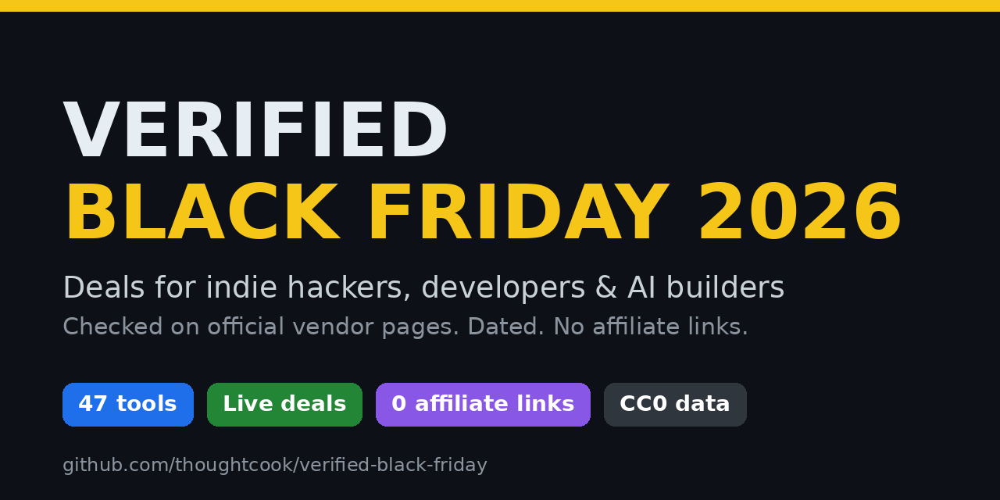

# 🧾 Verified Black Friday 2026 Deals

**Black Friday 2026 deals and Cyber Monday 2026 deals for indie hackers, developers and AI builders, where every price is checked on the vendor's own page and dated.**

**[🌐 Browse & filter the deals](https://thoughtcook.github.io/verified-black-friday/)** · **[📦 JSON](data/deals.json)** · **[📄 CSV](data/deals.csv)** · **[➕ Submit a deal](https://github.com/thoughtcook/verified-black-friday/issues/new?template=submit-deal.yml)**

> **No invented prices. No affiliate links. No 2025 deals dressed up as new.** If we couldn't confirm a deal, the list says so.
>
> ⭐ **Star this repo to get notified.** Deals are rechecked daily from Oct 21 through Dec 2, with full rechecks every Monday and Thursday and every day from Nov 20.

## Contents
[Top 5 picks](#-top-5-picks) · [Key dates](#-key-dates) · [Best live deals](#-best-live-deals-right-now) · [Stack builders](#-stack-builders) · [Legend](#legend) · [By category](#deals-by-category) · [Myth-busting](#-myth-busting) · [How we verify](#-how-we-verify) · [FAQ](#-faq) · [Contributing](#-contributing) · [Changelog](CHANGELOG.md)

## 🏆 Top 5 picks
_Savings are worked out only from prices shown on the linked official page (checked 2026-10-30)._

| # | Deal | Price | Saving | Why it's here |
|---|---|---|---|---|
| 1 | [Smooth Recorder](https://www.smoothrecorder.com) | $19 one-time | $30 off $49 (~61%) | Mac screen recorder, lifetime licence, limited to 100 buyers |
| 2 | [Proton VPN](https://protonvpn.com/black-friday) | $2.99/mo (2-yr, $71.76 upfront) | 70% off (per Cybernews; the official page shows the $2.99/mo price) | Official Black Friday page is already live |
| 3 | [Hostinger](https://www.hostinger.com/black-friday) | Hosting from $2.49/mo · VPS from $6.49/mo · .com $0.01 | Up to 80% off hosting | Ends Dec 14, 2026 |
| 4 | [ElevenLabs](https://elevenlabs.io/pricing) | Starter $1 first month (to Nov 1) / Creator $11 | 83% / 50% off month 1 | AI voice for videos and podcasts |
| 5 | [SpaceWise](https://www.spacewisemac.in/pricing) | $3.99 lifetime | $4 off $7.99 (50%) | Clears Docker, Xcode and node_modules clutter on Mac and Windows |

## ⏰ Key dates
| Date (2026) | What happens |
|---|---|
| Oct 20 | First full verification ✅ |
| Oct 21 to Dec 2 | Daily rechecks (full rechecks on Mondays and Thursdays) |
| Oct 30 | CapCut Desktop Black Friday sale ends |
| Nov 20 to Dec 2 | Full recheck every day |
| **Nov 27** | **Black Friday** |
| **Nov 30** | **Cyber Monday** |
| Dec 14 | Hostinger sale ends (latest end date published so far) |

A live countdown is on the [website](https://thoughtcook.github.io/verified-black-friday/).

## ⭐ Best live deals right now
_Live or Early only, with deals that publish an end date listed first. Unverified deals never appear here._

| Service | Deal | Dates | Ends | Status | Link | Checked |
|---|---|---|---|---|---|---|
| **CapCut (Desktop)** | Still up to 60% off first year of Pro (new/non-members), 40% off first year of Ultra (eligible). CapCut Desktop only — ENDS TODAY (Oct 30) | Oct 20–30 2026 | 2026-10-30 | 🟢 Live | [official](https://www.capcut.com/tools/capcut-black-friday-sale) | 2026-10-30 |
| **Dreamina (CapCut AI)** | US Basic first month $0.29 (98% off) then $15/mo; membership campaign Oct 21–30 — ENDS TODAY. Separate credit/plan discounts Oct 27–Nov 6 may continue after membership intro ends | Oct 21–30 2026 ($0.29 intro); credit/plan discounts to Nov 6 | 2026-10-30 | 🟢 Live | [official](https://dreamina.capcut.com/ai-video/dreamina-october-offer-faq-2026) | 2026-10-30 |
| **ElevenLabs** | Starter first month 83% off $1 (then $6/mo), labelled Until Nov 1; Creator first month 50% off $11 (then $22/mo). Last year's (2025): Starter $1 first month at BF | Starter promo to Nov 1 2026; Creator end not stated | 2026-11-01 | 🟢 Live | [official](https://elevenlabs.io/pricing) | 2026-10-30 |
| **Kavel** | EARLY BLACK FRIDAY: 2x credits on every new plan (first month on monthly, whole first year on yearly), normal price, no code. Starter $100/yr; Creator $288/yr | Live Oct 2026 – Dec 1 2026 | 2026-12-01 | 🟢 Live | [official](https://www.kavel.ai/pricing) | 2026-10-30 |
| **Deepvue** | Official BF page: Core + Journal $490/yr (was $990), rate locked while active. Masterclasses bonus if join by Nov 12; $490 lock ends Dec 4 (then $990/yr) | Live; $490 lock to Dec 4 2026 | 2026-12-04 | 🟢 Live | [official](https://deepvue.com/black-friday-2026/) | 2026-10-30 |
| **NordVPN** | Black Friday on the official page: 2-yr +3 mo Basic $3.49/mo ($94.23 first 27 mo), Complete $3.99/mo ($107.73), Prime $6.99/mo ($188.73). Last year's (2025): low $2.99/mo | Oct 21 – Dec 9 2026 (official FAQ) | 2026-12-09 | 🟢 Live | [official](https://nordvpn.com/black-friday/) | 2026-10-30 |
| **NordPass** | Official /black-friday page live. USD cards JS-loaded this run (curl 403). Reported from official pricing reads (Oct 23): Premium 2-yr $1.39/mo (53% +3 mo); Family $2.49/mo (58% +3 mo). Confirm at checkout. Ends Dec 9 2026 | Oct 21 – Dec 9 2026 | 2026-12-09 | 🟢 Live | [official](https://nordpass.com/black-friday/) | 2026-10-30 |
| **Hostinger** | Web hosting from $2.49/mo (80% off); VPS from $6.49/mo (67% off); .com $0.01 1st yr; business email from $0.39/mo; Reach email marketing from $0.99/mo (75% off); no code. Partner $2.37/48-mo claim not on official BF page this run | Oct 19 – Dec 14, 2026 | 2026-12-14 | 🟢 Live | [official](https://www.hostinger.com/black-friday) | 2026-10-30 |
| **Surfshark** | 2-yr (27 mo) Starter or One $2.49/mo, $67.23 upfront (page labels One the Black Friday deal); One+ $3.99/mo ($107.73) | Live since Oct 12 | not stated | 🟢 Live | [official](https://surfshark.com/pricing) | 2026-10-30 |
| **ExpressVPN** | 2-yr Basic $2.99/mo +4 mo ($83.72 upfront). Last year's (2025): $2.44/mo final week | Oct 2026, end not stated | not stated | 🟡 Early | [official](https://www.expressvpn.com/pricing) | 2026-10-30 |
| **Proton VPN** | Official /pricing (Oct 30): 2-yr VPN Plus $3.49/mo (65% off, billed $83.76/24 mo) — prior JS-card $2.99/mo ($71.76) not seen this run. Unlimited $7.99/mo ($191.76/24 mo). /black-friday countdown teaser only; partner 75%/$2.49 still not on official page | Oct 2026, end not stated | not stated | 🟡 Early | [official](https://protonvpn.com/pricing) | 2026-10-30 |
| **Private Internet Access** | Halloween Price Slash: 3 yr + 3 mo $2.03/mo (renews $79 every 3 yrs); 2 yr + 2 mo $2.19/mo ($56.94). The earlier $34.58 offer is no longer shown | Halloween offer, Oct 2026; end not stated | not stated | 🟡 Early | [official](https://www.privateinternetaccess.com/buy-vpn-online) | 2026-10-30 |
| **IPVanish** | Official Black Friday: 2-yr Essential $2.19/mo (save 85%); Complete $2.79/mo (save 82%); Advanced $3.29/mo (save 81%); Yearly Essential $3.89/mo. End not stated (JS countdown) | BF live Oct 2026; end not stated (JS countdown) | not stated | 🟢 Live | [official](https://www.ipvanish.com/black-friday/) | 2026-10-30 |
| **PureVPN** | Official Black Friday: 5-yr Standard $1.69/mo ($101.55 upfront, 87% off); Plus $2.69/mo ($161.40); Max $3.39/mo ($203.40). Also 2-yr and 1-yr tiers. Renews at list after term | BF live Oct 2026; end not stated on page | not stated | 🟢 Live | [official](https://www.purevpn.com/black-friday) | 2026-10-30 |
| **Sintra AI** | Official pricing sale (not BF-labelled): 1-mo Save 50% $48.50/mo (was $97); 3-mo Save 60% $23.60/mo (was $59); 12-mo Save 70% $15.60/mo (was $52). 250 credits/mo; 14-day MBG. Headline "The sale you've been waiting for" | Live by Oct 30 2026; end not stated | not stated | 🟢 Live | [official](https://sintra.ai/pricing) | 2026-10-30 |
| **Smooth Recorder** | $19 one-time lifetime instead of $49 (next 100 buyers; first 100 at $9 all claimed) | Oct 2026, limited quantity | not stated | 🟢 Live | [official](https://www.smoothrecorder.com) | 2026-10-30 |
| **Shotomatic** | 40% off lifetime with code BF2026: 1 Mac $23.40 (was $39); up to 3 Macs $65.40 (was $109). One-time; subscriptions excluded; prices before tax | Live since Oct 18 2026 (maker); coupon has no stated end date | not stated | 🟢 Live | [official](https://www.shotomatic.com/pricing?discount_code=BF2026) | 2026-10-30 |
| **SpaceWise** | Pro lifetime 50% off, $3.99 instead of $7.99 (launch deal, 3 devices) | Oct 2026, end not stated | not stated | 🟢 Live | [official](https://www.spacewisemac.in/pricing) | 2026-10-30 |
| **Skylum Luminar** | Official Black Friday: Desktop Only $99 (was $417, 77% off); All Platforms $139 (was $477, 71% off); Max $159 (was $546, 71% off). One-time perpetual; AI tools renew after 365 days | Black Friday offer live Oct 2026 | not stated | 🟢 Live | [official](https://skylum.com/luminar/pricing) | 2026-10-30 |
| **1Password** | Promo for new customers, first year, annual billing: Individual $2.99/mo (reg $3.99), Families $4.49/mo (reg $5.99), ~25% off. Not labelled Black Friday | Oct 2026, end not stated | not stated | 🟡 Early | [official](https://1password.com/pricing/password-manager) | 2026-10-30 |
| **Cliproxy** | Floating promo card still present (halloween-banner): Residential from $0.58/GB, Long-term Static $3.00/month; Save 70% badge. Static ISP from $1.8/IP. No Black Friday label | Promo seen Oct 2026; end not stated | not stated | 🟡 Early | [official](https://cliproxy.com/) | 2026-10-30 |

## 🧱 Stack builders
Bundles built only from the verified live deals above.

| Stack | Pieces | Verified prices |
|---|---|---|
| 🚀 **Indie launch stack** | Hostinger web hosting + .com domain + business email | from $2.49/mo (48 mo) + $0.01 first year |
| 🛰️ **Indie VPS stack** | Hostinger VPS + Proton VPN Plus | from $6.49/mo + $2.99/mo (2-yr) |
| 🎙️ **AI creator stack** | ElevenLabs Starter ($1 first mo to Nov 1) or Creator ($11) + Smooth Recorder | from $1 first month + $19 one-time |
| 🍎 **Mac dev cleanup stack** | SpaceWise Pro + Smooth Recorder | $3.99 + $19 = $22.99 one-time |
| 🔒 **Cheapest 2-yr privacy** | Private Internet Access or CyberGhost | $56.94 for 2 yr + 2 mo ($2.19/mo) |

## Legend
| Badge | Meaning |
|---|---|
| 🟢 Live | The 2026 Black Friday or Cyber Monday deal is live |
| 🟡 Early | An early 2026 deal is live; the main sale could be better |
| ⚪ Not yet | No 2026 deal yet. Any price shown is **last year's (2025)**, for reference only |
| 🟠 Unverified | Reported by a third party but **not** shown on the official page |
| ⛔ Never discounts | The vendor says it doesn't run seasonal sales |

`official` = the vendor's own page · `report` = a dated third-party article or post, upgraded once the vendor page confirms it.

## Deals by category

### 🤖 AI tools

| Service | Deal | Dates | Ends | Status | Link | Checked |
|---|---|---|---|---|---|---|
| **ElevenLabs** | Starter first month 83% off $1 (then $6/mo), labelled Until Nov 1; Creator first month 50% off $11 (then $22/mo). Last year's (2025): Starter $1 first month at BF | Starter promo to Nov 1 2026; Creator end not stated | 2026-11-01 | 🟢 Live | [official](https://elevenlabs.io/pricing) | 2026-10-30 |
| **Sintra AI** | Official pricing sale (not BF-labelled): 1-mo Save 50% $48.50/mo (was $97); 3-mo Save 60% $23.60/mo (was $59); 12-mo Save 70% $15.60/mo (was $52). 250 credits/mo; 14-day MBG. Headline "The sale you've been waiting for" | Live by Oct 30 2026; end not stated | not stated | 🟢 Live | [official](https://sintra.ai/pricing) | 2026-10-30 |
| **CapCut (Desktop)** | Still up to 60% off first year of Pro (new/non-members), 40% off first year of Ultra (eligible). CapCut Desktop only — ENDS TODAY (Oct 30) | Oct 20–30 2026 | 2026-10-30 | 🟢 Live | [official](https://www.capcut.com/tools/capcut-black-friday-sale) | 2026-10-30 |
| **Dreamina (CapCut AI)** | US Basic first month $0.29 (98% off) then $15/mo; membership campaign Oct 21–30 — ENDS TODAY. Separate credit/plan discounts Oct 27–Nov 6 may continue after membership intro ends | Oct 21–30 2026 ($0.29 intro); credit/plan discounts to Nov 6 | 2026-10-30 | 🟢 Live | [official](https://dreamina.capcut.com/ai-video/dreamina-october-offer-faq-2026) | 2026-10-30 |
| **Kavel** | EARLY BLACK FRIDAY: 2x credits on every new plan (first month on monthly, whole first year on yearly), normal price, no code. Starter $100/yr; Creator $288/yr | Live Oct 2026 – Dec 1 2026 | 2026-12-01 | 🟢 Live | [official](https://www.kavel.ai/pricing) | 2026-10-30 |
| **Cursor** | Last year's (2025): 20% off annual Pro + $100 credit | — | not stated | ⚪ Not yet | [official](https://cursor.com/pricing) | 2026-10-29 |
| **Grok (SuperGrok)** | No promo shown; now part of The X Subscription (Premium $30/mo, Super $100/mo, Ultra $200/mo) | — | not stated | ⚪ Not yet | [official](https://x.ai/pricing) | 2026-10-30 |
| **HeyGen** | No 2026 deal yet | — | not stated | ⚪ Not yet | [official](https://www.heygen.com/pricing) | 2026-10-29 |
| **Typeless** | Free $0; Pro $12 USD/member/month billed yearly, $30 billed monthly; Enterprise custom. No paid-plan discount or BF. SIGNAL ONLY: page bundle still has Last year's (2025) strings 'black_friday_2025' | — | not stated | ⚪ Not yet | [official](https://www.typeless.com/pricing) | 2026-10-30 |
| **Midjourney** | No 2026 deal; standing 20% off annual (Standard $288/yr). Last year's (2025): 20% off annual Standard | — | not stated | ⚪ Not yet | [official](https://docs.midjourney.com/hc/en-us/articles/27870484040333-Comparing-Midjourney-Plans) | 2026-10-29 |
| **Jasper** | Last year's (2025): 40% off annual + 300k bonus words | — | not stated | ⚪ Not yet | [report](https://blog.imseankim.com/cyber-monday-2025-best-ai-tool-api-credit-deals/) | 2026-10-29 |
| **Descript** | Last year's (2025): annual plans +1,000 AI credits, +10 media hours | — | not stated | ⚪ Not yet | [report](https://beebom.com/best-black-friday-deals-on-ai-tools-2025/) | 2026-10-29 |
| **Perplexity** | Last year's (2025): Pro 50% off via PayPal | — | not stated | ⚪ Not yet | [report](https://jenlehner.com/blog-content/black-friday-2025) | 2026-10-29 |
| **Grammarly** | Last year's (2025): ~50% off Pro annual | — | not stated | ⚪ Not yet | [report](https://prodfolks.substack.com/p/black-friday-for-pms) | 2026-10-29 |
| **ChatGPT / Claude** | No discount found | — | not stated | ⚪ Not yet | — | 2026-10-29 |
| **Runway** | Official runway.com/pricing (Oct 30): no Black Friday label. Standing annual (~20%): Standard $12/mo (from $15), Pro $28 (from $35), Max $76 (from $95). Separate product promo: Kling 4.0 generations 25% off until Nov 30 — not BF-labelled | Check Nov 3 / 16 / 24 | not stated | ⚪ Not yet | [official](https://runway.com/pricing) | 2026-10-30 |
| **Lovable** | Official lovable.dev/pricing + docs (Oct 30): no BF. Pro from $25/mo (100 credits; annual $250 = $21/mo); Business from $50/mo (100 credits; annual $500 = $42/mo). Student/teacher 50% off Pro 100-credit monthly (12 mo). Higher credit tiers on pricing page | Check Nov 3 / 16 / 24 | not stated | ⚪ Not yet | [official](https://lovable.dev/pricing) | 2026-10-30 |
| **Wispr Flow** | Official wisprflow.ai/pricing (Oct 30): no BF label. Free $0; Pro $15/user/mo monthly or $12/user/mo annual (standing 20% annual). Student/edu 50% off Pro; non-profits discounted. Notetaker full access through Nov 30 (rollout note) — not BF-labelled | Check Nov 3 / 16 / 24 | not stated | ⚪ Not yet | [official](https://wisprflow.ai/pricing) | 2026-10-30 |
| **Replit** | Official replit.com/pricing (Oct 30): no BF. Core $20/mo or $18/mo billed annually; Pro $100/mo or $90/mo billed annually; Enterprise custom. Standing annual strike-through only — not BF-labelled | Check Nov 3 / 16 / 24 | not stated | ⚪ Not yet | [official](https://replit.com/pricing) | 2026-10-30 |
| **Google AI Pro** | Official one.google.com/about/google-ai-plans/ (Oct 30, US view): Google AI Plus $4.99/mo; AI Pro $19.99/mo; AI Ultra from $99.99/mo (5x) / $199.99/mo (20x). No Black Friday promo on page | Check Nov 3 / 16 / 24 | not stated | ⚪ Not yet | [official](https://one.google.com/about/google-ai-plans/) | 2026-10-30 |
| **Gamma** | Official gamma.app/pricing (Oct 30): Cloudflare challenge blocked price cards this run — dollar amounts NOT re-verified. Plan tiers Free / Plus / Pro / Ultra / Business on official page. No BF promo confirmed | Check Nov 3 / 16 / 24 | not stated | ⚪ Not yet | [official](https://gamma.app/pricing) | 2026-10-30 |
| **Higgsfield** | Official higgsfield.ai/pricing (Oct 30): page JS-renders prices; no BF text in HTML. Official blog (Oct 24 2026, prices verified on pricing page): Starter $15/mo (200 credits); Plus $49/mo (1,000); Ultra $129/mo (3,000); Team $79/seat; Scale $215/seat. No Black Friday label | Check Nov 3 / 16 / 24 | not stated | ⚪ Not yet | [official](https://higgsfield.ai/pricing) | 2026-10-30 |
| **Manus** | Official manus.im/pricing (Oct 30 JS) + help center membership article: Free $0 (300 daily credits); Pro from $20/mo (4,000 credits) or $40/mo (8,000); Team from $20/seat/mo; annual ~17% off. No Black Friday label | Check Nov 3 / 16 / 24 | not stated | ⚪ Not yet | [official](https://manus.im/pricing) | 2026-10-30 |
| **Factory AI** | Official factory.ai/pricing + factory.com/pricing + docs.factory.com/pricing/individuals (Oct 30): no BF/CM 2026 label. Standing Pro $20/mo, Plus $100/mo, Max $200/mo; Teams $60/mo + $40/seat; Business/Enterprise custom. Historical only (not plan BF): Aug 2026 ~60% off OpenAI/Grok model usage until Sep 4 2026 7pm PT — ended. | Check Nov 3 / 16 / 24 | not stated | ⚪ Not yet | [official](https://factory.ai/pricing) | 2026-10-30 |

### 🔒 VPN

| Service | Deal | Dates | Ends | Status | Link | Checked |
|---|---|---|---|---|---|---|
| **Surfshark** | 2-yr (27 mo) Starter or One $2.49/mo, $67.23 upfront (page labels One the Black Friday deal); One+ $3.99/mo ($107.73) | Live since Oct 12 | not stated | 🟢 Live | [official](https://surfshark.com/pricing) | 2026-10-30 |
| **NordVPN** | Black Friday on the official page: 2-yr +3 mo Basic $3.49/mo ($94.23 first 27 mo), Complete $3.99/mo ($107.73), Prime $6.99/mo ($188.73). Last year's (2025): low $2.99/mo | Oct 21 – Dec 9 2026 (official FAQ) | 2026-12-09 | 🟢 Live | [official](https://nordvpn.com/black-friday/) | 2026-10-30 |
| **ExpressVPN** | 2-yr Basic $2.99/mo +4 mo ($83.72 upfront). Last year's (2025): $2.44/mo final week | Oct 2026, end not stated | not stated | 🟡 Early | [official](https://www.expressvpn.com/pricing) | 2026-10-30 |
| **Proton VPN** | Official /pricing (Oct 30): 2-yr VPN Plus $3.49/mo (65% off, billed $83.76/24 mo) — prior JS-card $2.99/mo ($71.76) not seen this run. Unlimited $7.99/mo ($191.76/24 mo). /black-friday countdown teaser only; partner 75%/$2.49 still not on official page | Oct 2026, end not stated | not stated | 🟡 Early | [official](https://protonvpn.com/pricing) | 2026-10-30 |
| **Private Internet Access** | Halloween Price Slash: 3 yr + 3 mo $2.03/mo (renews $79 every 3 yrs); 2 yr + 2 mo $2.19/mo ($56.94). The earlier $34.58 offer is no longer shown | Halloween offer, Oct 2026; end not stated | not stated | 🟡 Early | [official](https://www.privateinternetaccess.com/buy-vpn-online) | 2026-10-30 |
| **CyberGhost** | No Black Friday deal yet. Current Halloween offer: 2 yr + 2 mo $2.19/mo ($56.94 first 26 mo) | Halloween offer; end not stated | not stated | ⚪ Not yet | [official](https://www.cyberghostvpn.com/) | 2026-10-30 |
| **Mullvad** | Flat €5/mo; no sales or lifetime plans | — | not stated | ⛔ Never discounts | [official](https://mullvad.net/en/pricing) | 2026-10-29 |
| **IPVanish** | Official Black Friday: 2-yr Essential $2.19/mo (save 85%); Complete $2.79/mo (save 82%); Advanced $3.29/mo (save 81%); Yearly Essential $3.89/mo. End not stated (JS countdown) | BF live Oct 2026; end not stated (JS countdown) | not stated | 🟢 Live | [official](https://www.ipvanish.com/black-friday/) | 2026-10-30 |
| **PureVPN** | Official Black Friday: 5-yr Standard $1.69/mo ($101.55 upfront, 87% off); Plus $2.69/mo ($161.40); Max $3.39/mo ($203.40). Also 2-yr and 1-yr tiers. Renews at list after term | BF live Oct 2026; end not stated on page | not stated | 🟢 Live | [official](https://www.purevpn.com/black-friday) | 2026-10-30 |
| **Cliproxy** | Floating promo card still present (halloween-banner): Residential from $0.58/GB, Long-term Static $3.00/month; Save 70% badge. Static ISP from $1.8/IP. No Black Friday label | Promo seen Oct 2026; end not stated | not stated | 🟡 Early | [official](https://cliproxy.com/) | 2026-10-30 |

### 🖥️ Hosting & VPS

| Service | Deal | Dates | Ends | Status | Link | Checked |
|---|---|---|---|---|---|---|
| **Hostinger** | Web hosting from $2.49/mo (80% off); VPS from $6.49/mo (67% off); .com $0.01 1st yr; business email from $0.39/mo; Reach email marketing from $0.99/mo (75% off); no code. Partner $2.37/48-mo claim not on official BF page this run | Oct 19 – Dec 14, 2026 | 2026-12-14 | 🟢 Live | [official](https://www.hostinger.com/black-friday) | 2026-10-30 |
| **RackNerd** | Today 1GB KVM $21.99/yr, 2GB $35.99/yr. Last year's (2025): 1GB $10.60/yr | — | not stated | ⚪ Not yet | [official](https://www.racknerd.com/blackfriday) | 2026-10-29 |
| **BandwagonHost** | No live 2026 promo; 20G KVM $49.99/yr. Old BF codes only in HTML comments. Last year's (2025): ~19% off | — | not stated | ⚪ Not yet | [report](https://www.vpscpt.com/archives/2025-black-friday-vps-promotion-recommendations) | 2026-10-29 |
| **Vultr** | Last year's (2025): VPS from $2.50/mo; up to $300 new-user credit | — | not stated | ⚪ Not yet | [report](https://www.idcspy.com/141215.html) | 2026-10-29 |
| **DigitalOcean / Linode / Hetzner** | No verified deal found | — | not stated | ⚪ Not yet | — | 2026-10-29 |
| **DMIT** | Official homepage + /pages/pricing: list prices only, no BF/promo banner. Sample: LAX.AS3.T1 TINY $6.90/mo. Last year's (2025): BF buy-two-get-one Pro + spend cashback | — | not stated | ⚪ Not yet | [official](https://www.dmit.io/pages/pricing) | 2026-10-30 |
| **Railway** | Official railway.com/pricing (Oct 30): Free Trial $5 one-time credit; Free $0 ($1/mo usage); Hobby $5/mo; Pro $20/mo workspace; Enterprise custom. Usage-based beyond included credits. No BF promo | Check Nov 3 / 16 / 24 | not stated | ⚪ Not yet | [official](https://railway.com/pricing) | 2026-10-30 |

### 🍎 Mac & dev tools

| Service | Deal | Dates | Ends | Status | Link | Checked |
|---|---|---|---|---|---|---|
| **Smooth Recorder** | $19 one-time lifetime instead of $49 (next 100 buyers; first 100 at $9 all claimed) | Oct 2026, limited quantity | not stated | 🟢 Live | [official](https://www.smoothrecorder.com) | 2026-10-30 |
| **Shotomatic** | 40% off lifetime with code BF2026: 1 Mac $23.40 (was $39); up to 3 Macs $65.40 (was $109). One-time; subscriptions excluded; prices before tax | Live since Oct 18 2026 (maker); coupon has no stated end date | not stated | 🟢 Live | [official](https://www.shotomatic.com/pricing?discount_code=BF2026) | 2026-10-30 |
| **SpaceWise** | Pro lifetime 50% off, $3.99 instead of $7.99 (launch deal, 3 devices) | Oct 2026, end not stated | not stated | 🟢 Live | [official](https://www.spacewisemac.in/pricing) | 2026-10-30 |
| **Vitals** | AppSumo lifetime claimed in founder X post (Oct 10); AppSumo search previously showed no Vitals listing | Posted Oct 10, 2026 | not stated | 🟠 Unverified | [report](https://x.com/attacomsian/status/2108834703218561084) | 2026-10-29 |
| **Folder Preview Pro** | X post claims maker-confirmed 30% off code BFF2026. Official /folder-preview-pro still 404 this run | Nov 27 – Dec 3, 2026 (claimed) | not stated | 🟠 Unverified | [report](https://x.com/IndieMarkdowns/status/2112593838716182670) | 2026-10-30 |
| **Wins** | X claim of BF code BF26 Nov 20–Dec 12 still Unverified. Official wins.cool: Wins 3.6 launch offer 40% off code wins36, first 100, ENDS Oct 31 2026 (tomorrow). Single $19.99→$11.99, Pro $39.99→$23.99, X $49.99→$29.99 | Launch offer to Oct 31 2026; claimed BF Nov 20–Dec 12 | 2026-10-31 | 🟠 Unverified | [official](https://wins.cool) | 2026-10-30 |
| **Tailscale** | No 2026 deal yet | — | not stated | ⚪ Not yet | [official](https://tailscale.com/pricing) | 2026-10-29 |
| **CleanShot X** | Last year's (2025): 30% off ($20.30); today Basic $35 one-time | — | not stated | ⚪ Not yet | [official](https://cleanshot.com/pricing) | 2026-10-30 |
| **Unclutter BF Mac Apps Collection** | Last year's (2025): 12 Mac apps $76 (was $331) | — | not stated | ⚪ Not yet | [report](https://www.cultofmac.com/deals/best-black-friday-2025-mac-apps) | 2026-10-29 |
| **Raycast Pro** | Last year's (2025): 30% off Pro; today $10/mo or $96/yr | — | not stated | ⚪ Not yet | [report](https://www.reddit.com/r/raycastapp/comments/1p9r6u3/black_friday_30_off_on_raycast/) | 2026-10-29 |
| **Bartender 6** | Last year's (2025): 20% off | — | not stated | ⚪ Not yet | [report](https://9to5mac.com/2025/12/01/black-friday-cyber-monday-app-discounts-deal/) | 2026-10-29 |
| **TablePlus** | Basic $99; Standard 2-seat $129 (from $198). DISABLED banner (enable=false) for code BLACK_FRIDAY_2026, 25% off — not active yet | — | not stated | ⚪ Not yet | [official](https://tableplus.com/pricing) | 2026-10-30 |
| **CleanMyMac** | Last year's (2025): 30% off Basic/Plus | — | not stated | ⚪ Not yet | [report](https://www.popsci.com/gear/cleanmymac-software-black-friday-deal/) | 2026-10-29 |
| **Things 3** | Last year's (2025): 30% off (Mac $34.99) | — | not stated | ⚪ Not yet | [report](https://9to5mac.com/2025/12/01/black-friday-cyber-monday-app-discounts-deal/) | 2026-10-29 |
| **Framer** | Last year's (2025): 50% off first year | — | not stated | ⚪ Not yet | [report](https://designerup.co/blog/the-absolute-best-black-friday-and-cyber-monday-deals-for-designers-2025-edition/) | 2026-10-29 |
| **Paste** | Last year's (2025): $14.99 first year (was $29.99); today $29.99/yr | — | not stated | ⚪ Not yet | [report](https://allthings.how/the-most-useful-mac-and-ios-app-deals-for-black-friday-2025/) | 2026-10-29 |
| **Setapp** | No verified deal; today Mac $14.99/mo | — | not stated | ⚪ Not yet | [official](https://setapp.com/pricing) | 2026-10-30 |
| **Skylum Luminar** | Official Black Friday: Desktop Only $99 (was $417, 77% off); All Platforms $139 (was $477, 71% off); Max $159 (was $546, 71% off). One-time perpetual; AI tools renew after 365 days | Black Friday offer live Oct 2026 | not stated | 🟢 Live | [official](https://skylum.com/luminar/pricing) | 2026-10-30 |
| **Picmal** | Announced on official page (script): Black Friday half price $14.50 (was $29) with code BLACKFRIDAY, Nov 23 – Dec 1 2026. Marketing banner still says 'Until 30 November' but checkout promo window starts Nov 23 — NOT active Oct 30 | Goes live Nov 23 – Dec 1 2026 | 2026-12-01 | ⚪ Not yet | [official](https://picmal.app/pricing) | 2026-10-30 |
| **JetBrains** | No verified deal found | — | not stated | ⚪ Not yet | — | 2026-10-29 |
| **Warp, Superhuman, Linear, Obsidian Sync, Fantastical, Arc/Dia, RapidAPI** | No official deal yet; avoid grey-market resales | — | not stated | ⚪ Not yet | — | 2026-10-29 |
| **Enconvo** | Maker-side claim: 30% off lifetime with code BLACKFRIDAY2026, Nov 23–30. Official pricing still Standard $49 / Premium $99 / Teams $139 once — no BF label or code field | Nov 23 – Nov 30, 2026 (claimed) | not stated | 🟠 Unverified | [report](https://macworthy.com/deals/black-friday/) | 2026-10-30 |
| **DevUtils** | Maker/IndieMarkdowns claim 50% off all plans for BF 2026. Official pricing (Oct 30) still Basic $29 / Personal $39 perpetual — no discount visible yet | BF 2026 (claimed; not on official pricing yet) | not stated | 🟠 Unverified | [official](https://devutils.com/pricing/) | 2026-10-30 |
| **Univocal** | Announced on official purchase page: Black Friday Nov 20–30 $15 with code BF2026 (was $39 lifetime, up to 3 Macs). Sale window not open yet | Nov 20 – Nov 30 2026 | 2026-11-30 | ⚪ Not yet | [official](https://univocalapp.com/purchase/) | 2026-10-30 |

### 🔍 SEO

| Service | Deal | Dates | Ends | Status | Link | Checked |
|---|---|---|---|---|---|---|
| **Semrush** | No BF deal yet; annual billing up to 17% off | — | not stated | ⚪ Not yet | [official](https://www.semrush.com/prices/) | 2026-10-29 |
| **Ahrefs** | No seasonal sales; annual billing ~17% off | — | not stated | ⛔ Never discounts | [official](https://help.ahrefs.com/en/articles/1406260-do-you-offer-any-discounts-or-free-trials) | 2026-10-29 |

### 🧰 SaaS & productivity

| Service | Deal | Dates | Ends | Status | Link | Checked |
|---|---|---|---|---|---|---|
| **1Password** | Promo for new customers, first year, annual billing: Individual $2.99/mo (reg $3.99), Families $4.49/mo (reg $5.99), ~25% off. Not labelled Black Friday | Oct 2026, end not stated | not stated | 🟡 Early | [official](https://1password.com/pricing/password-manager) | 2026-10-30 |
| **NordPass** | Official /black-friday page live. USD cards JS-loaded this run (curl 403). Reported from official pricing reads (Oct 23): Premium 2-yr $1.39/mo (53% +3 mo); Family $2.49/mo (58% +3 mo). Confirm at checkout. Ends Dec 9 2026 | Oct 21 – Dec 9 2026 | 2026-12-09 | 🟢 Live | [official](https://nordpass.com/black-friday/) | 2026-10-30 |
| **Adobe Creative Cloud Pro** | Last year's (2025): 50% off first year ($34.97/mo) | — | not stated | ⚪ Not yet | [report](https://www.macrumors.com/2025/11/19/adobe-black-friday-sale/) | 2026-10-29 |
| **Notion** | Last year's (2025): 25% off Plus annual (unconfirmed) | — | not stated | ⚪ Not yet | [report](https://www.kickidler.com/info/top-black-friday-deals-for-saas) | 2026-10-29 |
| **Canva Pro** | Last year's (2025): 30–50% off annual (unconfirmed) | — | not stated | ⚪ Not yet | [report](https://www.kickidler.com/info/top-black-friday-deals-for-saas) | 2026-10-29 |
| **Pabbly Plus** | Announced: $799/yr instead of $1,428/yr (44% off), 100 seats; waitlist open until Nov 4 | Goes live Nov 4 | not stated | ⚪ Not yet | [official](https://blackfriday.pabbly.com/) | 2026-10-30 |
| **Spark Mail** | No 2026 deal yet; Plus $99/yr or $10/mo | — | not stated | ⚪ Not yet | [official](https://sparkmailapp.com/pricing) | 2026-10-29 |
| **X Premium** | Free $0, Plus $8/mo, Premium $30/mo, Super $100/mo, Ultra $200/mo; monthly only in page text; no monthly/annual discount, no BF. Volume 'Discounts at scale' only | — | not stated | ⚪ Not yet | [official](https://x.ai/pricing) | 2026-10-30 |
| **Deepvue** | Official BF page: Core + Journal $490/yr (was $990), rate locked while active. Masterclasses bonus if join by Nov 12; $490 lock ends Dec 4 (then $990/yr) | Live; $490 lock to Dec 4 2026 | 2026-12-04 | 🟢 Live | [official](https://deepvue.com/black-friday-2026/) | 2026-10-30 |
| **Supabase** | Official supabase.com/pricing (Oct 30): Free $0; Pro from $25/mo (incl. $10 compute credits); Team from $599/mo; Enterprise custom. No BF promo | Check Nov 3 / 16 / 24 | not stated | ⚪ Not yet | [official](https://supabase.com/pricing) | 2026-10-30 |
| **n8n** | Official n8n.io/pricing (Oct 30): Cloud Starter 20€/mo billed annually; Pro 50€/mo billed annually; Business 667€/mo billed annually (self-hosted); Enterprise contact. Standing Startup plan: 50% off Business if <20 employees. No Black Friday label | Check Nov 3 / 16 / 24 | not stated | ⚪ Not yet | [official](https://n8n.io/pricing/) | 2026-10-30 |
| **PostHog** | Official posthog.com/pricing (Oct 30): free forever tier (e.g. 1M analytics events/mo); pay-as-you-go above limits; annual/volume discounts via sales. No Black Friday promo | Check Nov 3 / 16 / 24 | not stated | ⚪ Not yet | [official](https://posthog.com/pricing) | 2026-10-30 |
| **Gumloop** | Official gumloop.com/pricing (Oct 30): Pro starts at $37/mo after free 14-day trial (20,000 credits on Pro per page FAQ). Enterprise custom. No Black Friday promo | Check Nov 3 / 16 / 24 | not stated | ⚪ Not yet | [official](https://gumloop.com/pricing) | 2026-10-30 |

## 💡 Myth-busting
- **Ahrefs doesn't do Black Friday.** Its help center says it never runs seasonal discounts. The only saving is annual billing (~17%).
- **Mullvad doesn't do sales.** Its pricing page says it has charged a flat €5/month since 2009, and that "no €1/month rate or lifetime membership" could support the service.
- **"Lifetime" accounts sold on Reddit or Telegram** for Warp, Superhuman, Linear and similar tools are grey-market resales, not deals. We don't list them.
- **Headline "/mo" VPN prices** are usually billed upfront for two or more years and renew at a higher price.

## ✅ How we verify
1. Every deal links to the **official vendor page** where possible.
2. Deals seen only in news articles or social posts are tagged `report` or 🟠 Unverified.
3. Every row has a **last checked** date.
4. Prices are copied from the source, never estimated. Savings are simple arithmetic on official prices.
5. Last year's prices always start with **"Last year's (2025)"**.
6. There are zero affiliate or referral links.
7. A weekly GitHub Action checks every link and validates the data schema.

## ❓ FAQ
**Why isn't X on the list?** Either it has no 2026 deal yet or we couldn't verify one. [Suggest it](https://github.com/thoughtcook/verified-black-friday/issues/new?template=submit-deal.yml) with an official link.
**Do you earn money from this?** No. There are no affiliate links or sponsored placements.
**Can I use the data?** Yes. It's CC0, so you can use it anywhere without asking or crediting us.
**A price is wrong!** Open an issue with the official link and we'll fix it and log the change in [CHANGELOG.md](CHANGELOG.md).
**I'm a vendor. Can I add my deal?** Yes. Use the deal form and say you're the vendor. It needs a public official page showing the price.
**Why do some rows show 2025 prices?** To show what to expect. They're always labelled "Last year's (2025)".

## 🤝 Contributing
Use the [deal form](https://github.com/thoughtcook/verified-black-friday/issues/new?template=submit-deal.yml) or open a PR. An **official vendor link is required**. Edit `data/deals.json`, then run `python3 scripts/build.py`. See [CONTRIBUTING.md](CONTRIBUTING.md).

## Disclaimer
Not affiliated with any vendor listed. Prices and terms change without notice, and regional prices and taxes vary, so always confirm on the vendor's site before you buy. There are no affiliate links. The data is CC0.

**If this saved you money, ⭐ star the repo so others find it.**

