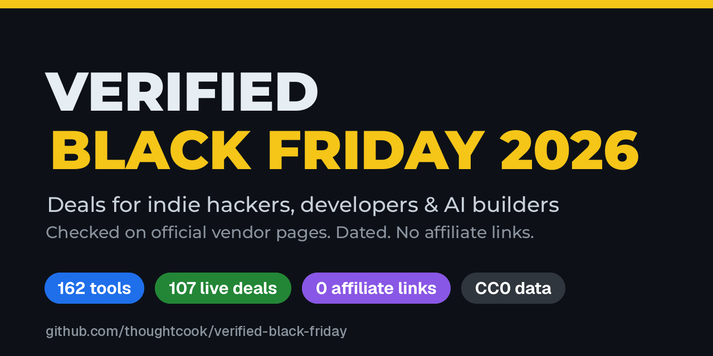

# 🧾 Verified Black Friday 2026 Deals

**Black Friday 2026 deals and Cyber Monday 2026 deals for indie hackers, developers and AI builders, where every price is checked on the vendor's own page and dated.**

**[🌐 Browse & filter the deals](https://thoughtcook.github.io/verified-black-friday/)** · **[📦 JSON](data/deals.json)** · **[📄 CSV](data/deals.csv)** · **[➕ Submit a deal](https://github.com/thoughtcook/verified-black-friday/issues/new?template=submit-deal.yml)**

> **No invented prices. No affiliate links. No 2025 deals dressed up as new.** If we couldn't confirm a deal, the list says so.
>
> ⭐ **Star this repo to get notified.** Deals are rechecked daily from Oct 21 through Dec 2, with full rechecks every Monday and Thursday and every day from Nov 20.

## Contents
[Top 5 picks](#-top-5-picks) · [Key dates](#-key-dates) · [Best live deals](#-best-live-deals-right-now) · [Stack builders](#-stack-builders) · [Legend](#legend) · [By category](#deals-by-category) · [Myth-busting](#-myth-busting) · [How we verify](#-how-we-verify) · [FAQ](#-faq) · [Contributing](#-contributing) · [Changelog](CHANGELOG.md)

## 🏆 Top 5 picks
_Savings are worked out only from prices shown on the linked official page (checked 2026-11-27)._

| # | Deal | Price | Saving | Why it's here |
|---|---|---|---|---|
| 1 | [Smooth Recorder](https://www.smoothrecorder.com) | $19 one-time | $30 off $49 (~61%) | Mac screen recorder, lifetime licence, limited to 100 buyers |
| 2 | [Proton VPN](https://protonvpn.com/black-friday) | $2.99/mo (1-yr, $35.88 first year) | 70% off (official /black-friday) | Official Black Friday page is live |
| 3 | [Hostinger](https://www.hostinger.com/black-friday) | Hosting from $1.99/mo · VPS from $6.49/mo · .com $0.01 | Up to 85% off hosting | Ends Dec 14, 2026 |
| 4 | [Proton Pass](https://proton.me/pass/black-friday) | Pass Plus $1.99/mo ($23.88 first year) | 60% off first year | Official Black Friday page is live |
| 5 | [Windscribe](https://windscribe.com/vpn-deals/black-friday-cyber-monday) | Pro $29/year (was $69) | 58% off; $2.42/mo billed yearly | Official BF page; renews at $29/year; ends Nov 30 |

## ⏰ Key dates
| Date (2026) | What happens |
|---|---|
| Oct 20 | First full verification ✅ |
| Oct 21 to Dec 2 | Daily rechecks (full rechecks on Mondays and Thursdays) |
| Nov 11 | SpaceWise Diwali $3.99 promo ended (back to $7.99 lifetime) |
| Nov 13 | Plerdy official yearly 50% and Chanty official business-plan sale went live as scheduled |
| Nov 16 | Higgsfield official 60% window ended; new official 65% window started. SpaceWise official BF Lifetime $5.99 went live. ElevenLabs official BFCM went live 3:00 a.m. ET. Koofr official yearly 55% (code BF2026) went live |
| Nov 17, 7:00 PM America/New_York | Higgsfield official 65% window ends (2026-11-18T00:00:00Z) |
| Nov 17, 14:00 UTC | MailerLite official 26% off annual plans starts (through Dec 18, 2026 16:00 UTC) |
| Nov 18 | Rank Math official countdown stamp 16:00:00 (tz not stated) |
| Nov 20 to Dec 2 | Full recheck every day |
| Nov 23, 3:00 AM EST | TradingView official BF sale went live (up to 80% off + 1 free month; through Nov 28, 2:59 AM EST / Nov 27, 11:59 PM PST) |
| Nov 23, 12:00 PM EST | Dubsado official BF sale went live (50% off first year of annual plans; through Nov 30, 1:00 PM PT / 4:00 PM EST) |
| **Nov 27** | **Black Friday**; ON1 Photo RAW sale ends 11:59 PM PT; Adobe official Creative Cloud Pro offer-terms expire |
| Nov 28 | TradingView official BF sale ends 2:59 AM EST (Nov 27, 11:59 PM PST); Coderick AI (SiteGround) annual 50% off countdown 06:00 UTC |
| **Nov 30** | **Cyber Monday**; Windscribe Pro $29/year ends; Koofr yearly 55% ends; Paperform 50% first-year ends 11:59 PM PT; Dubsado first-year 50% ends 1:00 PM PT / 4:00 PM EST; AdGuard VPN 2-year 83% and AdGuard DNS Personal/Team yearly end 4:00 PM EST (21:00 UTC) |
| Dec 1 | Kinsta, InMotion, Thrive Themes and OptinMonster BF sales end; Picmal script ends 08:00 UTC; BoltAI license-update renewals 64% off until Dec 1; ElevenLabs official BFCM ends 11:59 p.m. ET |
| Dec 2 | SpaceWise official BF Lifetime $5.99 JS end 23:59:59 (tz not stated); GTmetrix 40% off ends 11:59 PM Pacific |
| Dec 3 | Plerdy yearly 50% ends 07:59:59 UTC (Dec 2, 11:59 pm PT) |
| Dec 9 | NordVPN official Black Friday deal ends |
| Dec 14 | Hostinger sale ends (latest end date published so far) |

A live countdown is on the [website](https://thoughtcook.github.io/verified-black-friday/).

## ⭐ Best live deals right now
_Live or Early only, with deals that publish an end date listed first. Unverified deals never appear here._

| Service | Deal | Dates | Ends | Status | Link | Checked |
|---|---|---|---|---|---|---|
| **Google AI Pro (Gemini / Google One)** | Official one.google.com/about/google-ai-plans/ (Nov 25): still EARLY. Live banner: “Member early access: Save up to 50% on selected Google AI plans for Black Friday. Terms apply.” Official promo id black_friday_2026_phase_1; data-schedule-state=active; data-schedule-start=1795190400000 (2026-11-20T16:00:00Z, already passed); data-schedule-end=1795752000000 (2026-11-27T04:00:00Z = Nov 26, 11:00 p.m. America/New_York; was 1795766400000 / 2026-11-27T08:00:00Z). Terms: https://one.google.com/offer/specialoffer. Plan sale dollars were not printed (See offer login-walled; terms page has no plan dollars) and are not invented. No code. Not marked LIVE — official copy is member early access. | Member early-access window 2026-11-20T16:00:00Z through 2026-11-27T04:00:00Z (Nov 26, 11:00 p.m. America/New_York; official banner data-schedule; state active) | 2026-11-26 | 🟡 Early | [official](https://one.google.com/about/google-ai-plans/) | 2026-11-27 |
| **Adobe Creative Cloud Pro** | Official adobe.com plans + special-offers + offer-terms (Nov 17, headless Chrome; www curl was 403): LIVE 2026 Black Friday. Banners: “Black Friday is on. Save big on Creative Cloud Pro for a year. Ends Nov 27.” Official offer-terms (individuals, students, and teams): “Offer starts on November 13, 2026 and expires on November 27, 2026.” First-time subscribers, purchase directly from Adobe, 12-month commitment, then renews at then-current price. Printed currency this run is HKD (geo); USD was not readable — not FX-converted; unverified press $29.99 / $15.99 not used as official. Individuals: Save 60% first year, regularly HK$528.00/mo, alternatively HK$211.15/mo (annual billed monthly) or HK$2,437.79/yr prepaid first year (then-current HK$528.00/mo or HK$6,096.00/yr). Teams: Save 55% first year, regularly HK$778.00/mo, alternatively HK$349.71/mo per license or HK$4,196.53/yr per license first year (then-current HK$778.00/mo or HK$9,336.00/yr). Students & teachers: Save 79% first year, alternatively HK$110.55/mo or HK$1,326.63/yr first year, then HK$308.00/mo or HK$3,696.00/yr. Firefly Pro (separate from the Nov 27 CC Pro terms): Save 50% for the first 6 months, regularly HK$158.00/mo, alternatively HK$78.89/mo, “Ends Dec 6” (year not printed on that line). Firefly Pro Plus: Save 60% first 6 months, regularly HK$393.00/mo, alternatively HK$157.04/mo, same Ends Dec 6 line. Last year's (2025) 50% off first year $34.97/mo (from $69.99); students 70% off. | Official offer-terms: Nov 13, 2026 – Nov 27, 2026 (CC Pro). Firefly promo line says Ends Dec 6 (year not printed) | 2026-11-27 | 🟢 Live | [official](https://www.adobe.com/creativecloud/plans.html) | 2026-11-23 |
| **ON1 Photo RAW** | Official /landing/black-friday/ (Nov 13): LIVE Black Friday Sale on ON1 Photo RAW 2027. One-time Photo RAW 2027 $59.99 (was $99.99); Photo RAW MAX 2027 $129.99 (was $169.99). Subscriptions: MAX $79.99/year (was $89.99); ON1 Photo Studio $139.99/year (was $179.99). Black Friday pricing ends November 27 at 11:59 PM PT. Final price confirmed at checkout. | Live as of Nov 13 2026; ends Nov 27 2026 11:59 PM PT | 2026-11-27 | 🟢 Live | [official](https://www.on1.com/landing/black-friday/) | 2026-11-27 |
| **Rapid Indexer** | Official homepage (Nov 3): BF top-up credit bonuses +20% all / +30% on $100+ / +40% on $1,000+ (credits never expire). Through 27 Nov 2026 23:59 UTC. | Through 27 Nov 2026 23:59 UTC | 2026-11-27 | 🟢 Live | [official](https://rapid-indexer.com/) | 2026-11-27 |
| **Rank Math PRO** | Official /offer (Nov 25): still LIVE Black Friday. Title/H1 now “Black Friday Sale: 60% OFF + $20,000 Worth Deals” (was up to 50%). Coupon JS for standard plans: BLACKFRIDAY3-26 (was BLACKFRIDAY2-26). Countdown data-countdown="2026-11-28 16:00:00" (timezone still unstated; was 2026-11-23 16:00:00). Official USD sale prices billed annually ex VAT: Agency $64.99 → $25.99/mo (60% OFF); Business $27.99 → $12.99/mo (54% OFF); PRO $8.99 → $4.49/mo (50% OFF); Rank Math + WP Rocket bundle $13.99 → $7.49/mo (46% OFF for USD / 42% ROTW). Renewal fees return to list: Agency $64.99, Business $27.99, PRO $8.99, bundle $13.99, billed annually + taxes. Bundle Buy Now checkout slug/code: SPEEDSEOBF3-26 (USD) / SPEEDSEOBF3ROTW26 (ROTW); not the same as BLACKFRIDAY3-26. | Countdown data-countdown="2026-11-28 16:00:00" (tz unstated) | 2026-11-28 | 🟢 Live | [official](https://rankmath.com/offer/) | 2026-11-27 |
| **WP Rocket** | Official /black-friday-2026 and /pricing (Nov 10): LIVE BF. 1-year 40% off code black-friday; 3-year 60% off code black-friday-3y; first-time purchase, renews at regular price. dataLayer list−discount: 1-yr Single $35.97; Plus $71.97; Multi 50 $179.97. 3-yr Single $70.36; Plus $140.92; Multi 50 $352.60. Also Multi 100 1-yr $239.97 / 3-yr $467.51; Multi 500 1-yr $359.97 / 3-yr $705.40. Countdown data-date=2026-11-28; some CTA copy says November 27. | BF live Nov 10 2026; countdown to Nov 28 2026 (some copy says Nov 27) | 2026-11-28 | 🟢 Live | [official](https://wp-rocket.me/black-friday-2026/) | 2026-11-27 |
| **Higgsfield (AI video)** | Official /pricing and official /pricing.md (Nov 26 evening / Nov 27 02:36 UTC): BETTER. The official 69% window ended on schedule at 2026-11-27T00:00:00Z (Nov 26, 7:00 p.m. America/New_York). New official sale_11_11 window: starts_at 2026-11-27T00:00:00Z, ends_at 2026-11-28T00:00:00Z, phase black_friday_75, max_discount_percent 75. Visible copy: “Black Friday 75% OFF” / “Up to 75% off premium plans.” Official pricing.md (last updated 2026-11-27, USD for US customers): “Black Friday sale: up to 75% off, ends 2026-11-28 00:00 UTC” (= Nov 27, 7:00 p.m. America/New_York). Printed plan dollars: Plus (1,200 credits) $30/mo billed annually ($360/year; list $59/mo), or $40 first month on monthly billing then $59/mo — Plus annual dollars unchanged; Ultra 3,000 credits $40/mo billed annually ($480/year; list $129/mo; was $45/$540 under the 69% window), or $75 first month then $129/mo; Ultra 6,000 $75/mo billed annually ($900/year; list $258/mo; was $83/$996), or $140 first month then $250/mo; Ultra 9,000 $99/mo billed annually ($1,188/year; list $387/mo; was $117/$1,404), or $199 first month then $375/mo. Starter remains $19/mo (no sale in the official “best prices” list). Business (pricing.md, unchanged): Team $55/mo (list $79) or $45/mo billed annually ($539.98/year); Scale $119.99/mo (list $215) or $80/mo billed annually ($960.02/year). Official @higgsfield also tweeted a 24-hour “secret plan” (20,000 credits / $258/month) and a 3-day Higgsfield MCP trial; those were not on official pricing.md and the official /pricing JSON has secretPlan:null / secretPlanCard:null this run, so those tweet-only figures are not recorded as verified plan prices. Short window — through 2026-11-28T00:00:00Z (Nov 27, 7:00 p.m. America/New_York). | Official 75% window 2026-11-27T00:00:00Z through 2026-11-28T00:00:00Z = Nov 27, 7:00 p.m. America/New_York; prior 69% window ended 2026-11-27T00:00:00Z | 2026-11-28 | 🟢 Live | [official](https://higgsfield.ai/pricing) | 2026-11-27 |
| **Coderick AI (SiteGround)** | Official siteground.com/coderick-ai (Nov 12): LIVE bar “Black Friday deal - 50% off all annual plans.” Official catalog: Essential first year $50 (regular $100, renews $100/yr); Plus $100 (regular $200, renews $200); Pro $200 (regular $400, renews $400). Monthly plans unchanged at $10 / $20 / $40. Countdown to 2026-11-28 06:00 UTC. | Live as of Nov 12 2026; countdown to 2026-11-28 06:00 UTC | 2026-11-28 | 🟢 Live | [official](https://www.siteground.com/coderick-ai) | 2026-11-23 |
| **TradingView** | Official tradingview.com/black-friday/ (Nov 23): NEW LIVE. Page now shows “Sale ends in” (the “Launches in” teaser is gone). Banner “Up to 80% off” and “+1 free month.” Plan cards: Essential −30%, Plus −40%, Premium −70%, Ultimate −80%. Official USD (the page localizes by region; these figures are from the official USD render, not a currency conversion): Essential $126 / 13 months ($9.69/month, was $14.95/month, save $53.40 a year); Plus $251 / 13 months ($19.29/month, was $34.95/month); Premium $252 / 13 months ($19.38/month, was $69.95/month); Ultimate $576 / 13 months (the USD monthly unit price was not fully printed on the USD render and is not invented). FAQ: the 13th month is 30 extra days gifted; the free month is for web purchases only, not iOS/Android in-app purchases. During the sale you can get up to 3 years, each year in a separate transaction. A sales tax could be added depending on location; no tax amount was printed. | Official JS 2026-11-23T08:00:00Z (Nov 23, 3:00 AM EST / 12:00 AM PST) – 2026-11-28T07:59:59Z (Nov 28, 2:59:59 AM EST / Nov 27, 11:59:59 PM PST) | 2026-11-28 | 🟢 Live | [official](https://www.tradingview.com/black-friday/) | 2026-11-27 |
| **Sip** | Official sipapp.io/blackfriday/ (this run, Friday Nov 27 morning America/New_York): NEW LIVE. Visible page: “Black Friday,” “Fri Nov 27 to Sun Nov 29,” and a CTA “Get the 50% deal” that goes to sipapp.io/pricing/?coupon=BLACKFRIDAY26. Today is Friday Nov 27 in America/New_York, so the printed Friday–Sunday window is treated as current. Sale dollars are not printed on the official Black Friday page and are not invented. Cyber Monday copy (previously announced Mon Nov 30–Wed Dec 2, code CYBERMONDAY26) was not on the official page in this run and is not recorded as live. | Fri Nov 27–Sun Nov 29, 2026 (official page; no time zone printed) | 2026-11-29 | 🟢 Live | [official](https://sipapp.io/blackfriday/) | 2026-11-27 |
| **Windscribe** | Official /vpn-deals/black-friday-cyber-monday (Nov 12): LIVE BF. Pro annual $29 (was $69), 58% off, $2.42/mo billed yearly; renews at the discounted $29/year until canceled. Banner: Get Pro for $29/year. Ends Nov 30th. After Cyber Monday the price returns to the regular $69 annual rate. Not a lifetime license. | Live as of Nov 12 2026; ends Nov 30 / after Cyber Monday | 2026-11-30 | 🟢 Live | [official](https://windscribe.com/vpn-deals/black-friday-cyber-monday) | 2026-11-27 |
| **Things 3** | Official culturedcode.com/things/ (Nov 23): NEW LIVE banner “Black Friday Week Sale Get 30% off from November 23–30. The price you see in the App Store already has the discount applied.” No coupon. Official sale dollars were not printed on the homepage or /pricing/ and are not invented. Year and timezone are not printed next to November 23–30. Last year's (2025) 30% off: Mac $34.99, iPhone $6.99, iPad $13.99 (those 2025 dollars are last year's, not this sale). | November 23–30 (year and timezone not printed) | 2026-11-30 | 🟢 Live | [official](https://culturedcode.com/things/) | 2026-11-27 |
| **Univocal (Mac dictation/read-aloud)** | Official purchase page (Nov 20): NEW LIVE after the official start of 2026-11-20T00:00:00Z. Visible hero promo-note: “Black Friday November 20–30: $15 with BF2026.” Promo-bar copy: “Black Friday: $39 $15, code BF2026, applied at checkout, until November 30, then $39.” One licence covers up to 3 Macs. List $39 once. JS window for BF2026 is 2026-11-20T00:00:00Z to 2026-12-01T00:00:00Z. Printed dates are November 20–30; JS end is the start of Dec 1 UTC — both quoted, no single end date invented. Standing launch offer $19 / UVLAUNCH is not the live BF deal. | Printed November 20–30; JS 2026-11-20T00:00:00Z to 2026-12-01T00:00:00Z | 2026-11-30 | 🟢 Live | [official](https://univocalapp.com/purchase/) | 2026-11-27 |
| **AdBlock Premium** | Official getadblock.com/en/premium (Nov 24): NEW LIVE. Banner: “BLACK FRIDAY,” “30% off your first year of Premium,” “Ends Mon, 30 Nov” (i18n keys black-friday-2026-offer / black-friday-2026-ends). 2026-11-30 is a Monday. Yearly card prints was $40, now $28, labeled “inclusive of VAT.” Renewal line is the placeholder text “First year, then $renewal$/year” — the post-first-year price is not printed and is not invented. Also prints “Save 42% vs monthly in your first year.” | Ends Mon, 30 Nov (2026-11-30 is a Monday) | 2026-11-30 | 🟢 Live | [official](https://getadblock.com/en/premium/) | 2026-11-27 |
| **AdGuard** | Official adguard.com/en/license.html (Nov 23): NEW LIVE. Banner “Black Friday: up to 50% off AdGuard.” Official copy: “These discounts come only once a year! Now you can get a 1-year license at 50% off and a lifetime license at 45% off.” “Buy a new license on this page, extend or upgrade an existing one in your account. This offer runs through November 30.” Official promo JSON on the same page: date_from 2026-11-22T21:00:00.000+0000, date_to 2026-11-30T21:00:00.000+0000, discount 50, for_new_purchase / for_renewal / for_upgrade, global_promo, product_type ADBLOCK. Official USD: 1-year 3-device $29.88 → $14.94 (checkout also printed Your license $29.88, Your savings 50% -$14.94, Total $14.94); 1-year 9-device $65.88 → $32.94; lifetime 3-device $79.99 → $43.99; lifetime 9-device $169.99 → $93.50. No separate coupon. | Official JSON 2026-11-22T21:00:00Z through 2026-11-30T21:00:00Z; copy says through November 30 | 2026-11-30 | 🟢 Live | [official](https://adguard.com/en/license.html) | 2026-11-27 |
| **AdGuard VPN** | Official adguard-vpn.com/en/license.html (Nov 23): NEW LIVE. Official title/meta: “Black Friday / AdGuard VPN”; “Get 83% off the AdGuard VPN 2-year subscription.” Official coupon JSON: name BFVPN26, days_filter [730] only, discount 83, for_new_purchase / for_renewal / for_upgrade, global_promo, product_type VPN, date_from 2026-11-22T21:00:00.000+0000, date_to 2026-11-30T21:00:00.000+0000. Official USD 2-year (730 days): $48.92 (was $287.76), $2.04/month, 83% off, code BFVPN26. Same official USD tariff list also shows 1-year $47.88 (was $143.88, page discount_percent 67) and 1-month $11.99 (0% off); those are listed prices on the same page, not the named-code BFVPN26 deal (the official coupon JSON applies only to the 730-day plan). Separate from the AdGuard ad-blocker deal on adguard.com. | Official JSON 2026-11-22T21:00:00Z through 2026-11-30T21:00:00Z (America/New_York: Nov 22, 4:00 PM EST – Nov 30, 4:00 PM EST) | 2026-11-30 | 🟢 Live | [official](https://adguard-vpn.com/en/license.html) | 2026-11-27 |
| **AdGuard DNS** | Official adguard-dns.io/en/license.html (Nov 23): NEW LIVE. Official copy: “Get 65% off the Personal plan and 55% off the Team plan.” “To extend your existing subscription, just buy a new one using the same email address.” “This offer runs through November 30.” Official coupon JSON: name BFDNS26, types_filter [DNS_PERSONAL, DNS_TEAM], days_filter [365], discount field is 65, date_from 2026-11-22T21:00:00.000+0000, date_to 2026-11-30T21:00:00.000+0000, for_new_purchase / for_renewal / for_upgrade, global_promo, product_type DNS. Official page copy and tariff discount_percent are Personal 65% / Team 55% (the JSON discount field of 65 is not applied to Team). Official USD: Personal annual $10.46 (was $29.88), $0.87/month, 65% off, code BFDNS26; Personal monthly $2.49, no discount. Team annual starts at $161.90 (was $359.77), $13.49/month, 55% off, code BFDNS26; Team monthly starts at $29.99, no discount. Higher Team tiers exist; dollars above are the official starting Team prices. Separate from the AdGuard ad-blocker deal on adguard.com. | Official JSON 2026-11-22T21:00:00Z through 2026-11-30T21:00:00Z; copy says through November 30 | 2026-11-30 | 🟢 Live | [official](https://adguard-dns.io/en/license.html) | 2026-11-27 |
| **Adblock Plus** | Official adblockplus.org/premium (Nov 24): NEW LIVE. “Black Friday 30% off your first year of Premium,” “Ends Mon, 30 Nov.” Yearly plan card still prints regular $40 (JSON-LD also price 40 USD). Sale dollars are not printed and are not estimated. | Ends Mon, 30 Nov (2026-11-30 is a Monday) | 2026-11-30 | 🟢 Live | [official](https://adblockplus.org/premium) | 2026-11-27 |
| **Brevo** | Official brevo.com/black-friday/ (canonical /offers/black-friday/, Nov 23): NEW LIVE. H1 “Black Friday 30% OFF.” “Enjoy 30% off new annual plan subscriptions (Starter and/or Standard*) from 10k emails/month and up to 350k emails/month. Use the code BREVOFRIDAY2026 at checkout.” CTA “Get the discount.” Official terms Section 3: coupon valid from November 23, 2026 at 12:00:00 am CET until 11:59:59 pm CET on November 30, 2026. First contract year only; the 30% includes the regular 10% annual Self-Service discount (not stacked); not for existing annual / Professional / Enterprise plans. Sale plan dollars were not printed and are not invented. | Nov 23, 2026 00:00 CET – Nov 30, 2026 23:59:59 CET (official terms; start has passed) | 2026-11-30 | 🟢 Live | [official](https://www.brevo.com/black-friday/) | 2026-11-27 |
| **Paperform** | Official paperform.com/black-friday/ (Nov 17): LIVE “Paperform Black Friday & Cyber Monday Deal 2026.” 50% off the first 12 months of Paperform Pro and Business, code PFBF26, new subscriptions only, November 16–30, 2026 (Pacific Standard Time). FAQ: from 12am Monday November 16, 2026 until midnight at the end of Cyber Monday, November 30, 2026 (PT). Schema validFrom 2026-11-16T00:00:00-08:00 / validThrough 2026-11-30T23:59:59-08:00. Visible data-bf-live block; a hidden “has ended” block is not the live state this run. | Nov 16–30 2026 Pacific Standard Time (new subscriptions) | 2026-11-30 | 🟢 Live | [official](https://paperform.com/black-friday/) | 2026-11-27 |
| **Dubsado** | Official /black-friday-2026 (Nov 23): NEW LIVE. Page copy is now “Sale ends Monday, Nov. 30th at 1pm PT” (the “Sale starts … / Remind me” teaser is gone). 50% off the first year of annual plans; no code; discount applies automatically at checkout if eligible. Official USD: Premier $525 → $262.50; Starter $335 → $167.50. Official T&Cs: valid Monday, November 23, 2026 9am PT to Monday, November 30, 2026 1pm PT (America/New_York: Nov 23, 12:00 PM EST – Nov 30, 4:00 PM EST). Eligible: new Dubsado accounts and free trial accounts upgrading to annual; monthly accounts switching to annual, and Starter upgrading to Premier, are also eligible if the paid subscription started on or after November 17, 2025 (official 2026 eligibility cutoff, not Last year's (2025) sale). Existing annual renewals do not get the discount. You must subscribe during the window; starting a trial does not reserve the sale price. Affiliate codes may stack (official example only: Premier $525 → $262.50, then 20% affiliate → $210). | Official window Nov 23, 2026 9:00 AM PT – Nov 30, 2026 1:00 PM PT (America/New_York: Nov 23, 12:00 PM EST – Nov 30, 4:00 PM EST) | 2026-11-30 | 🟢 Live | [official](https://www.dubsado.com/black-friday-2026) | 2026-11-27 |
| **Vogoo AI** | Official /black-friday (Nov 16): still LIVE, 00:00 UTC Nov 3 – 23:59 UTC Nov 30 2026. Headline is now “Up to 60% OFF Yearly plans” (was 40% off yearly). Official yearly cards this run: Lite $19/mo / $228 billed yearly (Save $0 vs monthly); Pro $35/mo (monthly list $59) / $420 billed yearly (Save $288 vs monthly, on-page −41%); Ultra $65/mo (monthly list $129) / $780 billed yearly (on-page −50%). Page still mentions entering BLACKFRIDAY at checkout but also says the discount is included automatically. Monthly plans and credit packs are excluded. WORSE vs the Nov 5 official reading (Lite $6.45/mo reg $10.75; Pro $7.47/mo / $89.64 billed yearly, reg $12.45/$149.40). | Nov 3 – Nov 30 2026 UTC (still live; yearly dollars worsened vs Nov 5) | 2026-11-30 | 🟢 Live | [official](https://vogoo.ai/black-friday) | 2026-11-27 |
| **PastePal (Indie Goodies)** | Official Indie Goodies BF page (Nov 23): still 50% lifetime $7.49 (was $14.99), code INDIEGOODIESBF26. Dollars unchanged. Official in-page JSON for PastePal now includes startDate 2026-11-20 and endDate 2026-11-30 (year 2026). Those dates are not on the visible card but are in the official page data. | Official JSON startDate 2026-11-20, endDate 2026-11-30 (not printed on the visible card) | 2026-11-30 | 🟢 Live | [official](https://indiegoodies.com/blackfriday) | 2026-11-27 |
| **Almighty (Indie Goodies)** | Official Indie Goodies BF page (Nov 23): still 50% lifetime $7.49 (was $14.99), code INDIEGOODIESBF26. Dollars unchanged. Official in-page JSON for Almighty now includes startDate 2026-11-20 and endDate 2026-11-30 (year 2026). | Official JSON startDate 2026-11-20, endDate 2026-11-30 (not printed on the visible card) | 2026-11-30 | 🟢 Live | [official](https://indiegoodies.com/blackfriday) | 2026-11-27 |
| **Koofr** | Official koofr.eu/black-friday/ (Nov 17): NEW LIVE. 55% off yearly plans 250 GB to 5 TB, including gift cards, code BF2026, “valid from November 16 until November 30 2026,” prices per year ex VAT: 250 GB €17.70 (was €40); 500 GB €30.98 (was €69); 1 TB €44.26 (was €99); 2.5 TB €88.52 (was €197); 5 TB €154.92 (was €345). Raw HTML still has COMING SOON on a disabled CTA, but this-run headless Chrome shows “Get this deal” with the disabled class removed (JS START_DATE Nov 16, 2026 00:00:00 has now passed; END_DATE Nov 30, 2026 23:59:59, timezone not stated). Official help page confirms the same 55% / BF2026 / Nov 16–30 window. Dollars unchanged from the previously announced schedule. | Nov 16–30 2026 (official copy; JS end Nov 30, 2026 23:59:59, tz not stated) | 2026-11-30 | 🟢 Live | [official](https://koofr.eu/black-friday/) | 2026-11-27 |
| **Wasmer Pro** | Official wasmer.io/black-friday-2026 (Nov 20): LIVE “50% off Wasmer Pro for 12 months.” First-time customers only (existing paying customers not eligible). Code BLACKFRIDAY26 at checkout. Monthly: $5/month for 12 months, then $10/month. Annual: $50 for the first year, then $100/year. Discount applies only to the Pro base subscription; metered usage is billed separately. Redeem through November 30, 2026 at 11:59 PM PST. All prices USD. Official /pricing shows the same offer. | Redeem through Nov 30, 2026 11:59 PM PST | 2026-11-30 | 🟢 Live | [official](https://wasmer.io/black-friday-2026) | 2026-11-27 |
| **Daily Time Tracking** | Official dailytimetracking.com (Nov 25): NEW LIVE. Homepage offer balloon: “Black Friday · Up to 30% off.” Body copy: “Through November 30, get a discounted year of Daily with code DAILYBF2026.” Official dollar prices for the discounted year or a Lifetime plan are not printed on the homepage and are not invented. The homepage “Claim now” buttons point at App Store redeem URLs that include campaign parameters (pt, ct); this list uses the official homepage and the printed code instead. /pricing is 404. | Through November 30 (year not printed next to the date, on the 2026 Black Friday homepage); timezone not stated | 2026-11-30 | 🟢 Live | [official](https://dailytimetracking.com/) | 2026-11-27 |
| **Kinsta** | Official /black-friday/ (Nov 12): LIVE BF 2026. Monthly plans 50% off first 3 months; annual plans 3 months off; new customers only; offer ends December 1, 2026. Printed Business plan: Pay $17.50 for 3 months after the first month, renews at $35; annual Pay $0 today, $420→$315 after the first month. | Live as of Nov 12 2026; ends Dec 1 2026; new customers | 2026-12-01 | 🟢 Live | [official](https://kinsta.com/black-friday/) | 2026-11-27 |
| **InMotion Hosting** | Official /deals plus product pages (Nov 12): LIVE BF 2026, November 9 through December 1, 2026 (product footnote: new customer accounts only, valid through Dec 1, 2026 12pm ET). Up to 75% Shared, 73% WordPress, 70% VPS, 50% dedicated; first term then standard renewal. Shared Launch 36-mo $3.49/mo (75% off, renews $13.99). Self-Managed VPS 8 vCPU $13.99/mo (70% off, renews $46.99; CTA data-term=36, though the card also prints “For 24 month term”). Select domains from $10.00 first year. Cloud first month 50% off with code SAVE50, ends Dec 1, 2026. | Nov 9 – Dec 1 2026 12pm ET (new customers; first term) | 2026-12-01 | 🟢 Live | [official](https://www.inmotionhosting.com/deals) | 2026-11-27 |
| **ElevenLabs** | Official join.elevenlabs.io/bfcm and /bfcm/terms (Nov 17): LIVE after the official start of 3:00 a.m. ET, Nov 16, 2026. Title “Black Friday & Cyber Monday: up to 55% off ElevenLabs plans.” Visible “Get the offer” / “Offer ends in” countdown. Offer Period 3:00 a.m. ET, Nov 16, 2026 through 11:59 p.m. ET, Dec 01, 2026. Creator annual $99 for the first 12 months (55% off regular $220) for New and Upgrading Subscribers; also printed $8.25/mo billed yearly. Pro annual $445.50 first 12 months (55% off regular $990); also printed $37.13/mo billed yearly. Pro monthly-to-annual $495 first 12 months (50% off $990) for users on an active Pro monthly subscription who switch during the Offer Period. First term only; renews at regular annual. Direct elevenlabs.io only. | Live as of Nov 16 2026 3:00 a.m. ET; through 11:59 p.m. ET Dec 01, 2026 | 2026-12-01 | 🟢 Live | [official](https://join.elevenlabs.io/bfcm) | 2026-11-27 |
| **Framer** | Official www.framer.com/black-friday (this run, Friday Nov 27 morning America/New_York): NEW LIVE. Title: “Framer: Get 50% off Pro for Black Friday.” Hero: “Get 50% off your first year of Pro with 2,000 Agent credits and 30% off everything in Framer Store.” Paste code BLACKFRIDAY26 at checkout on a yearly Pro plan. 2,000 Agent credits are added automatically after each Pro purchase (no separate code). Official FAQ: new subscription in a new workspace without an active subscription; discount once per workspace; if you’ve subscribed before, move the site to a new free workspace and start a new yearly Pro there. Cannot apply to an active subscription, upgrade an existing plan, or switch monthly to yearly. Promo price is first year only; renews at regular price from year 2. No retroactive discount. Ends December 1, 2026, at 09:00 AM CET (3:00 a.m. America/New_York). Official sale dollars are not printed and are not invented. Official announcement: https://x.com/framer/status/2126240004209000502 | Ends Dec 1, 2026, 09:00 AM CET (3:00 a.m. America/New_York) | 2026-12-01 | 🟢 Live | [official](https://www.framer.com/black-friday) | 2026-11-27 |
| **Paste** | Official pasteapp.io/black-friday-2026 (Nov 23): NEW LIVE “Black Friday 2026 Offer: 50% Off.” Visible: Was $29.99 now $14.99. “The code BLACKFRIDAY2026 is applied at checkout.” “50% off the first year of the Annual plan on our website, November 20 to December 1.” (timezone not printed — not invented.) Prices in USD, exclude VAT, may vary by country or region. Official /pricing still prints list Personal $2.49/mo / $29.99 billed annually. Schema.org still lists regular $3.99/mo, $29.99/yr, and $89.99 — sale dollars taken from the visible BF line, not from schema. Lifetime sale dollars were not printed — not invented. Do not use the shop checkout URL (it has aff=1). | November 20 to December 1 (timezone not printed) | 2026-12-01 | 🟢 Live | [official](https://pasteapp.io/black-friday-2026) | 2026-11-27 |
| **Picmal (Mac design/export tool)** | Official /pricing (Nov 11): still LIVE. Script startsAt 2026-11-07T00:00:00Z, endsAt extended to 2026-12-01T08:00:00Z (was 2026-11-24T08:00:00Z); code BLACKFRIDAY. 1 Mac $29→$14.50 (printed). data-tiers still lists offerPrice $14.50/$19.50/$44.50/$74.50 (read from HTML). Marketing bar says 50% off until 30 November — script endsAt is authoritative. | Nov 7 – Dec 1 2026 08:00 UTC (script; was Nov 24) | 2026-12-01 | 🟢 Live | [official](https://picmal.app/pricing) | 2026-11-27 |
| **Thrive Themes** | Official /black-friday/ (Nov 11): LIVE BF. Up to 60% off new Thrive Themes subscriptions and eligible upgrades; renewals excluded. Sale opens Nov 9, 2026 at 10 a.m. Eastern; final sale day Dec 1 (hero: Ends Dec 1, 2026 at Midnight!). All Access Pass first year $240/year ($819 value), 60% off first year, then $599/year at renewal. | Nov 9, 2026 10:00 a.m. ET – Dec 1, 2026 (hero midnight) | 2026-12-01 | 🟢 Live | [official](https://thrivethemes.com/black-friday/) | 2026-11-27 |
| **OptinMonster** | Official /black-friday/ (Nov 11): LIVE BF. Up to 60% off new plans and eligible upgrades. Sale opens Nov 9, 2026 at 10 a.m. Eastern; final sale day Dec 1. First-year totals billed today: Basic $108 (renews $210/yr); Plus $288 (renews $570/yr); Pro $348 (renews $870/yr); Growth $588 (renews $1,470/yr). | Nov 9, 2026 10:00 a.m. ET – Dec 1, 2026 | 2026-12-01 | 🟢 Live | [official](https://optinmonster.com/black-friday) | 2026-11-27 |
| **Eden (eden.so creator/content workspace)** | Official eden.so/black-friday and eden.so/pricing (this run, Friday Nov 27 morning America/New_York): NEW LIVE. Official FAQ: early access Nov 20–22 has passed; main sale Black Friday Nov 27–Cyber Monday Nov 30 for everyone; each closes at midnight Arizona time (end of Nov 30 = Dec 1, 2:00 a.m. America/New_York). Official page JS sets data-bf-sale="main" when Date.now() is in 1795706400000–1796108400000 (2026-11-26T15:20:00Z–2026-12-01T07:00:00Z, i.e. Nov 26, 10:20 a.m. through Dec 1, 2:00 a.m. America/New_York), which reveals the .bf-sale-only blocks for visitors. The JS start is earlier than the 2026-11-27T07:00:00Z window recorded on the prior check. This check is inside both the FAQ main-sale dates and the JS window, so the revealed sale cards are treated as the live public offer. Printed in the live sale cards: Starter $16.20/mo / $194.35 a year, locked in while you stay (35% off; compare $25/mo); Pro $39.50/mo / $474 a year, locked in while you stay (40% off; compare $66/mo); Max $83.30/mo / $999.50 a year, locked in while you stay (50% off; compare $167/mo). Official FAQ: yearly sale price renews each year while you stay on that plan; monthly 20% off for 12 months. Monthly plan sale dollars were not clearly printed in the default yearly UI this run and are not invented. Regular yearly list prices $299 / $790 / $1,999 are printed in official regular-price (bf-regular-only) blocks, which the official CSS hides while the sale UI is on. | Official FAQ main sale Nov 27–Nov 30, 2026, closes midnight Arizona time (Dec 1, 2:00 a.m. America/New_York); JS window through 2026-12-01T07:00:00Z | 2026-12-01 | 🟢 Live | [official](https://eden.so/black-friday) | 2026-11-27 |
| **Kavel (AI image/video)** | Official /pricing (Nov 23): still LIVE. Visible banner flipped from “EARLY BLACK FRIDAY” to “BLACK FRIDAY 2× credits on every new plan — a whole extra year of credits on yearly. Ends December 1.” Same offer: 2x credits on every new plan, Starter $100/yr ($8.33/mo), no code required. Early→Live with the same dollars is a label change only. | Ends December 1 | 2026-12-01 | 🟢 Live | [official](https://www.kavel.ai/pricing) | 2026-11-27 |
| **Wins (Mac window manager)** | Official wins.cool (Nov 7): Black Friday code BF_26 40%; Single $11.99 / Pro $23.99 / X $29.99. Ends Dec 1 2026. | Nov 1 – Dec 1 2026 | 2026-12-01 | 🟢 Live | [official](https://wins.cool/) | 2026-11-27 |
| **Creatune** | Official /black-friday (Nov 23): NEW LIVE. “Creatune Black Friday Deal: 30% Off Your First Year.” Every annual plan is 30% off the first year, auto at checkout, no code. Nov 20 – Dec 1, 2026 (Pacific Time). Official first-year prices: Basic $83.16 (annual was $118.80/yr); Pro $167.16 ($238.80); Max $335.16 ($478.80). FAQ: “From November 20 to December 1, 2026 (Pacific Time), every annual plan is 30% off for the first year.” JSON validFrom 2026-11-20T08:00:00.000Z has passed. A leftover “The sale opens on November 20” sentence is start-date copy; the page also prints “Prices below show what you will pay during the sale.” Monthly plans and credit packs stay regular price. | Nov 20 – Dec 1, 2026 (Pacific Time) | 2026-12-01 | 🟢 Live | [official](https://creatune.ai/black-friday) | 2026-11-27 |
| **Fluent (Mac AI assistant)** | Official fluentmac.app/buy?discount_code=BF2026 (Nov 5): Black Friday 25% code BF2026 until Dec 1. Basic $49→$36.75; Standard $69→$51.75; Team $29→$21.75/seat. Discounted prices visible with code on buy page. | Until Dec 1 2026 | 2026-12-01 | 🟢 Live | [official](https://fluentmac.app/buy?discount_code=BF2026) | 2026-11-27 |
| **BoltAI** | Official boltai.com/pricing (Nov 23): still LIVE “Save up to $160 off list price today with BFCM2026.” Printed sale unchanged: Pro Regular $99 / Sale $59; Pro+ Regular $199 / Sale $119; Lifetime Regular $399 / Sale $239. One-time licenses. Renewals still “Black Friday: 64% off until Dec 1.” New this run: the new-license hero now prints a live countdown, “Black Friday sale ends in 9 days, 5 hours” (HTML at fetch ~2026-11-23T02:32Z). A calendar end date is still not printed next to the $59/$119/$239 figures and is not invented. | New-license end shown as a countdown of 9 days, 5 hours at fetch (~2026-11-23T02:32Z); renewals 64% off until Dec 1 | 2026-12-01 | 🟢 Live | [official](https://boltai.com/pricing) | 2026-11-27 |
| **NeoTiler (Mac)** | Official getneotiler.com (Nov 3): Black Friday Special 30% OFF lifetime — $6.99 (was $9.99), code BF30, priceValidUntil Dec 1 2026. One-time; up to 3 Macs. | Through Dec 1 2026 | 2026-12-01 | 🟢 Live | [official](https://getneotiler.com) | 2026-11-27 |
| **Compresto (Mac)** | Official compresto.app (Nov 6): Black Friday 40% off all plans with code BFCM26. Personal lifetime $49→$29.40; Standard lifetime page $69→$41.40 with code; subscriptions first payment 40% off. Through Dec 1 2026 (blog + pricing banner). | Nov 2 – Dec 1 2026 | 2026-12-01 | 🟢 Live | [official](https://compresto.app/pricing) | 2026-11-27 |
| **Kit** | Official kit.com/pricing (Nov 20): LIVE “Monthly Black Friday offer.” Creator plan $39 → $20/mo for the first 3 months, then $39/mo. Footnote: “Offer applies to the monthly Creator plan. Get 50% off for 3 months for accounts up to 500k subscribers. Ends Dec. 1.” Annual billing is a separate “Annual—save 17%” toggle, not the BF offer. https://kit.com/black-friday is 404; official source is /pricing. | Ends Dec. 1 (as printed on official /pricing this run; checked 20 Nov 2026) | 2026-12-01 | 🟢 Live | [official](https://kit.com/pricing) | 2026-11-25 |
| **Chanty** | Official /black-friday/ (Nov 14): LIVE, heading “Black Friday Deals.” 25% off monthly business $3 per user (was $4); 40% off annual business $2.40 per user (was $4). For new users, Free plan, or Appsumo Chanty users. End around Dec 1 2026 (FAQ: “until Dec. 01 2026 at 12:00 AM Geneva time (CET)”; official JS bfDueDate Dec 1, 2026 12:00:00 converted to CET — both printed, not reconciled). | Live as of Nov 14 2026 (started Nov 13 12:00 Geneva CET); ends around Dec 1 2026 (JS 12:00:00 CET vs FAQ midnight CET — unreconciled) | 2026-12-01 | 🟢 Live | [official](https://www.chanty.com/black-friday/) | 2026-11-25 |
| **Omnisend** | Official /bfcm/ (Nov 9): still 30% off first 3 months, code BLACK-FRIDAY-2026, through Dec 1 2026. Page now has conflicting eligibility: one line says exclusively for former paying customers now on the Free plan; another (and window.__OTE_OVERRIDES__) says valid for new customers and Free plan users upgrading to a paid plan. Free migration ≤5 days. | Until Dec 1 2026; eligibility copy conflicts | 2026-12-01 | 🟢 Live | [official](https://www.omnisend.com/bfcm/) | 2026-11-27 |
| **SciFig** | Official /black-friday (Nov 3): Extra 20% off new subscription first month/year + upgrades/credit packs (auto, no code). Example Starter $80 first year (renews $100/yr). Page claims up to 52% total vs 12× monthly on Pro annual first year. | Through 1 Dec 2026 23:59 PT | 2026-12-01 | 🟢 Live | [official](https://scifig.ai/black-friday) | 2026-11-27 |
| **JuxtaCode** | Official juxtacode.app/black-friday/ (Nov 23): NEW LIVE. “40% off JuxtaCode. Runs Friday 20 November to Tuesday 1 December 2026, US Pacific time. On now.” Sale price $24, regular $40, code BLACKFRIDAY26 (USD; tax at checkout). Official start 2026-11-20T08:00:00Z has passed. | Friday 20 November to Tuesday 1 December 2026, US Pacific (On now) | 2026-12-01 | 🟢 Live | [official](https://juxtacode.app/black-friday/) | 2026-11-27 |
| **WordPress.com** | Official wordpress.com/black-friday-2026/ (Nov 26, 9:36 p.m. America/New_York / Nov 27 02:36 UTC): NEW LIVE. Official FAQ: “From November 27 to December 1, 2026, you get an extra 25% off new annual and multi-year plans.” Ends December 1, 2026 at 11:59 p.m. UTC (6:59 p.m. America/New_York). Annual and multi-year only (not monthly). Existing customers: yes, on a new annual or multi-year plan; renewals aren’t eligible. First term only, then standard renewal. Official CTAs use code BFWPCOM2026. Hero: “Sale ends December 1. Extra 25% off annual and multi-year plans. That’s up to 66% less than paying monthly.” The official end is stated in UTC, so this window is treated as started at November 27, 00:00 UTC (already underway at this check). Sale plan dollars are not printed on the official page and are not invented. | Nov 27–Dec 1, 2026 (official FAQ); ends Dec 1, 2026 11:59 p.m. UTC (6:59 p.m. America/New_York) | 2026-12-01 | 🟢 Live | [official](https://wordpress.com/black-friday-2026/) | 2026-11-27 |
| **BetterDisplay Pro** | Official betterdisplay.pro (Nov 25): NEW LIVE. Visible notice: “Black Friday & Cyber Monday 2026,” “33% off,” “Use code BFCM2026,” “Available through December 1, 2026.” Official Pro CTA: “Get BetterDisplay Pro for $21.99 or €19.99, tax may apply.” Paddle checkout is opened with coupon BFCM2026. Sale dollars are not printed on the page and are not computed. Official copy describes the Pro license as perpetual (not a subscription). A November 26 start date was claimed in the vendor issue but is not printed on the official page. | Official copy: “Available through December 1, 2026” (start date not printed) | 2026-12-01 | 🟢 Live | [official](https://betterdisplay.pro/) | 2026-11-27 |
| **MoneyWiz** | Official wiz.money/black-friday (Nov 25): NEW LIVE. Eyebrow “Black Friday.” H1 “Meet MoneyWiz 2027. Take 20% off.” “Offer ends December 1, 2026.” “Use this code at checkout BFCM26.” “20% off Standard and Premium, first billing period.” Official US reference prices: Standard $23.99 / first year (was $29.99); Premium $47.99 / first year (was $59.99); Premium monthly $4.79 / first month (was $5.99). “In other countries you’ll get 20% off the local price.” “After the first discounted period, your subscription renews at the regular price unless you cancel.” Official terms: new website purchases only, through FastSpring; no App Store discount; Lifetime is not included. | Official: offer ends December 1, 2026 (start date not printed on the page) | 2026-12-01 | 🟢 Live | [official](https://www.wiz.money/black-friday) | 2026-11-27 |
| **JetBrains** | Official JetBrains blog https://blog.jetbrains.com/blog/2026/11/25/black-friday-2026/ (read this run): NEW LIVE. “40% off a new annual individual JetBrains IDE or ReSharper subscription, or an upgrade to an annual individual All Products Pack or dotUltimate one.” Code BF2026 at checkout. Also valid if you pay upfront for a two- or three-year subscription. Official window: November 25 – December 2, 2026. Eligibility (official FAQ): new annual individual JetBrains IDE and ReSharper subscriptions, and upgrades of existing individual JetBrains IDE or ReSharper subscriptions to annual All Products Pack or dotUltimate; except for continuity discounts, cannot be combined with other discounts, promotions, or benefits; does not apply to regular renewals. Official store HTML (jetbrains.com/store/?billing=yearly) printed no Black Friday copy or plan sale dollars this run (JS storefront) — sale dollars are not invented. (Setapp is a separate row and still has no official BF promo.) | November 25 – December 2, 2026 (official blog) | 2026-12-02 | 🟢 Live | [official](https://blog.jetbrains.com/blog/2026/11/25/black-friday-2026/) | 2026-11-27 |
| **Pabbly Plus (automation)** | Official blackfriday.pabbly.com (this run, Friday Nov 27 morning America/New_York): NEW LIVE. Official JS LAUNCH_DATE 2026-11-27T05:00:00Z (Nov 27, 12:00 a.m. America/New_York) has passed; DEAL_END is 2026-12-02T05:00:00Z (Dec 2, 10:30 a.m. IST / 12:00 a.m. America/New_York). The page script is in the live phase now: badge “Black Friday Sale is Live,” “Sale Ends In” countdown, coupon BFCM26 shown, Buy buttons enabled; the pre-launch “Sale Not Live Yet” / “Reserve Your Seat” bar is removed on load. Static <title> and social meta still say “Launching Nov 27” (stale SEO, not the runtime UI). Official price card and FAQ print Plus yearly $1,428 → $828 (42% off), all 9 apps; official FAQ says the $828/year price renews. Coupon BFCM26. Hero also mentions additional 10% off lifetime and combo deals; those dollars are not itemized here. | Live until Dec 2, 2026, 10:30 a.m. IST / 12:00 a.m. America/New_York (DEAL_END 2026-12-02T05:00:00Z) | 2026-12-02 | 🟢 Live | [official](https://blackfriday.pabbly.com/) | 2026-11-27 |
| **GTmetrix** | Official gtmetrix.com/pricing (Nov 15): Black Friday is here — 40% off all GTmetrix plans, code BF2026. Visible yearly USD cards: Lite $4.99 → $2.99 per month billed yearly; Core $9.99 → $5.99; Advanced $24.99 → $14.99; Expert $49.99 → $29.99. On-page copy: "Our biggest discount of the year ends December 2." Official meta description: ends Dec 2, 2026 @11:59 PM Pacific. All prices USD. | Live as of Nov 15 2026; ends Dec 2, 2026 11:59 PM Pacific | 2026-12-02 | 🟢 Live | [official](https://gtmetrix.com/pricing) | 2026-11-27 |
| **AppsByMo (Mac suite)** | Official homepage + content.js (Nov 10): LIVE. Script window start=2026-11-08T21:00:00Z end=2026-12-02T08:00:00Z. Code BLACKFRIDAY; 50% off every paid app; App Store prices halved. Static HTML still shows the pre-JS “upcoming” default — theme.js uses the script dates, which have already started. Individual app sale prices are in content.js; not restated here as invented 50% totals. | Nov 8 21:00 UTC – Dec 2 08:00 UTC (script; copy says 9 Nov – 1 Dec) | 2026-12-02 | 🟢 Live | [official](https://appsbymo.app/) | 2026-11-27 |
| **Gleam** | Official gleam.io/black-friday (Nov 26): “Every Gleam App for the Price of One.” “Until 2 December, the Full Package costs the same as Competitions. That’s Competitions, Rewards, Captures and Gallery, at one app’s price, for as long as you stay subscribed.” “Up to 60% off the Full Package.” Yearly-billed Full Package at Competitions prices: Pro $39/month (was $79; “Save $480 a year”; paying monthly $59 a month, down from $119); Business $119/month (was $299; “Save $2,160 a year”; paying monthly $179 a month, down from $479); Premium $299/month (was $749; “Save $5,400 a year”; paying monthly $499 a month, down from $1,199). “You keep that price for as long as your Full Package subscription stays active (yes, after Black Friday too).” Existing customers: 50% off a yearly upgrade when moving up a plan (Hobby to Pro, Pro to Business, or Business to Premium), first year only, code BFUPGRADE at checkout; after the first year, the plan renews at the standard yearly price. Official terms: the offer runs from 12:00am AEST on 20 November 2026 until 11:59pm PST on 2 December 2026. If you cancel, the offer price ends. Already on the Full Package: contact support before the offer ends to move to the offer price. One code per account; the offers can’t be combined with each other or with other discounts. | Official terms: 12:00am AEST 20 November 2026 until 11:59pm PST 2 December 2026 (2:59 a.m. ET December 3) | 2026-12-02 | 🟢 Live | [official](https://gleam.io/black-friday) | 2026-11-26 |
| **Plerdy** | Official /black-friday/ (Nov 14): LIVE. 50% off every yearly plan, first 12 months, then regular yearly; code plerdyBF2026. Printed first-year: Startup $10.50/mo ($126 instead of $252); Scale $21/mo ($252 instead of $504); Thrive $35/mo ($420 instead of $840). Enterprise cards also printed. Ends Dec 2, 2026, 11:59 pm PT / 2026-12-03 07:59:59 UTC. | Live as of Nov 14 2026 (started Nov 13 08:00 UTC); ends Dec 2 2026 11:59 pm PT / Dec 3 07:59:59 UTC | 2026-12-03 | 🟢 Live | [official](https://plerdy.com/black-friday/) | 2026-11-27 |
| **Bimg AI** | Official /black-friday (Nov 5): 50% off first month (monthly), or 50% off first year and every annual renewal. Campaign Nov 3 – Dec 3 2026. Choose plan on pricing page; confirm discount at checkout. | Nov 3 – Dec 3 2026 | 2026-12-03 | 🟢 Live | [official](https://bimg.ai/black-friday) | 2026-11-27 |
| **Internxt** | Official internxt.com/black-friday (Nov 23): still LIVE, ends December 3rd, 2026; discount auto at checkout. Official sale-page headline/FAQ this run print 85% off all Internxt plans (baseline was 87%). Official blog.internxt.com/black-friday-deals/ still prints both “87% off all our cloud storage plans” and “Internxt 2026 — 85% off…,” and still prints Essential 1TB from €1.29/month and lifetime from €247. Sale-page plan cards remain JS-opaque for euro totals. Quoted as printed; 85% vs 87% is a copy conflict, not marked worse without a worse printed euro total. | Sale ends Dec 3 2026 | 2026-12-03 | 🟢 Live | [official](https://internxt.com/black-friday) | 2026-11-25 |
| **Deepvue** | Official /black-friday-2026 (Nov 23): still LIVE at $490/yr (was $990). Visible hero/FAQ now: “Join by December 4, 2026 at 11:59 PM ET to lock in $490/year and get both Masterclasses.” The Nov 12 masterclass VIP deadline is no longer in visible copy. Dollars unchanged. | $490 lock + visible masterclass bonus now to Dec 4, 2026 11:59 PM ET | 2026-12-04 | 🟢 Live | [official](https://deepvue.com/black-friday-2026/) | 2026-11-27 |
| **Later (social scheduling)** | Official /black-friday-sale (Nov 5): 6 months free on new annual Growth or Scale (3 mo already in annual + 3 via code LATERBF26). Growth shown $37.50/mo billed yearly. New customers only; web checkout not iOS; no renewals/upgrades/monthly. | Nov 1 – Dec 4 2026 | 2026-12-04 | 🟢 Live | [official](https://later.com/black-friday-sale/) | 2026-11-27 |
| **Recut** | Official getrecut.com (Nov 20): still a live $50-off one-time deal, same dollars. Copy this run: “Early Black Friday! Recut is $50 off until Dec 4”; “Black Friday is early!”; one-time “Black Friday $149 $99.” Also “Goes up to $149 on 12/5.” Footer: “Recut is $99 until December 4, then it goes back to $149.” Subscribe remains $19/month at the regular rate (deal is the one-time license). No coupon needed. | Ends Dec 4 / goes up to $149 on 12/5 | 2026-12-04 | 🟢 Live | [official](https://getrecut.com/) | 2026-11-27 |
| **LiveWebinar** | Official livewebinar.com and livewebinar.com/pricing (Nov 23): official top banner already visible — “BLACK FRIDAY,” “-50% MONTHLY PLAN* BF2026M,” “-30% YEARLY PLAN* BF2026Y,” “Use code at checkout,” “ENDS DEC 4,” and “*New accounts only. Valid until Dec 4, 2026.” Banner CTA is the official pricing URL with redeem_code=BF2026M (monthly). Sale plan dollars were not printed on the banner or the static pricing cards and are not invented. The pricing cards still also show the standing “Annually 20% off,” which is not this Black Friday offer. Official blog livewebinar.com/blog/alternatives/black-friday-2026 (updated 20.11.2026) still prints the promotion period as November 24 – December 4, 2026, new accounts only, same codes (50% off first month on monthly plans / 30% off yearly). | Official banner: valid until Dec 4, 2026 (start date not printed on the banner). Official blog: November 24 – December 4, 2026 | 2026-12-04 | 🟢 Live | [official](https://www.livewebinar.com/pricing) | 2026-11-27 |
| **Vitals (Mac)** | Official vitalsmac.com/pricing (Nov 23): NEW LIVE (was Unverified). Visible: “Black Friday 73% off Vitals, until 5 December.” “$12.99 for one Mac until 5 December, 73% off the regular $49.” 2 Macs $19.99; “Vitals with Flit, Levers and SoundBar is $69.” Timer aria-label: “Black Friday ends at the end of 5 December.” Schema priceValidUntil 2026-12-05. Timezone not printed — not invented. AppSumo still lists a marketplace deal at different dollars and is not the official source. | Until 5 December / end of 5 December (schema priceValidUntil 2026-12-05; timezone not printed) | 2026-12-05 | 🟢 Live | [official](https://vitalsmac.com/pricing) | 2026-11-27 |
| **TimeCamp** | Official timecamp.com/black-friday/ (Nov 23; /black-friday-2026/ redirects here): NEW LIVE. “Save 30% on TimeCamp Ultimate,” “Sign up now and enjoy all the Ultimate features at the cost of Premium for the first 12 months.” First-time subscriptions only; then renews at $9.99/user/mo after 12 months, billed annually. Code TCBF26 at checkout. Printed example: Ultimate 10 users, 12 months, standard annual $1,198.80 → first year $839.16 (per user per month $6.99; you save $359.64). FAQ: starts November 23, 2026, 00:00 UTC; ends December 5, 2026, 23:59 UTC. | Nov 23, 2026 00:00 UTC – Dec 5, 2026 23:59 UTC | 2026-12-05 | 🟢 Live | [official](https://www.timecamp.com/black-friday/) | 2026-11-27 |
| **CloudLinux / Imunify360** | Official Imunify homepage + imunify360.com/imunify360-pricing/ and cloudlinux.com/pricing + /deals (Nov 10): now visually LIVE. CSS flipped to show the BF heroes (original heroes hidden). Imunify yearly 40%: Single $144→$86.40/yr; 30 users $300→$180; 250 $420→$252; Unlimited $540→$324. CloudLinux yearly (new partner accounts): 1 Hosting Account from $63.00/server/yr (1 server 25% / 2–4 $54.00 / 5–49 $42.00 30% / 50+ $33.60 30%); 5 Hosting Accounts from $108.00 (2–4 $90.00 / 5–49 $75.60 / 50+ $58.80); Unlimited from $162.00 (2–4 $144.00 / 5–49 $117.60 / 50+ $109.20). Footnote: new partner accounts only; upfront yearly; renewals revert; until Dec 5, 2026. Official X still said through Nov 30. No coupon code. | Visually live Nov 10 2026; footnote until Dec 5 2026 (official X had said Nov 30) | 2026-12-05 | 🟢 Live | [official](https://www.imunify360.com/) | 2026-11-27 |
| **VoiceInk** | Official tryvoiceink.com/black-friday (Nov 20): LIVE “Black Friday: 40% off VoiceInk for Mac” / “40% off VoiceInk, for life.” Pay once, lifetime access. Code BFVI2640 at checkout. Official copy: “Get 40% off VoiceInk, the private dictation app for Mac, through December 5.” Printed dollar sale prices were not on the page this run and are not invented. Timezone for the December 5 end is not stated on the page. | Through December 5 (as printed; year not written next to the date, on the 2026 Black Friday page) | 2026-12-05 | 🟢 Live | [official](https://tryvoiceink.com/black-friday) | 2026-11-27 |
| **Cloudways** | Official promo-code.php (Nov 7): 80% off first 2 months, code BFCM802; Flexible $11→$2.2/mo; Autonomous $20→$4/mo; new customers. Hellobar Dec 6 2026 13:00. | BF live Nov 2026 | 2026-12-06 | 🟢 Live | [official](https://www.cloudways.com/en/promo-code.php) | 2026-11-27 |
| **Seobility** | Official /en/lp/blackfriday26/ (Nov 20): still LIVE “Seobility Black Friday Deal 2026.” Still 60 days free + 15% off forever: Premium $69.90 → $59.41/mo billed monthly. Official end now printed: “November 17 to December 6”; data-end="2026-12-06T23:59:59+01:00”; data-date="Ends December 6.” Signup voucher this run is blackfriday26ext (baseline was blackfriday25lp). Agency $239.90 card was not found this run — not invented. | November 17 to December 6, 2026 (data-end 2026-12-06T23:59:59+01:00) | 2026-12-06 | 🟢 Live | [official](https://www.seobility.net/en/lp/blackfriday26/) | 2026-11-25 |
| **Tower (Git client)** | Official /pricing (Nov 24): NEW LIVE. Page header: “Black Friday, Up to 50% off.” Official USD (visible plan cards; priceCurrency USD): Basic “Black Friday 30% off first year,” $69 → $48.30 per user / annually; Pro “Black Friday 50% off first year,” $129 → $64.50 per user / annually. The Pro card also prints “10% off at 10+ seats” (printed only; a stacked checkout total is not computed). Enterprise $149 per user / annually, no Black Friday discount shown. JSON-LD still lists regular Basic $69.00 / Pro $129.00 USD; sale dollars come from the visible plan cards. Homepage hero: “Black Friday Up to 50% off Tower Pro & Basic · until Dec 6.” Official copy says “until Dec 6” with no year printed (footer is only © 2010-2026). Pricing page has no end date. Official X @gittower (2026-11-24T13:45:57.000Z / 8:45 AM EST): “Tower's Black Friday Sale is live! Get up to 50% off your first year of the most powerful Git client for Mac and Windows. No code needed. Until Dec 6.” No coupon code. | Official copy “until Dec 6” with no year printed (homepage hero and official X post); pricing page has no end date | 2026-12-06 | 🟢 Live | [official](https://www.git-tower.com/pricing) | 2026-11-27 |
| **SpaceWise 2.0 (Mac)** | Official /pricing (Nov 20): still LIVE Black Friday: “BLACK FRIDAY SALE · $5.99 LIFETIME (25% OFF)”, was $7.99, code BLACKFRI25. Official banner title this run: “Offer valid till Dec 7, 2026.” Previously recorded JS end was 2 Dec 2026 23:59:59 — this is an end-date extension, not a dollar change. | Offer valid till Dec 7, 2026 (official banner title this run; tz not stated) | 2026-12-07 | 🟢 Live | [official](https://www.spacewisemac.in/pricing) | 2026-11-27 |
| **Enconvo (Mac AI agent)** | Official enconvo.com (Nov 20): Black Friday 30% off Lifetime and Cloud, discount applied at checkout, no code (the announced BLACKFRIDAY2026 code is no longer needed). Lifetime one-time: Standard $59 → $41.30 / Premium $119 → $83.30 / Teams $159 → $111.30 (5 seats). Enconvo Cloud: 30% off the first month or year. Ends December 7, 2026 (page countdown ends Dec 8 00:00 PT). | Nov 20 – Dec 7, 2026 | 2026-12-07 | 🟢 Live | [official](https://enconvo.com) | 2026-11-27 |
| **HostPapa** | Official /deals (Nov 20): still a live Black Friday, up to 90% off, valid until December 7, 2026 11:59 pm EST. Printed example: Web Hosting Essentials on a 3-year term is $1.25/mo for the first term, then renews at $8.99/mo (baseline example was renews $7.29/mo — disclosed renewal is worse). First-term $1.25 unchanged. VPS-from $2.95 and Dedicated-from $47.96 were not printed in this-run /deals HTML and are not restated. No code (auto at checkout). | Valid until Dec 7, 2026 11:59 pm EST | 2026-12-07 | 🟢 Live | [official](https://www.hostpapa.com/deals/) | 2026-11-27 |
| **Tidio Lyro AI** | Official /black-friday/ (Nov 25): now LIVE. buildPhase is “live”; visible label “The deal ends in.” Headline: “Get 20% off your first payment on a Starter or Growth plan until 8 December.” Official window: “The deal runs from 25 November to 8 December 2026.” Code BF2026: 20% off first payment, monthly (first month) or annual (first year), valid 25 November to 8 December 2026. First payment only, then full price; add-ons not discounted (except on Shopify the code covers the whole subscription, add-ons included); not valid for custom plans. JS: startsOn 2026/11/25, endsBefore 2026/12/09. Official page does not print discounted USD plan prices; sale dollars are not invented. | Live 25 November – 8 December 2026 (JS startsOn 2026/11/25, endsBefore 2026/12/09) | 2026-12-08 | 🟢 Live | [official](https://www.tidio.com/black-friday/) | 2026-11-27 |
| **Leave Me Alone** | Official leavemealone.com/pricing and official announcement API (Nov 25 recheck): still LIVE. Banner “Black Friday: All your inboxes. 83% off.” Yearly Unlimited $59.00/year ($4.92/month billed yearly, was $30.00/month), 83% off; Yearly 1 inbox $48.00/year (68% off); Yearly 3 inboxes $72.00/year (70% off). Official API unchanged: name black-friday-2026, startsAt 2026-11-16T00:00:01.000Z, endsAt 2026-12-08T07:59:59.000Z; yearlyDiscountPercentage duration “forever.” USD from the official API yearlyPrice (5900/4800/7200 cents). | Nov 16, 2026 00:00:01 UTC – Dec 8, 2026 07:59:59 UTC (official API startsAt / endsAt) | 2026-12-08 | 🟢 Live | [official](https://leavemealone.com/pricing/) | 2026-11-27 |
| **NordVPN** | Official /black-friday (Nov 14 WebFetch; curl 403): Black Friday 2026, up to 78% off + 3 extra months. From $2.99/mo for a 2-year plan (was From $3.49/mo as of Nov 13). Official /pricing: Basic $2.99/mo, billed $80.73 first 27 months, renews $139.08/year; Complete $3.99/mo, $107.73 first 27 months, renews $219.48/year; Prime $6.99/mo, $188.73 first 27 months, renews $296.28/year. Deal ends December 9, 2026. Official FAQ: Oct 21–Dec 9 2026. Last year's (2025) BF low $2.99/mo | Oct 21 - Dec 9 2026 (official /black-friday FAQ) | 2026-12-09 | 🟢 Live | [official](https://nordvpn.com/black-friday/) | 2026-11-25 |
| **NordPass** | Official /black-friday (Nov 7 WebFetch): live until Dec 9. FAQ up to 50% OFF annual Personal + 3 extra months. USD cards JS-opaque this run. Business BF20OFF 20%. | Oct 21 - Dec 9 2026 | 2026-12-09 | 🟢 Live | [official](https://nordpass.com/black-friday/) | 2026-11-23 |
| **Hostinger** | Official BF (Nov 7): web hosting from $1.99/mo (85% off); VPS from $6.49/mo (67% off); .com $0.01 1st yr; no code. Oct 19–Dec 14 2026. | Oct 19 - Dec 14 2026 | 2026-12-14 | 🟢 Live | [official](https://www.hostinger.com/black-friday) | 2026-11-27 |
| **MailerLite** | Official /black-friday-deal (Nov 20): NEW LIVE (the Nov 17 14:00 UTC start has passed). Title “Black Lite Friday: 26% off annual plans with LITEFRIDAY26.” Comfort from $107/year (was $144/year); Power from $222/year (was $300/year). Code LITEFRIDAY26 must be used at checkout. FAQ: buy annual Power or Comfort, or upgrade an existing annual plan, between November 17 and December 18, 2026. Sale runs November 17, 2026, 14:00 UTC to December 18, 2026, 16:00 UTC. Countdown countdownTimer('2026-12-18T16:00:00+00:00'). Discount is not applied automatically. | November 17, 2026 14:00 UTC – December 18, 2026 16:00 UTC (countdown 2026-12-18T16:00:00+00:00) | 2026-12-18 | 🟢 Live | [official](https://www.mailerlite.com/black-friday-deal) | 2026-11-27 |
| **Scrollsequence** | Official BFCM page (Nov 24): NEW LIVE. Official “50% Off All Plans,” code BFCM2026, “Valid from 24th of November up to 31st of December 2026.” Window has started. Sale dollars are not printed and are not invented. | Valid from 24th of November up to 31st of December 2026 | 2026-12-31 | 🟢 Live | [official](https://beta.scrollsequence.com/black-friday-cyber-monday-deals) | 2026-11-27 |
| **Surfshark** | Official pricing (Nov 7): One 'Black Friday deal' $2.49/mo +3 mo ($67.23 first 27 mo); Starter $2.49/mo ($67.23); One+ $3.99/mo ($107.73). Save 90%/83%. | Live by Oct 12 2026; 2025 ran to Dec 1 | not stated | 🟢 Live | [official](https://surfshark.com/pricing) | 2026-11-27 |
| **ExpressVPN** | Official /pricing (Nov 20, USD): LIVE “Black Friday Sale ends soon! Save up to 81% on VPN protection.” Homepage: “Black Friday is live! Get up to 80% off.” 2-yr+4-mo: Basic $2.79/mo, billed $78.12 first 28 months, renews $99.95 annually, Save 81%; Advanced $3.99/mo, $111.72 first 28 months, renews $119.95 annually, Save 76%; Express Pro $6.99/mo, $195.72 first 28 months, renews $199.95 annually, Save 69%. No official end date (“ends soon” is not a date). Fortify 15% was not on these official pages. Was Early Access Basic $2.99/$83.72, Advanced $4.19/$117.32, Pro $7.19/$201.32. Last year's (2025) final week $2.44/mo | Live BF label this run; official end date not printed | not stated | 🟢 Live | [official](https://www.expressvpn.com/pricing) | 2026-11-27 |
| **Proton VPN** | Official /black-friday (Nov 10): still LIVE BF. VPN Plus 1-yr 70% off → $2.99/mo; billed $35.88 first 12 mo; renews $83.88/12 mo (was $9.99/mo list). Unlimited welcome 92% off $1.00 first month then $12.99/mo. End not stated on /black-friday. /pricing (Nov 10) now defaults to the same 1-yr Plus $2.99/mo ($35.88/12) and Unlimited 50% off $6.49/mo ($77.88/12) with coupon BF2026NEW, but still has no “Black Friday”/“Early” text. Previous standing 2-yr Plus $3.49/mo ($83.76/24) is gone from default SSR (remains only in hydration JSON). | BF live as of Nov 9 2026; end not stated on /black-friday this run | not stated | 🟢 Live | [official](https://protonvpn.com/black-friday) | 2026-11-27 |
| **CyberGhost** | Official /offer/black-friday (Nov 20): still LIVE “Black Friday Sale: Big deals are live now” / “Our Black Friday Sale is here!” 2 Years + 4 Months now $1.99/mo, billed $55.72 first 28 months, then autorenews at $55.72 annually, Save 85% (was $2.19/mo, billed $61.32, Save 83%). Also 1 Month $12.99/mo; 6 Months $6.99/mo. Homepage now shows the same live BF headline and $1.99/$55.72 plan. End not stated. | Live now; end not stated | not stated | 🟢 Live | [official](https://www.cyberghostvpn.com/offer/black-friday) | 2026-11-27 |
| **Private Internet Access** | Official buy page (Nov 20): LIVE “Black Friday Sale: Save up to 84%.” Featured “Black Friday: 84% Off 3 Years + 4 Months EXTRA,” $1.89/mo, autorenews at $75.60 every 3 years (was Early Access ~$2.03/mo, autorenews $81.20/3yr, 83%). 1 Year still $3.99/mo, billed $47.88 first year, renews $47.88 annually. 1 Month $11.95/mo. End not stated. | Live BF label this run; end not stated | not stated | 🟢 Live | [official](https://www.privateinternetaccess.com/buy-vpn-online) | 2026-11-27 |
| **IPVanish** | Official /black-friday (Nov 7): from $2.19/mo. 2-yr Essential $2.19; Complete $2.79. | BF live by Oct 16 2026 | not stated | 🟢 Live | [official](https://www.ipvanish.com/black-friday/) | 2026-11-27 |
| **PureVPN** | Official /black-friday (Nov 11; redirects to /vpn-deals/blackfriday): still LIVE BF. 5-year Standard now $1.49/mo, billed $93.87 for 63 months (88% off + 3 extra months), then auto-renews at $47.95/year. Previously $1.69/mo ($101.55 for 60 months, 87% off). A leftover Christmas $1.69 banner and FAQ are still on the page and were not used as the listed price. End not stated. | BF live Oct 2026; better 5-yr term as of Nov 11; end not stated | not stated | 🟢 Live | [official](https://www.purevpn.com/black-friday) | 2026-11-25 |
| **RackNerd** | Official Black Friday Event 2026 is live at /BlackFriday/ (Nov 20; both /blackfriday and /specials redirect there). KVM VPS: 1 GB $15.98/yr; 2.5 GB $27.98/yr; 4 GB $47.98/yr; 6 GB $74.98/yr; 8 GB $94.98/yr. Shared: 35 GB $9.49/yr; 90 GB $21.99/yr; 200 GB $49.88/yr. Reseller: 80 GB $29.88/yr; 115 GB $54.88/yr; 185 GB $84.88/yr. Dedicated: E3-1230 V2 $64/mo; Dual Xeon L5520 $75/mo; E5-2660 $139/mo; E5-2683 V4 $199/mo. No coupon code printed. No calendar end date printed; official JS is a rolling 20-minute “Complete your order within” timer, not a sale end date. Last year's (2025) ~$10.60/yr | No official calendar end date printed this run | not stated | 🟢 Live | [official](https://www.racknerd.com/blackfriday) | 2026-11-27 |
| **SiteGround** | Official /web-hosting.htm and homepage (Nov 15): still labelled EARLY BLACK FRIDAY DEAL (promo bar + hero badge). First-term dollars unchanged: StartUp $1.99/mo (Save 88%, renews $17.99); GrowBig $3.99/mo (Save 86%, renews $29.99); GoGeek $5.99/mo (Save 86%, renews $44.99). Prepaid for 12 months. End date still not stated. | Still labelled Early Black Friday as of Nov 15 2026; first-term dollars unchanged; end not stated | not stated | 🟡 Early | [official](https://www.siteground.com/web-hosting.htm) | 2026-11-23 |
| **Sintra AI** | Official pricing sale (Nov 3; not BF-labelled): 1-mo Save 50% $48.50/mo (was $97); 3-mo Save 60% $23.60/mo (was $59); 12-mo Save 70% $15.60/mo (was $52). 250 credits/mo; 14-day money-back | Live by Oct 30 2026; end not stated on page | not stated | 🟢 Live | [official](https://sintra.ai/pricing) | 2026-11-27 |
| **Scalenut** | Official /pricing (Nov 11): still a live Limited Offer, but worse than the Nov 10 Early Access row. The 65% off annual + 3X limits offer (Starter $21 / Plus $31 / Professional $70) is gone. Now 60% off annual + double limits: Starter $24/mo (was $59); Plus $36/mo (was $89); Professional $80/mo (was $199); billed annually, labelled “Limited Offer”. Monthly stays full price. A leftover FAQ still says a Black Friday deal will start on 19 November (60% off for life + 3X) — that is not what the live cards show. End not stated. | Limited Offer live as of Nov 11 2026 (Early Access 65%/3X gone); end not stated | not stated | 🟢 Live | [official](https://scalenut.com/pricing) | 2026-11-27 |
| **Grammarly** | Official grammarly.com/black-friday (Nov 26 evening / Nov 27 02:36 UTC): BETTER. Official hero (bold) now says “This Black Friday, get it all with our biggest savings of the year: 55% off Grammarly Pro, today only,” and the official hero image is captioned “Here's 55% off on us.” The page <title> and Open Graph title still say “Black Friday Deal: Save 50% on Grammarly Pro,” a later on-page CTA still says “Get 50% off Grammarly Pro,” and the og:image filename still includes BF50 — conflict left in the record; the hero “55% off … today only” is the current promotional claim. FAQ (same official page): available to new Grammarly Pro customers and Free-plan upgrades; existing paid users can use it on their next plan upon renewal; discounts cannot be applied to previous purchases; applied automatically at checkout; first term only, then regular price; Grammarly Pro only (Enterprise excluded); cannot be combined with other discounts, coupons, or free trials. Official FAQ still calls it a limited-time offer and prints no calendar end date — “today only” is recorded as printed, not converted into a date. Sale dollars are not printed and are not invented. | Live as of this check; official hero says “today only”; no calendar end date printed (title/meta still say 50%) | not stated | 🟢 Live | [official](https://www.grammarly.com/black-friday) | 2026-11-27 |
| **1Password** | Official personal pricing (Nov 23): still Early / first-year promo, dollars unchanged. New customers, first year, annual billing — Individual $2.99/mo (reg $3.99), Families $4.49/mo (reg $5.99), “Get an additional 25% for the first 12 months. Per month. Billed yearly.” A header/nav line now prints “Holiday sale: Save 25%.” Still not labelled Black Friday. End date not stated. Last year's (2025) 50% off annual | Oct 2026, end not stated; now labelled Holiday sale (not BF) | not stated | 🟡 Early | [official](https://1password.com/pricing/password-manager) | 2026-11-27 |
| **Proton Pass** | Official /pass/black-friday (Nov 7): Pass Plus 60% off — $1.99/mo, billed $23.88 first 12 mo, renews $35.88/yr; Pass Family 60% — billed $33.48 first 12 mo, renews $59.88/yr (up to 6); Unlimited cross-sell 50% — $6.49/mo, billed $77.88 first 12 mo, renews $119.88/yr. New users; existing unlock via account. | BF live as of Nov 7 2026; end not stated on Pass BF page | not stated | 🟢 Live | [official](https://proton.me/pass/black-friday) | 2026-11-27 |
| **Proton Drive** | Official proton.me/drive/black-friday (Nov 16): LIVE Black Friday. Drive Plus $4.99 → $2.49/month, billed at $29.88 for the first 12 months, then renews at $47.88 every 12 months (50% off). Also Proton Unlimited $12.99 → $6.49/month, billed at $77.88 first 12 months, renews $119.88; plus a $1.00 first-month welcome then $12.99/mo. Press claims of Drive Plus $1.99 / 60% were not on this official HTML — not used. End date not printed on the fetched page. New users; existing users unlock via the account sale button. Unlimited overlap is the same family offer already listed on Proton VPN / Proton Pass. | BF live as of Nov 16 2026; end not stated on the Drive BF page this run | not stated | 🟢 Live | [official](https://proton.me/drive/black-friday) | 2026-11-27 |
| **Proton Mail** | Official proton.me/mail/black-friday (Nov 16): LIVE Black Friday. Mail Plus $4.99 → $2.49/month, billed at $29.88 for the first 12 months, then renews at $47.88 every 12 months (50% off). Also Proton Unlimited $12.99 → $6.49/month, billed at $77.88 first 12 months, renews $119.88; plus a $1.00 first-month welcome then $12.99/mo. End date not printed on the fetched page. New users; existing users unlock via the account sale button. Unlimited overlap is the same family offer already listed on Proton VPN / Pass. | BF live as of Nov 16 2026; end not stated on the Mail BF page this run | not stated | 🟢 Live | [official](https://proton.me/mail/black-friday) | 2026-11-27 |
| **CleanShot X** | Official /pricing (Nov 24): NEW LIVE. Banner: “Black Friday is here! Enjoy a massive discount!” Official USD (visible plan cards; footer: “Prices in USD. Taxes may apply at checkout.”): Basic $35 → $24.50, “Pay once, use forever,” badge “30% OFF” (one year of updates, Cloud 1 GB). Pro yearly default: $10 → $5 “per user/mo, billed annually,” badge “50% OFF the first year.” Monthly tab prices are not in the static HTML and are not invented. A yearly Pro total is not printed and is not computed. JSON-LD still lists regular Offer price 35.00 USD; sale dollars come from the visible cards. The page prints no coupon/promo code for this BF sale. A countdown span is empty in the static HTML; the page does not print an end date. Student 30% and PixelSnap 2 20% are standing discounts, not this BF offer. macOS 13.0 or newer. | Official end date not printed (countdown span empty in the static HTML) | not stated | 🟢 Live | [official](https://cleanshot.com/pricing) | 2026-11-27 |
| **TablePlus** | Official /pricing (Nov 20): NEW LIVE. Banner now enable="true" (was enable="false" as of Nov 7). Visible “Black Friday: 25% off with code BLACK_FRIDAY_2026” plus “Buy now →.” Sale note: “Use the code BLACK_FRIDAY_2026 at checkout to get 25% off.” Printed list (USD, VAT may apply; one-time, no auto-renewal): Basic $99/license (1 device); Standard $198→$129/license (2 devices) with a standing “Save 35%” badge on the card (this 35% is the printed $198→$129 list, not 25% of $198); Team $79/seat, starts with 3 seats. Extra device $79/device; Renew License $59/device. 25% checkout dollars are not printed — not invented. The old “End today” string is gone. No official end date on the page. | No official end date printed | not stated | 🟢 Live | [official](https://tableplus.com/pricing) | 2026-11-27 |
| **Skylum Luminar (photo editor)** | Official skylum.com/luminar pricing (Nov 3): Black Friday banner up to 77% off. Perpetual: All Platforms $139 (was $477); Max $159 (was $546). One-time. End not stated | Black Friday offer live Oct 24 2026; end not stated | not stated | 🟢 Live | [official](https://skylum.com/luminar/pricing) | 2026-11-25 |
| **Topaz Labs** | Official /sale (Nov 14): LIVE Black Friday 2026. Title “Black Friday 2026 Sale: Save up to 67%.” On-page: “Up to 67% off app bundles. Or 15% off single apps.” Bundles (first year): Studio Collection $299/yr (was $499) or $29/mo (was $49); Filmmaker Pro Bundle $499/yr (was $799) or $49/mo (was $79); AI Creator Bundle $199/yr (was $599) or $19/mo (was $59). Single apps: Topaz Photo $169/yr (was $199) / $21/mo (was $25); Gigapixel $127/yr (was $149) / $16/mo (was $19); Topaz Video $254/yr (was $299) / $33/mo (was $39). Topaz for Web cards also printed: $169/yr (was $199) / $16/mo (was $19) “Unlimited cloud rendering”; $254/yr (was $299) / $25/mo (was $29) “200/mo video cloud credits.” Existing single-app subscribers: add all apps for $99/year or $9/mo. No official end date on the page. | Live as of Nov 14 2026; end not stated on the official /sale page | not stated | 🟢 Live | [official](https://www.topazlabs.com/sale) | 2026-11-27 |
| **Smooth Recorder (Mac)** | Official site (Nov 11): sale bar now labelled Black Friday — $19 one-time (was $49). Pay once, no subscription. Same $19 price as the prior early deal. “Next 100 buyers” copy was not on the page this run. | BF-labelled as of Nov 11 2026; end not stated | not stated | 🟢 Live | [official](https://www.smoothrecorder.com) | 2026-11-27 |
| **Pictory** | Official /pricing/ (Nov 17): still a live Black Friday Offer, and annual first-term dollars improved vs the Nov 10 reading (Professional annual was $29.50/mo billed annually, code BLACKFRIDAY2026). Official cards this run: Starter $12.50/mo billed annually (was $29) or $14.50/mo billed monthly (was $29); Professional $17.50/mo billed annually (was $59) or $29.50/mo billed monthly (was $59); Teams $59.50/mo billed annually (was $199) or $99.50/mo billed monthly (was $199). Checkout links now use official code BLACKFRIYAYY50 (BLACKFRIDAY2026 was not in this-run HTML). End date still not stated on the pricing page. | BF live as of Nov 10 2026; still live Nov 17; end not stated on official /pricing/ | not stated | 🟢 Live | [official](https://pictory.ai/pricing/) | 2026-11-25 |
| **CapCut (Desktop)** | Official CapCut Black Friday sale page (Nov 17): still LIVE. Headline is now “Get 90% Off Your First Month.” CapCut PC Only; new users, users nearing expiry, and users whose subscriptions expired over 30 days ago get 90% off their first month with a monthly subscription—plus a free trial for select new users. Prices vary by region. The earlier $3.99-or-less figure was not printed in this-run HTML — not restated as official this run. End date still not stated. | BF live Nov 2026; end not stated on sale page | not stated | 🟢 Live | [official](https://www.capcut.com/tools/capcut-black-friday-sale) | 2026-11-27 |
| **Folder Preview Pro (Anybox)** | Official anybox.ltd/folder-preview-pro (Nov 25): NEW LIVE. Visible banner: “Black Friday / Get 30% off Folder Preview Pro for a limited time.” Official one-time Pro price on the Buy button: $9.99 → $6.99. Plan cards still also print regular Folder Preview $1.99 and Folder Preview Pro $9.99. The page prints no coupon/promo code and no end date (“for a limited time” is not a date). Last year's (2025) 30% off ($6.99) is a prior-year figure only; this year’s $6.99 was read on the official page this run. | Official end date not printed (“for a limited time” only) | not stated | 🟢 Live | [official](https://anybox.ltd/folder-preview-pro) | 2026-11-27 |
| **Standard Notes** | Official /plans (Nov 14): LIVE banner “Save 50% in our Black Friday sale.” Subhead: “Get our best price of the year with 50% off annual plans.” Plan cards still print Productivity $90/year and Professional $120/year (sale dollars are not printed on the cards and were not computed). No official end date on the page. | Live as of Nov 14 2026; end not stated on the official /plans page | not stated | 🟢 Live | [official](https://standardnotes.com/plans) | 2026-11-27 |
| **Cliproxy (static ISP / residential proxies)** | Official cliproxy.com (this run): no Black Friday or Cyber Monday label. Visible list prices still include Enterprise residential from $0.58/GB. A “Christmas shopping spree! Up to 10% cashback” line is in an HTML comment only — not treated as a live public promo. Dash SPA still a login wall. No time-limited BF promo printed. | Promo-tier seen Oct 23 2026; end not stated; no BF label this run | not stated | 🟡 Early | [official](https://cliproxy.com/) | 2026-11-27 |
| **Shotomatic** | 40% off lifetime with code BF2026: 1 Mac $23.40 (was $39); up to 3 Macs $65.40 (was $109). One-time; subscriptions excluded; before tax. Official pricing with discount_code (not affiliate). End not stated. Rechecked Nov 3. | Live since Oct 18 2026; coupon no stated end | not stated | 🟢 Live | [official](https://www.shotomatic.com/pricing?discount_code=BF2026) | 2026-11-27 |
| **Cutfac (Mac AI short-form)** | Official /pricing (Nov 3): now Black Friday-labelled; BF2026 applied at checkout 40% off one-time: 1 Mac $29.40 (was $49); 3 Macs $41.40 (was $69); 5 Macs $59.40 (was $99). One-time + 1 yr updates. | BF2026 live Nov 3 2026; end not stated on page | not stated | 🟢 Live | [official](https://cutfac.com/pricing) | 2026-11-27 |
| **Codexpert / EasyCommerce** | Official codexpert.io/coupon + easycommerce.dev/pricing (Nov 3): BFCM up to 70% off Codexpert products until Cyber Monday ends. EasyCommerce Pro Personal yearly $59.70 (was $199); Professional $149.70 (was $499); Agency $239.70 (was $799); coupon BFCM26. | Live Nov 2026 through Cyber Monday (countdown on coupon page) | not stated | 🟢 Live | [official](https://codexpert.io/coupon/) | 2026-11-27 |
| **Sender** | Official pricing (Nov 7): Black Friday — 60% on 24-month (40% Standard / 60% Professional) or 30% on 12-month; first-time users; no code. | BF live as of Nov 6 2026 | not stated | 🟢 Live | [official](https://www.sender.net/pricing/) | 2026-11-27 |
| **Systeme.io** | Official blackfriday.systeme.io (Nov 12): still LIVE BF/CM yearly deals, no coupon. Startup Plan still $170/year (~$14.17/mo). Webinar Plan $470/year (“Only $39/month instead of $47”); Unlimited Plan $970/year (“Only $80/month instead of $97”). No reliable 2026 end date printed this run. | BF/CM 2026 landing still live Nov 12; end not clearly stated | not stated | 🟢 Live | [official](https://blackfriday.systeme.io) | 2026-11-27 |
| **Perch (Mac coding-agent menu bar)** | Official perch.run/black-friday (Nov 3): Lifetime licence $17.40 (was $29), 40% off, code BLACKFRIDAY2026; first 500 orders; team seats same $17.40. Also Perch Pro iPhone $29/yr (was $49) until Dec 1, no code. | 2 Nov – 1 Dec 2026 PT or until first 500 orders | not stated | 🟢 Live | [official](https://perch.run/black-friday) | 2026-11-27 |
| **Growave (Shopify loyalty)** | Official /bfcm-deals (Nov 3): Growth $159/mo (was $199) lifetime 20% for new + upgrades to Growth; auto at checkout. Through 1 Dec 2026 23:59 ET. | Through 1 Dec 2026 23:59 ET | not stated | 🟢 Live | [official](https://www.growave.io/bfcm-deals) | 2026-11-27 |
| **BearConnect (LinkedIn automation)** | Official home + /pricing (Nov 8): banner “Black Friday: 50% Off for 6 Months” code 50OFFBC. List: Starter $56 / LinkedIn account / month billed annually ($670/year per account); Growth $237/month for 5 LinkedIn accounts billed annually (additional accounts $47/month each). Discounted totals after 50% not printed. End date not stated. | BF live as of Nov 8 2026; end not stated | not stated | 🟢 Live | [official](https://bearconnect.io/pricing/) | 2026-11-27 |
| **Craft** | Official www.craft.do/pricing (Nov 20): LIVE Black Friday banner “Get up to 40% off Craft Plus and Family.” Yearly 40% off with code BLACKFRIDAY26-A; monthly 20% off with BLACKFRIDAY26-M. Official page JSON list prices in USD: Plus $95.88/year, Family $179.88/year, Plus $9.99/mo, Family $15.99/mo. This run’s visible cards were HKD (Plus yearly HK$62/mo struck through → HK$37.2/mo; JSON Plus yearly HK$744 → HK$446.4, Family yearly HK$1395 → HK$837). USD sale totals are not printed as a checkout total and are not computed. Team plans had no publicPromo in the payload this run. Sale end date is not printed (a “Valid until {endDate}” template only). | Live as of Nov 20 2026; official end date not printed | not stated | 🟢 Live | [official](https://www.craft.do/pricing) | 2026-11-27 |
| **Clean Email** | Official clean.email/plans?start=yearly&c=BLACKFRIDAY-2026 (Nov 26 evening America/New_York, Chrome): NEW LIVE. Visible coupon copy with the official BLACKFRIDAY-2026 parameter applied: “Clear the Black Friday clutter—30% off your first year!” The default /plans page without that parameter did not show the Black Friday copy in this run. Checkout uses FastSpring with coupon BLACKFRIDAY-2026 (vendor coupon query parameter c=, not an affiliate link). Plan sale dollars were not printed in the rendered price widgets this run and are not invented. Official end date was not printed (a November 18–December 2 window was claimed in the vendor issue and is not used here). | Official end date not printed | not stated | 🟢 Live | [official](https://clean.email/plans?start=yearly&c=BLACKFRIDAY-2026) | 2026-11-27 |

## 🧱 Stack builders
Bundles built only from the verified live deals above.

| Stack | Pieces | Verified prices |
|---|---|---|
| 🚀 **Indie launch stack** | Hostinger web hosting + .com domain + business email | from $2.49/mo (48 mo) + $0.01 first year |
| 🛰️ **Indie VPS stack** | Hostinger VPS + Proton VPN Plus | from $6.49/mo + $2.99/mo (2-yr) |
| 🎙️ **AI creator stack** | ElevenLabs Creator annual (official BF $99 first year, now live through 11:59 p.m. ET Dec 1) + Smooth Recorder | $99 first year + $19 one-time |
| 🍎 **Mac creator stack** | Picmal (1 Mac) + Smooth Recorder | $14.50 + $19 = $33.50 one-time |
| 🔒 **Cheapest 2-yr privacy** | Private Internet Access or CyberGhost | $56.94 for 2 yr + 2 mo ($2.19/mo) |

## Legend
| Badge | Meaning |
|---|---|
| 🟢 Live | The 2026 Black Friday or Cyber Monday deal is live |
| 🟡 Early | An early 2026 deal is live; the main sale could be better |
| ⚪ Not yet | No 2026 deal yet. Any price shown is **last year's (2025)**, for reference only |
| 🟠 Unverified | Reported by a third party but **not** shown on the official page |
| ⛔ Never discounts | The vendor says it doesn't run seasonal sales |

`official` = the vendor's own page · `report` = a dated third-party article or post, upgraded once the vendor page confirms it.

## Deals by category

### 🤖 AI tools

| Service | Deal | Dates | Ends | Status | Link | Checked |
|---|---|---|---|---|---|---|
| **ElevenLabs** | Official join.elevenlabs.io/bfcm and /bfcm/terms (Nov 17): LIVE after the official start of 3:00 a.m. ET, Nov 16, 2026. Title “Black Friday & Cyber Monday: up to 55% off ElevenLabs plans.” Visible “Get the offer” / “Offer ends in” countdown. Offer Period 3:00 a.m. ET, Nov 16, 2026 through 11:59 p.m. ET, Dec 01, 2026. Creator annual $99 for the first 12 months (55% off regular $220) for New and Upgrading Subscribers; also printed $8.25/mo billed yearly. Pro annual $445.50 first 12 months (55% off regular $990); also printed $37.13/mo billed yearly. Pro monthly-to-annual $495 first 12 months (50% off $990) for users on an active Pro monthly subscription who switch during the Offer Period. First term only; renews at regular annual. Direct elevenlabs.io only. | Live as of Nov 16 2026 3:00 a.m. ET; through 11:59 p.m. ET Dec 01, 2026 | 2026-12-01 | 🟢 Live | [official](https://join.elevenlabs.io/bfcm) | 2026-11-27 |
| **Sintra AI** | Official pricing sale (Nov 3; not BF-labelled): 1-mo Save 50% $48.50/mo (was $97); 3-mo Save 60% $23.60/mo (was $59); 12-mo Save 70% $15.60/mo (was $52). 250 credits/mo; 14-day money-back | Live by Oct 30 2026; end not stated on page | not stated | 🟢 Live | [official](https://sintra.ai/pricing) | 2026-11-27 |
| **Scalenut** | Official /pricing (Nov 11): still a live Limited Offer, but worse than the Nov 10 Early Access row. The 65% off annual + 3X limits offer (Starter $21 / Plus $31 / Professional $70) is gone. Now 60% off annual + double limits: Starter $24/mo (was $59); Plus $36/mo (was $89); Professional $80/mo (was $199); billed annually, labelled “Limited Offer”. Monthly stays full price. A leftover FAQ still says a Black Friday deal will start on 19 November (60% off for life + 3X) — that is not what the live cards show. End not stated. | Limited Offer live as of Nov 11 2026 (Early Access 65%/3X gone); end not stated | not stated | 🟢 Live | [official](https://scalenut.com/pricing) | 2026-11-27 |
| **Cursor** | Official cursor.com/pricing (Nov 7): no BF promo. Last year's (2025) 20% off annual Pro + $100 credit | Last year's (2025): to Dec 1 2025 | not stated | ⚪ Not yet | [official](https://cursor.com/pricing) | 2026-11-27 |
| **Midjourney** | Official plans page (Nov 3 WebFetch; curl 403): no BF promo; standing 20% off annual: Basic $10/mo or $96/yr, Standard $30 or $288, Pro $60 or $576, Mega $120 or $1,152. Last year's (2025) 20% off annual Standard | to Dec 1 2025 | not stated | ⚪ Not yet | [official](https://docs.midjourney.com/hc/en-us/articles/27870484040333-Comparing-Midjourney-Plans) | 2026-11-23 |
| **Jasper** | Official jasper.ai/pricing (Nov 9): no BF. Pro $59/month billed yearly or $69/month billed monthly. Last year's (2025) 40% off annual + 300k bonus words | Last year's (2025): to Dec 1 2025 | not stated | ⚪ Not yet | [official](https://www.jasper.ai/pricing) | 2026-11-27 |
| **Descript** | Official descript.com/pricing (Nov 9): no BF. Paid plans from $16/month. Last year's (2025) Annual Creator/Business: +1,000 AI credits +10 media hours | Last year's (2025): Nov 2025 | not stated | ⚪ Not yet | [official](https://www.descript.com/pricing) | 2026-11-27 |
| **Perplexity** | Official /pro (Nov 15 Chrome): no Black Friday / Cyber Monday label and no subscription % off. Pro $17/month when billed annually with +$40 free Computer credits LIMITED TIME; Max $167/month when billed annually with +$450 free Computer credits LIMITED TIME. Credit-grant end date not printed. Last year's (2025) Pro 50% off via PayPal; 1 mo free Pro with Comet. | NO PROMO YET as of Nov 15 2026; Last year's (2025) Nov 2025 | not stated | ⚪ Not yet | [official](https://www.perplexity.ai/pro) | 2026-11-16 |
| **Grammarly** | Official grammarly.com/black-friday (Nov 26 evening / Nov 27 02:36 UTC): BETTER. Official hero (bold) now says “This Black Friday, get it all with our biggest savings of the year: 55% off Grammarly Pro, today only,” and the official hero image is captioned “Here's 55% off on us.” The page <title> and Open Graph title still say “Black Friday Deal: Save 50% on Grammarly Pro,” a later on-page CTA still says “Get 50% off Grammarly Pro,” and the og:image filename still includes BF50 — conflict left in the record; the hero “55% off … today only” is the current promotional claim. FAQ (same official page): available to new Grammarly Pro customers and Free-plan upgrades; existing paid users can use it on their next plan upon renewal; discounts cannot be applied to previous purchases; applied automatically at checkout; first term only, then regular price; Grammarly Pro only (Enterprise excluded); cannot be combined with other discounts, coupons, or free trials. Official FAQ still calls it a limited-time offer and prints no calendar end date — “today only” is recorded as printed, not converted into a date. Sale dollars are not printed and are not invented. | Live as of this check; official hero says “today only”; no calendar end date printed (title/meta still say 50%) | not stated | 🟢 Live | [official](https://www.grammarly.com/black-friday) | 2026-11-27 |
| **ChatGPT / Claude** | Claude official anthropic.com/pricing (Oct 29): Pro $17/mo annual ($200) or $20 monthly; Max from $100/mo; no BF. ChatGPT pricing NOT RECHECKED (403 / JS challenge) |  | not stated | ⚪ Not yet | — | 2026-11-23 |
| **Topaz Labs** | Official /sale (Nov 14): LIVE Black Friday 2026. Title “Black Friday 2026 Sale: Save up to 67%.” On-page: “Up to 67% off app bundles. Or 15% off single apps.” Bundles (first year): Studio Collection $299/yr (was $499) or $29/mo (was $49); Filmmaker Pro Bundle $499/yr (was $799) or $49/mo (was $79); AI Creator Bundle $199/yr (was $599) or $19/mo (was $59). Single apps: Topaz Photo $169/yr (was $199) / $21/mo (was $25); Gigapixel $127/yr (was $149) / $16/mo (was $19); Topaz Video $254/yr (was $299) / $33/mo (was $39). Topaz for Web cards also printed: $169/yr (was $199) / $16/mo (was $19) “Unlimited cloud rendering”; $254/yr (was $299) / $25/mo (was $29) “200/mo video cloud credits.” Existing single-app subscribers: add all apps for $99/year or $9/mo. No official end date on the page. | Live as of Nov 14 2026; end not stated on the official /sale page | not stated | 🟢 Live | [official](https://www.topazlabs.com/sale) | 2026-11-27 |
| **Grok (SuperGrok)** | Official x.ai/pricing (Nov 3): Free $0; Plus $8/mo; Premium $30/mo; Super $100/mo; Ultra $200/mo; Teams $30+/user/mo. Monthly. No BF. Keep separate from classic X Premium help doc. | Check Nov 16 / 24 | not stated | ⚪ Not yet | [official](https://x.ai/pricing) | 2026-11-27 |
| **HeyGen** | Official pricing (Nov 9): no BF. Creator $29/mo (or $24/mo annual); Pro starts at $49/mo; Business $149/mo plus $20/seat/mo. Hidden countdown dates 2026-08-11 to 2026-08-12 are expired leftovers. | Check Nov 16 / 24 | not stated | ⚪ Not yet | [official](https://www.heygen.com/pricing) | 2026-11-27 |
| **Pictory** | Official /pricing/ (Nov 17): still a live Black Friday Offer, and annual first-term dollars improved vs the Nov 10 reading (Professional annual was $29.50/mo billed annually, code BLACKFRIDAY2026). Official cards this run: Starter $12.50/mo billed annually (was $29) or $14.50/mo billed monthly (was $29); Professional $17.50/mo billed annually (was $59) or $29.50/mo billed monthly (was $59); Teams $59.50/mo billed annually (was $199) or $99.50/mo billed monthly (was $199). Checkout links now use official code BLACKFRIYAYY50 (BLACKFRIDAY2026 was not in this-run HTML). End date still not stated on the pricing page. | BF live as of Nov 10 2026; still live Nov 17; end not stated on official /pricing/ | not stated | 🟢 Live | [official](https://pictory.ai/pricing/) | 2026-11-25 |
| **Typeless (AI voice dictation)** | Official /pricing (this run, WebFetch): Free $0; Pro $12 USD/member/mo billed yearly, $30 monthly; Ultra $200. No live Black Friday or Cyber Monday banner on the official pricing page. Standing student 50% off remains a student discount, not a time-limited BF sale. NO PROMO YET. | NO PROMO YET as of Nov 26 evening / Nov 27 02:36 UTC 2026 | not stated | ⚪ Not yet | [official](https://www.typeless.com/pricing) | 2026-11-27 |
| **CapCut (Desktop)** | Official CapCut Black Friday sale page (Nov 17): still LIVE. Headline is now “Get 90% Off Your First Month.” CapCut PC Only; new users, users nearing expiry, and users whose subscriptions expired over 30 days ago get 90% off their first month with a monthly subscription—plus a free trial for select new users. Prices vary by region. The earlier $3.99-or-less figure was not printed in this-run HTML — not restated as official this run. End date still not stated. | BF live Nov 2026; end not stated on sale page | not stated | 🟢 Live | [official](https://www.capcut.com/tools/capcut-black-friday-sale) | 2026-11-27 |
| **Dreamina (CapCut AI)** | Official FAQ (Nov 3): membership campaign ran Oct 21–30 2026 ($0.29 Basic first month then $15/mo) — ENDED. Prefer FAQ over any residual homepage banner. Demoted from Live. | Membership ended Oct 30 2026 | 2026-10-30 | ⚪ Not yet | [official](https://dreamina.capcut.com/ai-video/dreamina-october-offer-faq-2026) | 2026-11-27 |
| **Kavel (AI image/video)** | Official /pricing (Nov 23): still LIVE. Visible banner flipped from “EARLY BLACK FRIDAY” to “BLACK FRIDAY 2× credits on every new plan — a whole extra year of credits on yearly. Ends December 1.” Same offer: 2x credits on every new plan, Starter $100/yr ($8.33/mo), no code required. Early→Live with the same dollars is a label change only. | Ends December 1 | 2026-12-01 | 🟢 Live | [official](https://www.kavel.ai/pricing) | 2026-11-27 |
| **Runway** | Official /pricing (Nov 25): still no Black Friday label on the plans. Standing annual billing about 20% off (visible $15→$12 / $35→$28 / $95→$76 per month billed yearly). Kling 4.0 generations still “25% off … until November 30” (product-credit promo, not a full plan BF sale). Watching for a plan-level BF. | Kling 4.0 25% off gens to Nov 30; no plan-level BF label | not stated | ⚪ Not yet | [official](https://runway.com/pricing) | 2026-11-27 |
| **Lovable** | Official pricing + docs (Nov 3): no BF keywords. Price cards JS-opaque this run; docs still describe Pro/Business + student discount. Watching | Check Nov 16 / 24 | not stated | ⚪ Not yet | [official](https://lovable.dev/pricing) | 2026-11-27 |
| **Wispr Flow (AI voice dictation)** | Official pricing (Nov 3): no BF. Free; Pro $15/user/mo or $12 annual; edu 50% off. Watching | Check Nov 16 / 24 | not stated | ⚪ Not yet | [official](https://wisprflow.ai/pricing) | 2026-11-27 |
| **Replit** | Official pricing (Nov 3): Core $20/mo ($18 annual); Pro $100/mo ($90 annual). Annual only, no BF. Watching | Check Nov 16 / 24 | not stated | ⚪ Not yet | [official](https://replit.com/pricing) | 2026-11-25 |
| **Google AI Pro (Gemini / Google One)** | Official one.google.com/about/google-ai-plans/ (Nov 25): still EARLY. Live banner: “Member early access: Save up to 50% on selected Google AI plans for Black Friday. Terms apply.” Official promo id black_friday_2026_phase_1; data-schedule-state=active; data-schedule-start=1795190400000 (2026-11-20T16:00:00Z, already passed); data-schedule-end=1795752000000 (2026-11-27T04:00:00Z = Nov 26, 11:00 p.m. America/New_York; was 1795766400000 / 2026-11-27T08:00:00Z). Terms: https://one.google.com/offer/specialoffer. Plan sale dollars were not printed (See offer login-walled; terms page has no plan dollars) and are not invented. No code. Not marked LIVE — official copy is member early access. | Member early-access window 2026-11-20T16:00:00Z through 2026-11-27T04:00:00Z (Nov 26, 11:00 p.m. America/New_York; official banner data-schedule; state active) | 2026-11-26 | 🟡 Early | [official](https://one.google.com/about/google-ai-plans/) | 2026-11-27 |
| **Gamma (AI decks)** | Official gamma.app/pricing (Oct 29): Cloudflare blocked price cards — dollars not re-verified. Tiers Free/Plus/Pro/Ultra/Business. No BF confirmed. Watching | Check Nov 3 / 16 / 24 | not stated | ⚪ Not yet | [official](https://gamma.app/pricing) | 2026-11-23 |
| **Higgsfield (AI video)** | Official /pricing and official /pricing.md (Nov 26 evening / Nov 27 02:36 UTC): BETTER. The official 69% window ended on schedule at 2026-11-27T00:00:00Z (Nov 26, 7:00 p.m. America/New_York). New official sale_11_11 window: starts_at 2026-11-27T00:00:00Z, ends_at 2026-11-28T00:00:00Z, phase black_friday_75, max_discount_percent 75. Visible copy: “Black Friday 75% OFF” / “Up to 75% off premium plans.” Official pricing.md (last updated 2026-11-27, USD for US customers): “Black Friday sale: up to 75% off, ends 2026-11-28 00:00 UTC” (= Nov 27, 7:00 p.m. America/New_York). Printed plan dollars: Plus (1,200 credits) $30/mo billed annually ($360/year; list $59/mo), or $40 first month on monthly billing then $59/mo — Plus annual dollars unchanged; Ultra 3,000 credits $40/mo billed annually ($480/year; list $129/mo; was $45/$540 under the 69% window), or $75 first month then $129/mo; Ultra 6,000 $75/mo billed annually ($900/year; list $258/mo; was $83/$996), or $140 first month then $250/mo; Ultra 9,000 $99/mo billed annually ($1,188/year; list $387/mo; was $117/$1,404), or $199 first month then $375/mo. Starter remains $19/mo (no sale in the official “best prices” list). Business (pricing.md, unchanged): Team $55/mo (list $79) or $45/mo billed annually ($539.98/year); Scale $119.99/mo (list $215) or $80/mo billed annually ($960.02/year). Official @higgsfield also tweeted a 24-hour “secret plan” (20,000 credits / $258/month) and a 3-day Higgsfield MCP trial; those were not on official pricing.md and the official /pricing JSON has secretPlan:null / secretPlanCard:null this run, so those tweet-only figures are not recorded as verified plan prices. Short window — through 2026-11-28T00:00:00Z (Nov 27, 7:00 p.m. America/New_York). | Official 75% window 2026-11-27T00:00:00Z through 2026-11-28T00:00:00Z = Nov 27, 7:00 p.m. America/New_York; prior 69% window ended 2026-11-27T00:00:00Z | 2026-11-28 | 🟢 Live | [official](https://higgsfield.ai/pricing) | 2026-11-27 |
| **Manus (AI agent)** | Official /pricing + help.manus.im membership (Oct 29): Free $0; Pro from $20/mo (4k credits) / $40/mo (8k); Team from $20/seat/mo; annual ~17% off. No BF. Watching | Check Nov 3 / 16 / 24 | not stated | ⚪ Not yet | [official](https://manus.im/pricing) | 2026-11-27 |
| **Factory AI** | Official factory.ai/pricing (Nov 3): no BF/CM 2026 label. Standing Pro $20/mo, Plus $100/mo, Max $200/mo. No BF. | Check Nov 16 / 24 | not stated | ⚪ Not yet | [official](https://factory.ai/pricing) | 2026-11-27 |
| **Coderick AI (SiteGround)** | Official siteground.com/coderick-ai (Nov 12): LIVE bar “Black Friday deal - 50% off all annual plans.” Official catalog: Essential first year $50 (regular $100, renews $100/yr); Plus $100 (regular $200, renews $200); Pro $200 (regular $400, renews $400). Monthly plans unchanged at $10 / $20 / $40. Countdown to 2026-11-28 06:00 UTC. | Live as of Nov 12 2026; countdown to 2026-11-28 06:00 UTC | 2026-11-28 | 🟢 Live | [official](https://www.siteground.com/coderick-ai) | 2026-11-23 |
| **Creatune** | Official /black-friday (Nov 23): NEW LIVE. “Creatune Black Friday Deal: 30% Off Your First Year.” Every annual plan is 30% off the first year, auto at checkout, no code. Nov 20 – Dec 1, 2026 (Pacific Time). Official first-year prices: Basic $83.16 (annual was $118.80/yr); Pro $167.16 ($238.80); Max $335.16 ($478.80). FAQ: “From November 20 to December 1, 2026 (Pacific Time), every annual plan is 30% off for the first year.” JSON validFrom 2026-11-20T08:00:00.000Z has passed. A leftover “The sale opens on November 20” sentence is start-date copy; the page also prints “Prices below show what you will pay during the sale.” Monthly plans and credit packs stay regular price. | Nov 20 – Dec 1, 2026 (Pacific Time) | 2026-12-01 | 🟢 Live | [official](https://creatune.ai/black-friday) | 2026-11-27 |
| **Tidio Lyro AI** | Official /black-friday/ (Nov 25): now LIVE. buildPhase is “live”; visible label “The deal ends in.” Headline: “Get 20% off your first payment on a Starter or Growth plan until 8 December.” Official window: “The deal runs from 25 November to 8 December 2026.” Code BF2026: 20% off first payment, monthly (first month) or annual (first year), valid 25 November to 8 December 2026. First payment only, then full price; add-ons not discounted (except on Shopify the code covers the whole subscription, add-ons included); not valid for custom plans. JS: startsOn 2026/11/25, endsBefore 2026/12/09. Official page does not print discounted USD plan prices; sale dollars are not invented. | Live 25 November – 8 December 2026 (JS startsOn 2026/11/25, endsBefore 2026/12/09) | 2026-12-08 | 🟢 Live | [official](https://www.tidio.com/black-friday/) | 2026-11-27 |
| **Vogoo AI** | Official /black-friday (Nov 16): still LIVE, 00:00 UTC Nov 3 – 23:59 UTC Nov 30 2026. Headline is now “Up to 60% OFF Yearly plans” (was 40% off yearly). Official yearly cards this run: Lite $19/mo / $228 billed yearly (Save $0 vs monthly); Pro $35/mo (monthly list $59) / $420 billed yearly (Save $288 vs monthly, on-page −41%); Ultra $65/mo (monthly list $129) / $780 billed yearly (on-page −50%). Page still mentions entering BLACKFRIDAY at checkout but also says the discount is included automatically. Monthly plans and credit packs are excluded. WORSE vs the Nov 5 official reading (Lite $6.45/mo reg $10.75; Pro $7.47/mo / $89.64 billed yearly, reg $12.45/$149.40). | Nov 3 – Nov 30 2026 UTC (still live; yearly dollars worsened vs Nov 5) | 2026-11-30 | 🟢 Live | [official](https://vogoo.ai/black-friday) | 2026-11-27 |
| **SciFig** | Official /black-friday (Nov 3): Extra 20% off new subscription first month/year + upgrades/credit packs (auto, no code). Example Starter $80 first year (renews $100/yr). Page claims up to 52% total vs 12× monthly on Pro annual first year. | Through 1 Dec 2026 23:59 PT | 2026-12-01 | 🟢 Live | [official](https://scifig.ai/black-friday) | 2026-11-27 |
| **Bimg AI** | Official /black-friday (Nov 5): 50% off first month (monthly), or 50% off first year and every annual renewal. Campaign Nov 3 – Dec 3 2026. Choose plan on pricing page; confirm discount at checkout. | Nov 3 – Dec 3 2026 | 2026-12-03 | 🟢 Live | [official](https://bimg.ai/black-friday) | 2026-11-27 |

### 🔒 VPN

| Service | Deal | Dates | Ends | Status | Link | Checked |
|---|---|---|---|---|---|---|
| **Surfshark** | Official pricing (Nov 7): One 'Black Friday deal' $2.49/mo +3 mo ($67.23 first 27 mo); Starter $2.49/mo ($67.23); One+ $3.99/mo ($107.73). Save 90%/83%. | Live by Oct 12 2026; 2025 ran to Dec 1 | not stated | 🟢 Live | [official](https://surfshark.com/pricing) | 2026-11-27 |
| **NordVPN** | Official /black-friday (Nov 14 WebFetch; curl 403): Black Friday 2026, up to 78% off + 3 extra months. From $2.99/mo for a 2-year plan (was From $3.49/mo as of Nov 13). Official /pricing: Basic $2.99/mo, billed $80.73 first 27 months, renews $139.08/year; Complete $3.99/mo, $107.73 first 27 months, renews $219.48/year; Prime $6.99/mo, $188.73 first 27 months, renews $296.28/year. Deal ends December 9, 2026. Official FAQ: Oct 21–Dec 9 2026. Last year's (2025) BF low $2.99/mo | Oct 21 - Dec 9 2026 (official /black-friday FAQ) | 2026-12-09 | 🟢 Live | [official](https://nordvpn.com/black-friday/) | 2026-11-25 |
| **ExpressVPN** | Official /pricing (Nov 20, USD): LIVE “Black Friday Sale ends soon! Save up to 81% on VPN protection.” Homepage: “Black Friday is live! Get up to 80% off.” 2-yr+4-mo: Basic $2.79/mo, billed $78.12 first 28 months, renews $99.95 annually, Save 81%; Advanced $3.99/mo, $111.72 first 28 months, renews $119.95 annually, Save 76%; Express Pro $6.99/mo, $195.72 first 28 months, renews $199.95 annually, Save 69%. No official end date (“ends soon” is not a date). Fortify 15% was not on these official pages. Was Early Access Basic $2.99/$83.72, Advanced $4.19/$117.32, Pro $7.19/$201.32. Last year's (2025) final week $2.44/mo | Live BF label this run; official end date not printed | not stated | 🟢 Live | [official](https://www.expressvpn.com/pricing) | 2026-11-27 |
| **Proton VPN** | Official /black-friday (Nov 10): still LIVE BF. VPN Plus 1-yr 70% off → $2.99/mo; billed $35.88 first 12 mo; renews $83.88/12 mo (was $9.99/mo list). Unlimited welcome 92% off $1.00 first month then $12.99/mo. End not stated on /black-friday. /pricing (Nov 10) now defaults to the same 1-yr Plus $2.99/mo ($35.88/12) and Unlimited 50% off $6.49/mo ($77.88/12) with coupon BF2026NEW, but still has no “Black Friday”/“Early” text. Previous standing 2-yr Plus $3.49/mo ($83.76/24) is gone from default SSR (remains only in hydration JSON). | BF live as of Nov 9 2026; end not stated on /black-friday this run | not stated | 🟢 Live | [official](https://protonvpn.com/black-friday) | 2026-11-27 |
| **CyberGhost** | Official /offer/black-friday (Nov 20): still LIVE “Black Friday Sale: Big deals are live now” / “Our Black Friday Sale is here!” 2 Years + 4 Months now $1.99/mo, billed $55.72 first 28 months, then autorenews at $55.72 annually, Save 85% (was $2.19/mo, billed $61.32, Save 83%). Also 1 Month $12.99/mo; 6 Months $6.99/mo. Homepage now shows the same live BF headline and $1.99/$55.72 plan. End not stated. | Live now; end not stated | not stated | 🟢 Live | [official](https://www.cyberghostvpn.com/offer/black-friday) | 2026-11-27 |
| **Private Internet Access** | Official buy page (Nov 20): LIVE “Black Friday Sale: Save up to 84%.” Featured “Black Friday: 84% Off 3 Years + 4 Months EXTRA,” $1.89/mo, autorenews at $75.60 every 3 years (was Early Access ~$2.03/mo, autorenews $81.20/3yr, 83%). 1 Year still $3.99/mo, billed $47.88 first year, renews $47.88 annually. 1 Month $11.95/mo. End not stated. | Live BF label this run; end not stated | not stated | 🟢 Live | [official](https://www.privateinternetaccess.com/buy-vpn-online) | 2026-11-27 |
| **Mullvad** | Official pricing (Nov 14): still no sale. Flat €5 per month; page says €5 is equivalent to $5.51 (FX). Continues to say no lifetime or discounted rates. |  | not stated | ⛔ Never discounts | [official](https://mullvad.net/en/pricing) | 2026-11-27 |
| **IPVanish** | Official /black-friday (Nov 7): from $2.19/mo. 2-yr Essential $2.19; Complete $2.79. | BF live by Oct 16 2026 | not stated | 🟢 Live | [official](https://www.ipvanish.com/black-friday/) | 2026-11-27 |
| **PureVPN** | Official /black-friday (Nov 11; redirects to /vpn-deals/blackfriday): still LIVE BF. 5-year Standard now $1.49/mo, billed $93.87 for 63 months (88% off + 3 extra months), then auto-renews at $47.95/year. Previously $1.69/mo ($101.55 for 60 months, 87% off). A leftover Christmas $1.69 banner and FAQ are still on the page and were not used as the listed price. End not stated. | BF live Oct 2026; better 5-yr term as of Nov 11; end not stated | not stated | 🟢 Live | [official](https://www.purevpn.com/black-friday) | 2026-11-25 |
| **Windscribe** | Official /vpn-deals/black-friday-cyber-monday (Nov 12): LIVE BF. Pro annual $29 (was $69), 58% off, $2.42/mo billed yearly; renews at the discounted $29/year until canceled. Banner: Get Pro for $29/year. Ends Nov 30th. After Cyber Monday the price returns to the regular $69 annual rate. Not a lifetime license. | Live as of Nov 12 2026; ends Nov 30 / after Cyber Monday | 2026-11-30 | 🟢 Live | [official](https://windscribe.com/vpn-deals/black-friday-cyber-monday) | 2026-11-27 |
| **Cliproxy (static ISP / residential proxies)** | Official cliproxy.com (this run): no Black Friday or Cyber Monday label. Visible list prices still include Enterprise residential from $0.58/GB. A “Christmas shopping spree! Up to 10% cashback” line is in an HTML comment only — not treated as a live public promo. Dash SPA still a login wall. No time-limited BF promo printed. | Promo-tier seen Oct 23 2026; end not stated; no BF label this run | not stated | 🟡 Early | [official](https://cliproxy.com/) | 2026-11-27 |
| **AdGuard VPN** | Official adguard-vpn.com/en/license.html (Nov 23): NEW LIVE. Official title/meta: “Black Friday / AdGuard VPN”; “Get 83% off the AdGuard VPN 2-year subscription.” Official coupon JSON: name BFVPN26, days_filter [730] only, discount 83, for_new_purchase / for_renewal / for_upgrade, global_promo, product_type VPN, date_from 2026-11-22T21:00:00.000+0000, date_to 2026-11-30T21:00:00.000+0000. Official USD 2-year (730 days): $48.92 (was $287.76), $2.04/month, 83% off, code BFVPN26. Same official USD tariff list also shows 1-year $47.88 (was $143.88, page discount_percent 67) and 1-month $11.99 (0% off); those are listed prices on the same page, not the named-code BFVPN26 deal (the official coupon JSON applies only to the 730-day plan). Separate from the AdGuard ad-blocker deal on adguard.com. | Official JSON 2026-11-22T21:00:00Z through 2026-11-30T21:00:00Z (America/New_York: Nov 22, 4:00 PM EST – Nov 30, 4:00 PM EST) | 2026-11-30 | 🟢 Live | [official](https://adguard-vpn.com/en/license.html) | 2026-11-27 |

### 🖥️ Hosting & VPS

| Service | Deal | Dates | Ends | Status | Link | Checked |
|---|---|---|---|---|---|---|
| **RackNerd** | Official Black Friday Event 2026 is live at /BlackFriday/ (Nov 20; both /blackfriday and /specials redirect there). KVM VPS: 1 GB $15.98/yr; 2.5 GB $27.98/yr; 4 GB $47.98/yr; 6 GB $74.98/yr; 8 GB $94.98/yr. Shared: 35 GB $9.49/yr; 90 GB $21.99/yr; 200 GB $49.88/yr. Reseller: 80 GB $29.88/yr; 115 GB $54.88/yr; 185 GB $84.88/yr. Dedicated: E3-1230 V2 $64/mo; Dual Xeon L5520 $75/mo; E5-2660 $139/mo; E5-2683 V4 $199/mo. No coupon code printed. No calendar end date printed; official JS is a rolling 20-minute “Complete your order within” timer, not a sale end date. Last year's (2025) ~$10.60/yr | No official calendar end date printed this run | not stated | 🟢 Live | [official](https://www.racknerd.com/blackfriday) | 2026-11-27 |
| **BandwagonHost** | Official bandwagonhost.com (Nov 3): live plan prices; HTML only commented-out old BF/11-11 codes (BWH2021BF etc), no live 2026 promo. Last year's (2025) ~19% off | Nov 2025 | not stated | ⚪ Not yet | [official](https://bandwagonhost.com/) | 2026-11-27 |
| **Hostinger** | Official BF (Nov 7): web hosting from $1.99/mo (85% off); VPS from $6.49/mo (67% off); .com $0.01 1st yr; no code. Oct 19–Dec 14 2026. | Oct 19 - Dec 14 2026 | 2026-12-14 | 🟢 Live | [official](https://www.hostinger.com/black-friday) | 2026-11-27 |
| **SiteGround** | Official /web-hosting.htm and homepage (Nov 15): still labelled EARLY BLACK FRIDAY DEAL (promo bar + hero badge). First-term dollars unchanged: StartUp $1.99/mo (Save 88%, renews $17.99); GrowBig $3.99/mo (Save 86%, renews $29.99); GoGeek $5.99/mo (Save 86%, renews $44.99). Prepaid for 12 months. End date still not stated. | Still labelled Early Black Friday as of Nov 15 2026; first-term dollars unchanged; end not stated | not stated | 🟡 Early | [official](https://www.siteground.com/web-hosting.htm) | 2026-11-23 |
| **Kinsta** | Official /black-friday/ (Nov 12): LIVE BF 2026. Monthly plans 50% off first 3 months; annual plans 3 months off; new customers only; offer ends December 1, 2026. Printed Business plan: Pay $17.50 for 3 months after the first month, renews at $35; annual Pay $0 today, $420→$315 after the first month. | Live as of Nov 12 2026; ends Dec 1 2026; new customers | 2026-12-01 | 🟢 Live | [official](https://kinsta.com/black-friday/) | 2026-11-27 |
| **InMotion Hosting** | Official /deals plus product pages (Nov 12): LIVE BF 2026, November 9 through December 1, 2026 (product footnote: new customer accounts only, valid through Dec 1, 2026 12pm ET). Up to 75% Shared, 73% WordPress, 70% VPS, 50% dedicated; first term then standard renewal. Shared Launch 36-mo $3.49/mo (75% off, renews $13.99). Self-Managed VPS 8 vCPU $13.99/mo (70% off, renews $46.99; CTA data-term=36, though the card also prints “For 24 month term”). Select domains from $10.00 first year. Cloud first month 50% off with code SAVE50, ends Dec 1, 2026. | Nov 9 – Dec 1 2026 12pm ET (new customers; first term) | 2026-12-01 | 🟢 Live | [official](https://www.inmotionhosting.com/deals) | 2026-11-27 |
| **Cloudways** | Official promo-code.php (Nov 7): 80% off first 2 months, code BFCM802; Flexible $11→$2.2/mo; Autonomous $20→$4/mo; new customers. Hellobar Dec 6 2026 13:00. | BF live Nov 2026 | 2026-12-06 | 🟢 Live | [official](https://www.cloudways.com/en/promo-code.php) | 2026-11-27 |
| **Vultr** | Official /pricing (Nov 3 WebFetch; curl 403): Cloud Compute Regular from $2.50/mo; list prices only, no BF/promo language. Do not use third-party idcspy. Last year's (2025) up to $300 new-user credit | No BF on official pricing Nov 3; 2025 ref Nov 2025 | not stated | ⚪ Not yet | [official](https://www.vultr.com/pricing/) | 2026-11-23 |
| **DigitalOcean / Linode / Hetzner** | Official pricing pages (Oct 29): no BF/promo text on digitalocean.com/pricing, linode.com/pricing (WebFetch), hetzner.com |  | not stated | ⚪ Not yet | — | 2026-11-23 |
| **DMIT** | Official dmit.io home and /pages/pricing (this run, curl 403 / WebFetch 200): product/list-price copy only, no Black Friday, Cyber Monday, coupon, or promo banner. Announcements page WebFetch timed out; event/black-friday pages still curl 403. Standing legal copy about discount codes “from time to time” is not a current BF offer. Last year's (2025) BF buy-two-get-one Pro + spend cashback. | NO PROMO YET as of Nov 26 evening / Nov 27 02:36 UTC 2026; 2025 BF typically late Nov | not stated | ⚪ Not yet | [official](https://www.dmit.io/pages/pricing) | 2026-11-27 |
| **Railway** | Official pricing (Nov 3): Hobby $5/mo; Pro $20/mo; Free/$1 usage; Trial $5 credit. No BF promo. Watching | Check Nov 16 / 24 | not stated | ⚪ Not yet | [official](https://railway.com/pricing) | 2026-11-27 |
| **HostPapa** | Official /deals (Nov 20): still a live Black Friday, up to 90% off, valid until December 7, 2026 11:59 pm EST. Printed example: Web Hosting Essentials on a 3-year term is $1.25/mo for the first term, then renews at $8.99/mo (baseline example was renews $7.29/mo — disclosed renewal is worse). First-term $1.25 unchanged. VPS-from $2.95 and Dedicated-from $47.96 were not printed in this-run /deals HTML and are not restated. No code (auto at checkout). | Valid until Dec 7, 2026 11:59 pm EST | 2026-12-07 | 🟢 Live | [official](https://www.hostpapa.com/deals/) | 2026-11-27 |
| **CloudLinux / Imunify360** | Official Imunify homepage + imunify360.com/imunify360-pricing/ and cloudlinux.com/pricing + /deals (Nov 10): now visually LIVE. CSS flipped to show the BF heroes (original heroes hidden). Imunify yearly 40%: Single $144→$86.40/yr; 30 users $300→$180; 250 $420→$252; Unlimited $540→$324. CloudLinux yearly (new partner accounts): 1 Hosting Account from $63.00/server/yr (1 server 25% / 2–4 $54.00 / 5–49 $42.00 30% / 50+ $33.60 30%); 5 Hosting Accounts from $108.00 (2–4 $90.00 / 5–49 $75.60 / 50+ $58.80); Unlimited from $162.00 (2–4 $144.00 / 5–49 $117.60 / 50+ $109.20). Footnote: new partner accounts only; upfront yearly; renewals revert; until Dec 5, 2026. Official X still said through Nov 30. No coupon code. | Visually live Nov 10 2026; footnote until Dec 5 2026 (official X had said Nov 30) | 2026-12-05 | 🟢 Live | [official](https://www.imunify360.com/) | 2026-11-27 |
| **Wasmer Pro** | Official wasmer.io/black-friday-2026 (Nov 20): LIVE “50% off Wasmer Pro for 12 months.” First-time customers only (existing paying customers not eligible). Code BLACKFRIDAY26 at checkout. Monthly: $5/month for 12 months, then $10/month. Annual: $50 for the first year, then $100/year. Discount applies only to the Pro base subscription; metered usage is billed separately. Redeem through November 30, 2026 at 11:59 PM PST. All prices USD. Official /pricing shows the same offer. | Redeem through Nov 30, 2026 11:59 PM PST | 2026-11-30 | 🟢 Live | [official](https://wasmer.io/black-friday-2026) | 2026-11-27 |
| **WordPress.com** | Official wordpress.com/black-friday-2026/ (Nov 26, 9:36 p.m. America/New_York / Nov 27 02:36 UTC): NEW LIVE. Official FAQ: “From November 27 to December 1, 2026, you get an extra 25% off new annual and multi-year plans.” Ends December 1, 2026 at 11:59 p.m. UTC (6:59 p.m. America/New_York). Annual and multi-year only (not monthly). Existing customers: yes, on a new annual or multi-year plan; renewals aren’t eligible. First term only, then standard renewal. Official CTAs use code BFWPCOM2026. Hero: “Sale ends December 1. Extra 25% off annual and multi-year plans. That’s up to 66% less than paying monthly.” The official end is stated in UTC, so this window is treated as started at November 27, 00:00 UTC (already underway at this check). Sale plan dollars are not printed on the official page and are not invented. | Nov 27–Dec 1, 2026 (official FAQ); ends Dec 1, 2026 11:59 p.m. UTC (6:59 p.m. America/New_York) | 2026-12-01 | 🟢 Live | [official](https://wordpress.com/black-friday-2026/) | 2026-11-27 |

### 🍎 Mac & dev tools

| Service | Deal | Dates | Ends | Status | Link | Checked |
|---|---|---|---|---|---|---|
| **JetBrains** | Official JetBrains blog https://blog.jetbrains.com/blog/2026/11/25/black-friday-2026/ (read this run): NEW LIVE. “40% off a new annual individual JetBrains IDE or ReSharper subscription, or an upgrade to an annual individual All Products Pack or dotUltimate one.” Code BF2026 at checkout. Also valid if you pay upfront for a two- or three-year subscription. Official window: November 25 – December 2, 2026. Eligibility (official FAQ): new annual individual JetBrains IDE and ReSharper subscriptions, and upgrades of existing individual JetBrains IDE or ReSharper subscriptions to annual All Products Pack or dotUltimate; except for continuity discounts, cannot be combined with other discounts, promotions, or benefits; does not apply to regular renewals. Official store HTML (jetbrains.com/store/?billing=yearly) printed no Black Friday copy or plan sale dollars this run (JS storefront) — sale dollars are not invented. (Setapp is a separate row and still has no official BF promo.) | November 25 – December 2, 2026 (official blog) | 2026-12-02 | 🟢 Live | [official](https://blog.jetbrains.com/blog/2026/11/25/black-friday-2026/) | 2026-11-27 |
| **CleanShot X** | Official /pricing (Nov 24): NEW LIVE. Banner: “Black Friday is here! Enjoy a massive discount!” Official USD (visible plan cards; footer: “Prices in USD. Taxes may apply at checkout.”): Basic $35 → $24.50, “Pay once, use forever,” badge “30% OFF” (one year of updates, Cloud 1 GB). Pro yearly default: $10 → $5 “per user/mo, billed annually,” badge “50% OFF the first year.” Monthly tab prices are not in the static HTML and are not invented. A yearly Pro total is not printed and is not computed. JSON-LD still lists regular Offer price 35.00 USD; sale dollars come from the visible cards. The page prints no coupon/promo code for this BF sale. A countdown span is empty in the static HTML; the page does not print an end date. Student 30% and PixelSnap 2 20% are standing discounts, not this BF offer. macOS 13.0 or newer. | Official end date not printed (countdown span empty in the static HTML) | not stated | 🟢 Live | [official](https://cleanshot.com/pricing) | 2026-11-27 |
| **Unclutter BF Mac Apps Collection** | Last year's (2025) 12 apps (CleanShot X, DaisyDisk, Downie, ForkLift, Default Folder X...) $331 -> $76; any single app 50% off | Nov 24/25 2025 for ~2 weeks | not stated | ⚪ Not yet | [report](https://www.cultofmac.com/deals/best-black-friday-2025-mac-apps) | 2026-11-23 |
| **Raycast Pro** | Last year's (2025) 30% off Pro. Official raycast.com/pricing (Nov 11): no Black Friday or sale keywords. | Last year's (2025) BF | not stated | ⚪ Not yet | [official](https://www.raycast.com/pricing) | 2026-11-27 |
| **Bartender 6** | Last year's (2025) 20% off, code BLACKFRIDAY2025. Oct 29: Bartender 7 launched; official page shows a 'Bartender Pro Lifetime Launch Discount' (price loads by JS, not read; not Black Friday) | BF 2025 | not stated | ⚪ Not yet | [report](https://9to5mac.com/2025/12/01/black-friday-cyber-monday-app-discounts-deal/) | 2026-11-23 |
| **TablePlus** | Official /pricing (Nov 20): NEW LIVE. Banner now enable="true" (was enable="false" as of Nov 7). Visible “Black Friday: 25% off with code BLACK_FRIDAY_2026” plus “Buy now →.” Sale note: “Use the code BLACK_FRIDAY_2026 at checkout to get 25% off.” Printed list (USD, VAT may apply; one-time, no auto-renewal): Basic $99/license (1 device); Standard $198→$129/license (2 devices) with a standing “Save 35%” badge on the card (this 35% is the printed $198→$129 list, not 25% of $198); Team $79/seat, starts with 3 seats. Extra device $79/device; Renew License $59/device. 25% checkout dollars are not printed — not invented. The old “End today” string is gone. No official end date on the page. | No official end date printed | not stated | 🟢 Live | [official](https://tableplus.com/pricing) | 2026-11-27 |
| **CleanMyMac (MacPaw)** | Last year's (2025) 30% off Basic/Plus, code BF2025 | to Dec 1 2025 | not stated | ⚪ Not yet | [report](https://www.popsci.com/gear/cleanmymac-software-black-friday-deal/) | 2026-11-23 |
| **Things 3** | Official culturedcode.com/things/ (Nov 23): NEW LIVE banner “Black Friday Week Sale Get 30% off from November 23–30. The price you see in the App Store already has the discount applied.” No coupon. Official sale dollars were not printed on the homepage or /pricing/ and are not invented. Year and timezone are not printed next to November 23–30. Last year's (2025) 30% off: Mac $34.99, iPhone $6.99, iPad $13.99 (those 2025 dollars are last year's, not this sale). | November 23–30 (year and timezone not printed) | 2026-11-30 | 🟢 Live | [official](https://culturedcode.com/things/) | 2026-11-27 |
| **Framer** | Official www.framer.com/black-friday (this run, Friday Nov 27 morning America/New_York): NEW LIVE. Title: “Framer: Get 50% off Pro for Black Friday.” Hero: “Get 50% off your first year of Pro with 2,000 Agent credits and 30% off everything in Framer Store.” Paste code BLACKFRIDAY26 at checkout on a yearly Pro plan. 2,000 Agent credits are added automatically after each Pro purchase (no separate code). Official FAQ: new subscription in a new workspace without an active subscription; discount once per workspace; if you’ve subscribed before, move the site to a new free workspace and start a new yearly Pro there. Cannot apply to an active subscription, upgrade an existing plan, or switch monthly to yearly. Promo price is first year only; renews at regular price from year 2. No retroactive discount. Ends December 1, 2026, at 09:00 AM CET (3:00 a.m. America/New_York). Official sale dollars are not printed and are not invented. Official announcement: https://x.com/framer/status/2126240004209000502 | Ends Dec 1, 2026, 09:00 AM CET (3:00 a.m. America/New_York) | 2026-12-01 | 🟢 Live | [official](https://www.framer.com/black-friday) | 2026-11-27 |
| **Paste** | Official pasteapp.io/black-friday-2026 (Nov 23): NEW LIVE “Black Friday 2026 Offer: 50% Off.” Visible: Was $29.99 now $14.99. “The code BLACKFRIDAY2026 is applied at checkout.” “50% off the first year of the Annual plan on our website, November 20 to December 1.” (timezone not printed — not invented.) Prices in USD, exclude VAT, may vary by country or region. Official /pricing still prints list Personal $2.49/mo / $29.99 billed annually. Schema.org still lists regular $3.99/mo, $29.99/yr, and $89.99 — sale dollars taken from the visible BF line, not from schema. Lifetime sale dollars were not printed — not invented. Do not use the shop checkout URL (it has aff=1). | November 20 to December 1 (timezone not printed) | 2026-12-01 | 🟢 Live | [official](https://pasteapp.io/black-friday-2026) | 2026-11-27 |
| **Setapp** | No verified BF discount. Official Nov 3: Mac plan visible; no BF promo text |  | not stated | ⚪ Not yet | [official](https://setapp.com/pricing) | 2026-11-27 |
| **Skylum Luminar (photo editor)** | Official skylum.com/luminar pricing (Nov 3): Black Friday banner up to 77% off. Perpetual: All Platforms $139 (was $477); Max $159 (was $546). One-time. End not stated | Black Friday offer live Oct 24 2026; end not stated | not stated | 🟢 Live | [official](https://skylum.com/luminar/pricing) | 2026-11-25 |
| **ON1 Photo RAW** | Official /landing/black-friday/ (Nov 13): LIVE Black Friday Sale on ON1 Photo RAW 2027. One-time Photo RAW 2027 $59.99 (was $99.99); Photo RAW MAX 2027 $129.99 (was $169.99). Subscriptions: MAX $79.99/year (was $89.99); ON1 Photo Studio $139.99/year (was $179.99). Black Friday pricing ends November 27 at 11:59 PM PT. Final price confirmed at checkout. | Live as of Nov 13 2026; ends Nov 27 2026 11:59 PM PT | 2026-11-27 | 🟢 Live | [official](https://www.on1.com/landing/black-friday/) | 2026-11-27 |
| **Picmal (Mac design/export tool)** | Official /pricing (Nov 11): still LIVE. Script startsAt 2026-11-07T00:00:00Z, endsAt extended to 2026-12-01T08:00:00Z (was 2026-11-24T08:00:00Z); code BLACKFRIDAY. 1 Mac $29→$14.50 (printed). data-tiers still lists offerPrice $14.50/$19.50/$44.50/$74.50 (read from HTML). Marketing bar says 50% off until 30 November — script endsAt is authoritative. | Nov 7 – Dec 1 2026 08:00 UTC (script; was Nov 24) | 2026-12-01 | 🟢 Live | [official](https://picmal.app/pricing) | 2026-11-27 |
| **Warp, Superhuman, Linear, Fantastical, Arc/Dia, RapidAPI** | No official BF deal (Nov 17 official pages: warp.dev, superhuman.com (17% off = annual billing), linear.app, flexibits.com). Obsidian Sync/Publish moved to its own row. SIGNAL ONLY: flexibits.com pricing HTML still has a hidden 'Black Friday Sale! Save 20%' banner whose script dates are 2025-11-24 to 2025-12-02 (Last year's (2025) Fantastical 20% off). RapidAPI was NOT RECHECKED this run. |  | not stated | ⚪ Not yet | — | 2026-11-23 |
| **Vitals (Mac)** | Official vitalsmac.com/pricing (Nov 23): NEW LIVE (was Unverified). Visible: “Black Friday 73% off Vitals, until 5 December.” “$12.99 for one Mac until 5 December, 73% off the regular $49.” 2 Macs $19.99; “Vitals with Flit, Levers and SoundBar is $69.” Timer aria-label: “Black Friday ends at the end of 5 December.” Schema priceValidUntil 2026-12-05. Timezone not printed — not invented. AppSumo still lists a marketplace deal at different dollars and is not the official source. | Until 5 December / end of 5 December (schema priceValidUntil 2026-12-05; timezone not printed) | 2026-12-05 | 🟢 Live | [official](https://vitalsmac.com/pricing) | 2026-11-27 |
| **Smooth Recorder (Mac)** | Official site (Nov 11): sale bar now labelled Black Friday — $19 one-time (was $49). Pay once, no subscription. Same $19 price as the prior early deal. “Next 100 buyers” copy was not on the page this run. | BF-labelled as of Nov 11 2026; end not stated | not stated | 🟢 Live | [official](https://www.smoothrecorder.com) | 2026-11-27 |
| **SpaceWise 2.0 (Mac)** | Official /pricing (Nov 20): still LIVE Black Friday: “BLACK FRIDAY SALE · $5.99 LIFETIME (25% OFF)”, was $7.99, code BLACKFRI25. Official banner title this run: “Offer valid till Dec 7, 2026.” Previously recorded JS end was 2 Dec 2026 23:59:59 — this is an end-date extension, not a dollar change. | Offer valid till Dec 7, 2026 (official banner title this run; tz not stated) | 2026-12-07 | 🟢 Live | [official](https://www.spacewisemac.in/pricing) | 2026-11-27 |
| **Tailscale** | Official pricing (Oct 29): no promo text | Check Nov 3 / 16 / 24 | not stated | ⚪ Not yet | [official](https://tailscale.com/pricing) | 2026-11-27 |
| **Folder Preview Pro (Anybox)** | Official anybox.ltd/folder-preview-pro (Nov 25): NEW LIVE. Visible banner: “Black Friday / Get 30% off Folder Preview Pro for a limited time.” Official one-time Pro price on the Buy button: $9.99 → $6.99. Plan cards still also print regular Folder Preview $1.99 and Folder Preview Pro $9.99. The page prints no coupon/promo code and no end date (“for a limited time” is not a date). Last year's (2025) 30% off ($6.99) is a prior-year figure only; this year’s $6.99 was read on the official page this run. | Official end date not printed (“for a limited time” only) | not stated | 🟢 Live | [official](https://anybox.ltd/folder-preview-pro) | 2026-11-27 |
| **Wins (Mac window manager)** | Official wins.cool (Nov 7): Black Friday code BF_26 40%; Single $11.99 / Pro $23.99 / X $29.99. Ends Dec 1 2026. | Nov 1 – Dec 1 2026 | 2026-12-01 | 🟢 Live | [official](https://wins.cool/) | 2026-11-27 |
| **Enconvo (Mac AI agent)** | Official enconvo.com (Nov 20): Black Friday 30% off Lifetime and Cloud, discount applied at checkout, no code (the announced BLACKFRIDAY2026 code is no longer needed). Lifetime one-time: Standard $59 → $41.30 / Premium $119 → $83.30 / Teams $159 → $111.30 (5 seats). Enconvo Cloud: 30% off the first month or year. Ends December 7, 2026 (page countdown ends Dec 8 00:00 PT). | Nov 20 – Dec 7, 2026 | 2026-12-07 | 🟢 Live | [official](https://enconvo.com) | 2026-11-27 |
| **DevUtils** | Maker/IndieMarkdowns claim 50% off all plans for BF 2026. Official https://devutils.com/pricing/ (Oct 30) still Basic $29 / Personal $39 perpetual — NO discount visible yet | BF 2026 (claimed; not on official pricing yet) | not stated | 🟠 Unverified | [official](https://devutils.com/pricing/) | 2026-11-27 |
| **Univocal (Mac dictation/read-aloud)** | Official purchase page (Nov 20): NEW LIVE after the official start of 2026-11-20T00:00:00Z. Visible hero promo-note: “Black Friday November 20–30: $15 with BF2026.” Promo-bar copy: “Black Friday: $39 $15, code BF2026, applied at checkout, until November 30, then $39.” One licence covers up to 3 Macs. List $39 once. JS window for BF2026 is 2026-11-20T00:00:00Z to 2026-12-01T00:00:00Z. Printed dates are November 20–30; JS end is the start of Dec 1 UTC — both quoted, no single end date invented. Standing launch offer $19 / UVLAUNCH is not the live BF deal. | Printed November 20–30; JS 2026-11-20T00:00:00Z to 2026-12-01T00:00:00Z | 2026-11-30 | 🟢 Live | [official](https://univocalapp.com/purchase/) | 2026-11-27 |
| **Shotomatic** | 40% off lifetime with code BF2026: 1 Mac $23.40 (was $39); up to 3 Macs $65.40 (was $109). One-time; subscriptions excluded; before tax. Official pricing with discount_code (not affiliate). End not stated. Rechecked Nov 3. | Live since Oct 18 2026; coupon no stated end | not stated | 🟢 Live | [official](https://www.shotomatic.com/pricing?discount_code=BF2026) | 2026-11-27 |
| **Cutfac (Mac AI short-form)** | Official /pricing (Nov 3): now Black Friday-labelled; BF2026 applied at checkout 40% off one-time: 1 Mac $29.40 (was $49); 3 Macs $41.40 (was $69); 5 Macs $59.40 (was $99). One-time + 1 yr updates. | BF2026 live Nov 3 2026; end not stated on page | not stated | 🟢 Live | [official](https://cutfac.com/pricing) | 2026-11-27 |
| **Fluent (Mac AI assistant)** | Official fluentmac.app/buy?discount_code=BF2026 (Nov 5): Black Friday 25% code BF2026 until Dec 1. Basic $49→$36.75; Standard $69→$51.75; Team $29→$21.75/seat. Discounted prices visible with code on buy page. | Until Dec 1 2026 | 2026-12-01 | 🟢 Live | [official](https://fluentmac.app/buy?discount_code=BF2026) | 2026-11-27 |
| **BoltAI** | Official boltai.com/pricing (Nov 23): still LIVE “Save up to $160 off list price today with BFCM2026.” Printed sale unchanged: Pro Regular $99 / Sale $59; Pro+ Regular $199 / Sale $119; Lifetime Regular $399 / Sale $239. One-time licenses. Renewals still “Black Friday: 64% off until Dec 1.” New this run: the new-license hero now prints a live countdown, “Black Friday sale ends in 9 days, 5 hours” (HTML at fetch ~2026-11-23T02:32Z). A calendar end date is still not printed next to the $59/$119/$239 figures and is not invented. | New-license end shown as a countdown of 9 days, 5 hours at fetch (~2026-11-23T02:32Z); renewals 64% off until Dec 1 | 2026-12-01 | 🟢 Live | [official](https://boltai.com/pricing) | 2026-11-27 |
| **Parallels Desktop** | Official promo_data.json (Nov 20) now has a live-style banner: “DON'T MISS OUT: Black Friday starts now. Save up to %savings%,” plus “Buy now,” countdownExpiry “2026/11/30/09,” timer text “Ends soon.” Buy page HTML has a countdown widget but no printed dollar sale prices, and %savings% is not a numeric value in the JSON this run. /black-friday/ is 404. Keep watch — not marked LIVE until official dollars or a printed percent are readable. Unofficial PD50 claims ignored. | Official promo_data.json countdownExpiry 2026/11/30/09; no official sale $ this run | not stated | ⚪ Not yet | [official](https://www.parallels.com/products/desktop/buy/) | 2026-11-27 |
| **NeoTiler (Mac)** | Official getneotiler.com (Nov 3): Black Friday Special 30% OFF lifetime — $6.99 (was $9.99), code BF30, priceValidUntil Dec 1 2026. One-time; up to 3 Macs. | Through Dec 1 2026 | 2026-12-01 | 🟢 Live | [official](https://getneotiler.com) | 2026-11-27 |
| **Compresto (Mac)** | Official compresto.app (Nov 6): Black Friday 40% off all plans with code BFCM26. Personal lifetime $49→$29.40; Standard lifetime page $69→$41.40 with code; subscriptions first payment 40% off. Through Dec 1 2026 (blog + pricing banner). | Nov 2 – Dec 1 2026 | 2026-12-01 | 🟢 Live | [official](https://compresto.app/pricing) | 2026-11-27 |
| **Perch (Mac coding-agent menu bar)** | Official perch.run/black-friday (Nov 3): Lifetime licence $17.40 (was $29), 40% off, code BLACKFRIDAY2026; first 500 orders; team seats same $17.40. Also Perch Pro iPhone $29/yr (was $49) until Dec 1, no code. | 2 Nov – 1 Dec 2026 PT or until first 500 orders | not stated | 🟢 Live | [official](https://perch.run/black-friday) | 2026-11-27 |
| **PastePal (Indie Goodies)** | Official Indie Goodies BF page (Nov 23): still 50% lifetime $7.49 (was $14.99), code INDIEGOODIESBF26. Dollars unchanged. Official in-page JSON for PastePal now includes startDate 2026-11-20 and endDate 2026-11-30 (year 2026). Those dates are not on the visible card but are in the official page data. | Official JSON startDate 2026-11-20, endDate 2026-11-30 (not printed on the visible card) | 2026-11-30 | 🟢 Live | [official](https://indiegoodies.com/blackfriday) | 2026-11-27 |
| **Almighty (Indie Goodies)** | Official Indie Goodies BF page (Nov 23): still 50% lifetime $7.49 (was $14.99), code INDIEGOODIESBF26. Dollars unchanged. Official in-page JSON for Almighty now includes startDate 2026-11-20 and endDate 2026-11-30 (year 2026). | Official JSON startDate 2026-11-20, endDate 2026-11-30 (not printed on the visible card) | 2026-11-30 | 🟢 Live | [official](https://indiegoodies.com/blackfriday) | 2026-11-27 |
| **AppsByMo (Mac suite)** | Official homepage + content.js (Nov 10): LIVE. Script window start=2026-11-08T21:00:00Z end=2026-12-02T08:00:00Z. Code BLACKFRIDAY; 50% off every paid app; App Store prices halved. Static HTML still shows the pre-JS “upcoming” default — theme.js uses the script dates, which have already started. Individual app sale prices are in content.js; not restated here as invented 50% totals. | Nov 8 21:00 UTC – Dec 2 08:00 UTC (script; copy says 9 Nov – 1 Dec) | 2026-12-02 | 🟢 Live | [official](https://appsbymo.app/) | 2026-11-27 |
| **Sip** | Official sipapp.io/blackfriday/ (this run, Friday Nov 27 morning America/New_York): NEW LIVE. Visible page: “Black Friday,” “Fri Nov 27 to Sun Nov 29,” and a CTA “Get the 50% deal” that goes to sipapp.io/pricing/?coupon=BLACKFRIDAY26. Today is Friday Nov 27 in America/New_York, so the printed Friday–Sunday window is treated as current. Sale dollars are not printed on the official Black Friday page and are not invented. Cyber Monday copy (previously announced Mon Nov 30–Wed Dec 2, code CYBERMONDAY26) was not on the official page in this run and is not recorded as live. | Fri Nov 27–Sun Nov 29, 2026 (official page; no time zone printed) | 2026-11-29 | 🟢 Live | [official](https://sipapp.io/blackfriday/) | 2026-11-27 |
| **Recut** | Official getrecut.com (Nov 20): still a live $50-off one-time deal, same dollars. Copy this run: “Early Black Friday! Recut is $50 off until Dec 4”; “Black Friday is early!”; one-time “Black Friday $149 $99.” Also “Goes up to $149 on 12/5.” Footer: “Recut is $99 until December 4, then it goes back to $149.” Subscribe remains $19/month at the regular rate (deal is the one-time license). No coupon needed. | Ends Dec 4 / goes up to $149 on 12/5 | 2026-12-04 | 🟢 Live | [official](https://getrecut.com/) | 2026-11-27 |
| **JuxtaCode** | Official juxtacode.app/black-friday/ (Nov 23): NEW LIVE. “40% off JuxtaCode. Runs Friday 20 November to Tuesday 1 December 2026, US Pacific time. On now.” Sale price $24, regular $40, code BLACKFRIDAY26 (USD; tax at checkout). Official start 2026-11-20T08:00:00Z has passed. | Friday 20 November to Tuesday 1 December 2026, US Pacific (On now) | 2026-12-01 | 🟢 Live | [official](https://juxtacode.app/black-friday/) | 2026-11-27 |
| **VoiceInk** | Official tryvoiceink.com/black-friday (Nov 20): LIVE “Black Friday: 40% off VoiceInk for Mac” / “40% off VoiceInk, for life.” Pay once, lifetime access. Code BFVI2640 at checkout. Official copy: “Get 40% off VoiceInk, the private dictation app for Mac, through December 5.” Printed dollar sale prices were not on the page this run and are not invented. Timezone for the December 5 end is not stated on the page. | Through December 5 (as printed; year not written next to the date, on the 2026 Black Friday page) | 2026-12-05 | 🟢 Live | [official](https://tryvoiceink.com/black-friday) | 2026-11-27 |
| **Tower (Git client)** | Official /pricing (Nov 24): NEW LIVE. Page header: “Black Friday, Up to 50% off.” Official USD (visible plan cards; priceCurrency USD): Basic “Black Friday 30% off first year,” $69 → $48.30 per user / annually; Pro “Black Friday 50% off first year,” $129 → $64.50 per user / annually. The Pro card also prints “10% off at 10+ seats” (printed only; a stacked checkout total is not computed). Enterprise $149 per user / annually, no Black Friday discount shown. JSON-LD still lists regular Basic $69.00 / Pro $129.00 USD; sale dollars come from the visible plan cards. Homepage hero: “Black Friday Up to 50% off Tower Pro & Basic · until Dec 6.” Official copy says “until Dec 6” with no year printed (footer is only © 2010-2026). Pricing page has no end date. Official X @gittower (2026-11-24T13:45:57.000Z / 8:45 AM EST): “Tower's Black Friday Sale is live! Get up to 50% off your first year of the most powerful Git client for Mac and Windows. No code needed. Until Dec 6.” No coupon code. | Official copy “until Dec 6” with no year printed (homepage hero and official X post); pricing page has no end date | 2026-12-06 | 🟢 Live | [official](https://www.git-tower.com/pricing) | 2026-11-27 |
| **BetterDisplay Pro** | Official betterdisplay.pro (Nov 25): NEW LIVE. Visible notice: “Black Friday & Cyber Monday 2026,” “33% off,” “Use code BFCM2026,” “Available through December 1, 2026.” Official Pro CTA: “Get BetterDisplay Pro for $21.99 or €19.99, tax may apply.” Paddle checkout is opened with coupon BFCM2026. Sale dollars are not printed on the page and are not computed. Official copy describes the Pro license as perpetual (not a subscription). A November 26 start date was claimed in the vendor issue but is not printed on the official page. | Official copy: “Available through December 1, 2026” (start date not printed) | 2026-12-01 | 🟢 Live | [official](https://betterdisplay.pro/) | 2026-11-27 |
| **MoneyWiz** | Official wiz.money/black-friday (Nov 25): NEW LIVE. Eyebrow “Black Friday.” H1 “Meet MoneyWiz 2027. Take 20% off.” “Offer ends December 1, 2026.” “Use this code at checkout BFCM26.” “20% off Standard and Premium, first billing period.” Official US reference prices: Standard $23.99 / first year (was $29.99); Premium $47.99 / first year (was $59.99); Premium monthly $4.79 / first month (was $5.99). “In other countries you’ll get 20% off the local price.” “After the first discounted period, your subscription renews at the regular price unless you cancel.” Official terms: new website purchases only, through FastSpring; no App Store discount; Lifetime is not included. | Official: offer ends December 1, 2026 (start date not printed on the page) | 2026-12-01 | 🟢 Live | [official](https://www.wiz.money/black-friday) | 2026-11-27 |
| **Daily Time Tracking** | Official dailytimetracking.com (Nov 25): NEW LIVE. Homepage offer balloon: “Black Friday · Up to 30% off.” Body copy: “Through November 30, get a discounted year of Daily with code DAILYBF2026.” Official dollar prices for the discounted year or a Lifetime plan are not printed on the homepage and are not invented. The homepage “Claim now” buttons point at App Store redeem URLs that include campaign parameters (pt, ct); this list uses the official homepage and the printed code instead. /pricing is 404. | Through November 30 (year not printed next to the date, on the 2026 Black Friday homepage); timezone not stated | 2026-11-30 | 🟢 Live | [official](https://dailytimetracking.com/) | 2026-11-27 |

### 🔍 SEO

| Service | Deal | Dates | Ends | Status | Link | Checked |
|---|---|---|---|---|---|---|
| **Rank Math PRO** | Official /offer (Nov 25): still LIVE Black Friday. Title/H1 now “Black Friday Sale: 60% OFF + $20,000 Worth Deals” (was up to 50%). Coupon JS for standard plans: BLACKFRIDAY3-26 (was BLACKFRIDAY2-26). Countdown data-countdown="2026-11-28 16:00:00" (timezone still unstated; was 2026-11-23 16:00:00). Official USD sale prices billed annually ex VAT: Agency $64.99 → $25.99/mo (60% OFF); Business $27.99 → $12.99/mo (54% OFF); PRO $8.99 → $4.49/mo (50% OFF); Rank Math + WP Rocket bundle $13.99 → $7.49/mo (46% OFF for USD / 42% ROTW). Renewal fees return to list: Agency $64.99, Business $27.99, PRO $8.99, bundle $13.99, billed annually + taxes. Bundle Buy Now checkout slug/code: SPEEDSEOBF3-26 (USD) / SPEEDSEOBF3ROTW26 (ROTW); not the same as BLACKFRIDAY3-26. | Countdown data-countdown="2026-11-28 16:00:00" (tz unstated) | 2026-11-28 | 🟢 Live | [official](https://rankmath.com/offer/) | 2026-11-27 |
| **Semrush** | Official pricing (Oct 29): no BF; SEO $117.33/mo billed annually or $139 monthly (up to 17% off annual); 7-day trial | Expected late Nov | not stated | ⚪ Not yet | [official](https://www.semrush.com/prices/) | 2026-11-27 |
| **Ahrefs** | Ahrefs officially says it never runs seasonal discounts incl. Black Friday; only annual billing ~17% off | n/a | not stated | ⚪ Not yet | [official](https://help.ahrefs.com/en/articles/1406260-do-you-offer-any-discounts-or-free-trials) | 2026-11-27 |
| **Seobility** | Official /en/lp/blackfriday26/ (Nov 20): still LIVE “Seobility Black Friday Deal 2026.” Still 60 days free + 15% off forever: Premium $69.90 → $59.41/mo billed monthly. Official end now printed: “November 17 to December 6”; data-end="2026-12-06T23:59:59+01:00”; data-date="Ends December 6.” Signup voucher this run is blackfriday26ext (baseline was blackfriday25lp). Agency $239.90 card was not found this run — not invented. | November 17 to December 6, 2026 (data-end 2026-12-06T23:59:59+01:00) | 2026-12-06 | 🟢 Live | [official](https://www.seobility.net/en/lp/blackfriday26/) | 2026-11-25 |
| **Rapid Indexer** | Official homepage (Nov 3): BF top-up credit bonuses +20% all / +30% on $100+ / +40% on $1,000+ (credits never expire). Through 27 Nov 2026 23:59 UTC. | Through 27 Nov 2026 23:59 UTC | 2026-11-27 | 🟢 Live | [official](https://rapid-indexer.com/) | 2026-11-27 |
| **GTmetrix** | Official gtmetrix.com/pricing (Nov 15): Black Friday is here — 40% off all GTmetrix plans, code BF2026. Visible yearly USD cards: Lite $4.99 → $2.99 per month billed yearly; Core $9.99 → $5.99; Advanced $24.99 → $14.99; Expert $49.99 → $29.99. On-page copy: "Our biggest discount of the year ends December 2." Official meta description: ends Dec 2, 2026 @11:59 PM Pacific. All prices USD. | Live as of Nov 15 2026; ends Dec 2, 2026 11:59 PM Pacific | 2026-12-02 | 🟢 Live | [official](https://gtmetrix.com/pricing) | 2026-11-27 |

### 🧰 SaaS & productivity

| Service | Deal | Dates | Ends | Status | Link | Checked |
|---|---|---|---|---|---|---|
| **Adobe Creative Cloud Pro** | Official adobe.com plans + special-offers + offer-terms (Nov 17, headless Chrome; www curl was 403): LIVE 2026 Black Friday. Banners: “Black Friday is on. Save big on Creative Cloud Pro for a year. Ends Nov 27.” Official offer-terms (individuals, students, and teams): “Offer starts on November 13, 2026 and expires on November 27, 2026.” First-time subscribers, purchase directly from Adobe, 12-month commitment, then renews at then-current price. Printed currency this run is HKD (geo); USD was not readable — not FX-converted; unverified press $29.99 / $15.99 not used as official. Individuals: Save 60% first year, regularly HK$528.00/mo, alternatively HK$211.15/mo (annual billed monthly) or HK$2,437.79/yr prepaid first year (then-current HK$528.00/mo or HK$6,096.00/yr). Teams: Save 55% first year, regularly HK$778.00/mo, alternatively HK$349.71/mo per license or HK$4,196.53/yr per license first year (then-current HK$778.00/mo or HK$9,336.00/yr). Students & teachers: Save 79% first year, alternatively HK$110.55/mo or HK$1,326.63/yr first year, then HK$308.00/mo or HK$3,696.00/yr. Firefly Pro (separate from the Nov 27 CC Pro terms): Save 50% for the first 6 months, regularly HK$158.00/mo, alternatively HK$78.89/mo, “Ends Dec 6” (year not printed on that line). Firefly Pro Plus: Save 60% first 6 months, regularly HK$393.00/mo, alternatively HK$157.04/mo, same Ends Dec 6 line. Last year's (2025) 50% off first year $34.97/mo (from $69.99); students 70% off. | Official offer-terms: Nov 13, 2026 – Nov 27, 2026 (CC Pro). Firefly promo line says Ends Dec 6 (year not printed) | 2026-11-27 | 🟢 Live | [official](https://www.adobe.com/creativecloud/plans.html) | 2026-11-23 |
| **1Password** | Official personal pricing (Nov 23): still Early / first-year promo, dollars unchanged. New customers, first year, annual billing — Individual $2.99/mo (reg $3.99), Families $4.49/mo (reg $5.99), “Get an additional 25% for the first 12 months. Per month. Billed yearly.” A header/nav line now prints “Holiday sale: Save 25%.” Still not labelled Black Friday. End date not stated. Last year's (2025) 50% off annual | Oct 2026, end not stated; now labelled Holiday sale (not BF) | not stated | 🟡 Early | [official](https://1password.com/pricing/password-manager) | 2026-11-27 |
| **NordPass** | Official /black-friday (Nov 7 WebFetch): live until Dec 9. FAQ up to 50% OFF annual Personal + 3 extra months. USD cards JS-opaque this run. Business BF20OFF 20%. | Oct 21 - Dec 9 2026 | 2026-12-09 | 🟢 Live | [official](https://nordpass.com/black-friday/) | 2026-11-23 |
| **Proton Pass** | Official /pass/black-friday (Nov 7): Pass Plus 60% off — $1.99/mo, billed $23.88 first 12 mo, renews $35.88/yr; Pass Family 60% — billed $33.48 first 12 mo, renews $59.88/yr (up to 6); Unlimited cross-sell 50% — $6.49/mo, billed $77.88 first 12 mo, renews $119.88/yr. New users; existing unlock via account. | BF live as of Nov 7 2026; end not stated on Pass BF page | not stated | 🟢 Live | [official](https://proton.me/pass/black-friday) | 2026-11-27 |
| **Proton Drive** | Official proton.me/drive/black-friday (Nov 16): LIVE Black Friday. Drive Plus $4.99 → $2.49/month, billed at $29.88 for the first 12 months, then renews at $47.88 every 12 months (50% off). Also Proton Unlimited $12.99 → $6.49/month, billed at $77.88 first 12 months, renews $119.88; plus a $1.00 first-month welcome then $12.99/mo. Press claims of Drive Plus $1.99 / 60% were not on this official HTML — not used. End date not printed on the fetched page. New users; existing users unlock via the account sale button. Unlimited overlap is the same family offer already listed on Proton VPN / Proton Pass. | BF live as of Nov 16 2026; end not stated on the Drive BF page this run | not stated | 🟢 Live | [official](https://proton.me/drive/black-friday) | 2026-11-27 |
| **Proton Mail** | Official proton.me/mail/black-friday (Nov 16): LIVE Black Friday. Mail Plus $4.99 → $2.49/month, billed at $29.88 for the first 12 months, then renews at $47.88 every 12 months (50% off). Also Proton Unlimited $12.99 → $6.49/month, billed at $77.88 first 12 months, renews $119.88; plus a $1.00 first-month welcome then $12.99/mo. End date not printed on the fetched page. New users; existing users unlock via the account sale button. Unlimited overlap is the same family offer already listed on Proton VPN / Pass. | BF live as of Nov 16 2026; end not stated on the Mail BF page this run | not stated | 🟢 Live | [official](https://proton.me/mail/black-friday) | 2026-11-27 |
| **Notion** | Official notion.com/pricing (Oct 29): no BF promo text in fetched HTML. Last year's (2025) 25% off Plus/Team annual (unconfirmed) | Nov 2025 | not stated | ⚪ Not yet | [report](https://www.kickidler.com/info/top-black-friday-deals-for-saas) | 2026-11-23 |
| **Canva Pro** | Last year's (2025) 30-50% off annual (unconfirmed). NOT RECHECKED Oct 29: canva.com/pricing returns unsupported-browser page to curl and WebFetch | Nov 2025 | not stated | ⚪ Not yet | [report](https://www.kickidler.com/info/top-black-friday-deals-for-saas) | 2026-11-23 |
| **Obsidian Sync & Publish** | Official obsidian.md/pricing (this run, WebFetch): no Black Friday or Cyber Monday promo. List unchanged: Sync $4 USD per user per month billed annually; Publish $8 USD per site per month billed annually; Catalyst $25 one-time; Commercial $50 per user per year. Official pricing FAQ: “Students, faculty members, and nonprofit employees are eligible for a 40% discount on Obsidian Sync and Publish. We do not offer any other discounts or promotions.” That is a standing education/nonprofit discount, not a time-limited BF/CM sale. | NO PROMO YET as of Nov 26 evening / Nov 27 02:36 UTC 2026; standing 40% education/nonprofit discount only | not stated | ⚪ Not yet | [official](https://obsidian.md/pricing) | 2026-11-27 |
| **Spark Mail (Readdle)** | Official pricing (Oct 29): no BF. Plus $10/mo or $99/yr (shown struck from $120 = standard annual saving 17%); Pro $20/mo or $199/yr | Check Nov 3 / 16 / 24 | not stated | ⚪ Not yet | [official](https://sparkmailapp.com/pricing) | 2026-11-27 |
| **WP Rocket** | Official /black-friday-2026 and /pricing (Nov 10): LIVE BF. 1-year 40% off code black-friday; 3-year 60% off code black-friday-3y; first-time purchase, renews at regular price. dataLayer list−discount: 1-yr Single $35.97; Plus $71.97; Multi 50 $179.97. 3-yr Single $70.36; Plus $140.92; Multi 50 $352.60. Also Multi 100 1-yr $239.97 / 3-yr $467.51; Multi 500 1-yr $359.97 / 3-yr $705.40. Countdown data-date=2026-11-28; some CTA copy says November 27. | BF live Nov 10 2026; countdown to Nov 28 2026 (some copy says Nov 27) | 2026-11-28 | 🟢 Live | [official](https://wp-rocket.me/black-friday-2026/) | 2026-11-27 |
| **Thrive Themes** | Official /black-friday/ (Nov 11): LIVE BF. Up to 60% off new Thrive Themes subscriptions and eligible upgrades; renewals excluded. Sale opens Nov 9, 2026 at 10 a.m. Eastern; final sale day Dec 1 (hero: Ends Dec 1, 2026 at Midnight!). All Access Pass first year $240/year ($819 value), 60% off first year, then $599/year at renewal. | Nov 9, 2026 10:00 a.m. ET – Dec 1, 2026 (hero midnight) | 2026-12-01 | 🟢 Live | [official](https://thrivethemes.com/black-friday/) | 2026-11-27 |
| **OptinMonster** | Official /black-friday/ (Nov 11): LIVE BF. Up to 60% off new plans and eligible upgrades. Sale opens Nov 9, 2026 at 10 a.m. Eastern; final sale day Dec 1. First-year totals billed today: Basic $108 (renews $210/yr); Plus $288 (renews $570/yr); Pro $348 (renews $870/yr); Growth $588 (renews $1,470/yr). | Nov 9, 2026 10:00 a.m. ET – Dec 1, 2026 | 2026-12-01 | 🟢 Live | [official](https://optinmonster.com/black-friday) | 2026-11-27 |
| **X Premium** | NOT RECHECKED Nov 20: help.x.com 403 (curl + urllib + WebFetch); x.com/i/premium login-walled / WebFetch 403. No public monthly/annual prices or discount dates read this run (none invented). Prior status kept. | NOT RECHECKED Nov 20 (also Nov 17/16/13): help.x.com 403; x.com/i/premium login-walled | not stated | ⚪ Not yet | [official](https://help.x.com/en/using-x/x-premium) | 2026-11-16 |
| **Eden (eden.so creator/content workspace)** | Official eden.so/black-friday and eden.so/pricing (this run, Friday Nov 27 morning America/New_York): NEW LIVE. Official FAQ: early access Nov 20–22 has passed; main sale Black Friday Nov 27–Cyber Monday Nov 30 for everyone; each closes at midnight Arizona time (end of Nov 30 = Dec 1, 2:00 a.m. America/New_York). Official page JS sets data-bf-sale="main" when Date.now() is in 1795706400000–1796108400000 (2026-11-26T15:20:00Z–2026-12-01T07:00:00Z, i.e. Nov 26, 10:20 a.m. through Dec 1, 2:00 a.m. America/New_York), which reveals the .bf-sale-only blocks for visitors. The JS start is earlier than the 2026-11-27T07:00:00Z window recorded on the prior check. This check is inside both the FAQ main-sale dates and the JS window, so the revealed sale cards are treated as the live public offer. Printed in the live sale cards: Starter $16.20/mo / $194.35 a year, locked in while you stay (35% off; compare $25/mo); Pro $39.50/mo / $474 a year, locked in while you stay (40% off; compare $66/mo); Max $83.30/mo / $999.50 a year, locked in while you stay (50% off; compare $167/mo). Official FAQ: yearly sale price renews each year while you stay on that plan; monthly 20% off for 12 months. Monthly plan sale dollars were not clearly printed in the default yearly UI this run and are not invented. Regular yearly list prices $299 / $790 / $1,999 are printed in official regular-price (bf-regular-only) blocks, which the official CSS hides while the sale UI is on. | Official FAQ main sale Nov 27–Nov 30, 2026, closes midnight Arizona time (Dec 1, 2:00 a.m. America/New_York); JS window through 2026-12-01T07:00:00Z | 2026-12-01 | 🟢 Live | [official](https://eden.so/black-friday) | 2026-11-27 |
| **Readwise Reader** | Official /pricing (this run, WebFetch): Full $9.99/mo billed yearly; Highlights $7.99/mo yearly; Highlights Lite $5.59/mo yearly. No Black Friday or Cyber Monday promo. | NO PROMO YET as of Nov 26 evening / Nov 27 02:36 UTC 2026 | not stated | ⚪ Not yet | [official](https://readwise.io/pricing) | 2026-11-27 |
| **Standard Notes** | Official /plans (Nov 14): LIVE banner “Save 50% in our Black Friday sale.” Subhead: “Get our best price of the year with 50% off annual plans.” Plan cards still print Productivity $90/year and Professional $120/year (sale dollars are not printed on the cards and were not computed). No official end date on the page. | Live as of Nov 14 2026; end not stated on the official /plans page | not stated | 🟢 Live | [official](https://standardnotes.com/plans) | 2026-11-27 |
| **Fitbod: Gym & Fitness Planner** | App Store (this run): no “Lifetime” and no “Black Friday” string in the official product page HTML. Promo-only Lifetime plan is still not listed. Prior IAP amounts are not restated as a sale (no BF label this run). | NO PROMO YET as of Nov 26 evening / Nov 27 02:36 UTC 2026; Lifetime still not listed | not stated | ⚪ Not yet | [official](https://apps.apple.com/us/app/fitbod-gym-fitness-planner/id1041517543) | 2026-11-27 |
| **Pabbly Plus (automation)** | Official blackfriday.pabbly.com (this run, Friday Nov 27 morning America/New_York): NEW LIVE. Official JS LAUNCH_DATE 2026-11-27T05:00:00Z (Nov 27, 12:00 a.m. America/New_York) has passed; DEAL_END is 2026-12-02T05:00:00Z (Dec 2, 10:30 a.m. IST / 12:00 a.m. America/New_York). The page script is in the live phase now: badge “Black Friday Sale is Live,” “Sale Ends In” countdown, coupon BFCM26 shown, Buy buttons enabled; the pre-launch “Sale Not Live Yet” / “Reserve Your Seat” bar is removed on load. Static <title> and social meta still say “Launching Nov 27” (stale SEO, not the runtime UI). Official price card and FAQ print Plus yearly $1,428 → $828 (42% off), all 9 apps; official FAQ says the $828/year price renews. Coupon BFCM26. Hero also mentions additional 10% off lifetime and combo deals; those dollars are not itemized here. | Live until Dec 2, 2026, 10:30 a.m. IST / 12:00 a.m. America/New_York (DEAL_END 2026-12-02T05:00:00Z) | 2026-12-02 | 🟢 Live | [official](https://blackfriday.pabbly.com/) | 2026-11-27 |
| **Deepvue** | Official /black-friday-2026 (Nov 23): still LIVE at $490/yr (was $990). Visible hero/FAQ now: “Join by December 4, 2026 at 11:59 PM ET to lock in $490/year and get both Masterclasses.” The Nov 12 masterclass VIP deadline is no longer in visible copy. Dollars unchanged. | $490 lock + visible masterclass bonus now to Dec 4, 2026 11:59 PM ET | 2026-12-04 | 🟢 Live | [official](https://deepvue.com/black-friday-2026/) | 2026-11-27 |
| **Granola (AI meeting notes)** | Official pricing (Oct 29 WebFetch): Basic $0; Business $14/user/mo; Enterprise $35/user/mo. No BF promo. Watching | Check Nov 3 / 16 / 24 | not stated | ⚪ Not yet | [official](https://www.granola.ai/pricing) | 2026-11-27 |
| **Supabase** | Official pricing (Oct 29): Free $0; Pro from $25/mo; Team from $599/mo; Enterprise custom. No BF promo. Watching | Check Nov 3 / 16 / 24 | not stated | ⚪ Not yet | [official](https://supabase.com/pricing) | 2026-11-27 |
| **n8n (automation)** | Official pricing (Oct 29): Starter 20€/mo annual; Pro 50€/mo annual; Business 667€/mo annual; Startup 50% off Business (<20 employees). No BF label. Watching | Check Nov 3 / 16 / 24 | not stated | ⚪ Not yet | [official](https://n8n.io/pricing/) | 2026-11-27 |
| **PostHog** | Official pricing (Oct 29): generous free tier forever; PAYG above limits; annual volume via sales. No BF. Watching | Check Nov 3 / 16 / 24 | not stated | ⚪ Not yet | [official](https://posthog.com/pricing) | 2026-11-27 |
| **Gumloop (no-code agents)** | Official pricing (Oct 29): Pro from $37/mo after 14-day trial; Enterprise custom. No BF. Watching | Check Nov 3 / 16 / 24 | not stated | ⚪ Not yet | [official](https://gumloop.com/pricing) | 2026-11-27 |
| **Lenny's Newsletter** | Official subscribe page (Nov 3): no Black Friday/Cyber Monday 2026 label. Standing $20/mo and $200/yr. No 2026 promo. | Check Nov 16 / 24 | not stated | ⚪ Not yet | [official](https://www.lennysnewsletter.com/subscribe) | 2026-11-27 |
| **AdBlock Premium** | Official getadblock.com/en/premium (Nov 24): NEW LIVE. Banner: “BLACK FRIDAY,” “30% off your first year of Premium,” “Ends Mon, 30 Nov” (i18n keys black-friday-2026-offer / black-friday-2026-ends). 2026-11-30 is a Monday. Yearly card prints was $40, now $28, labeled “inclusive of VAT.” Renewal line is the placeholder text “First year, then $renewal$/year” — the post-first-year price is not printed and is not invented. Also prints “Save 42% vs monthly in your first year.” | Ends Mon, 30 Nov (2026-11-30 is a Monday) | 2026-11-30 | 🟢 Live | [official](https://getadblock.com/en/premium/) | 2026-11-27 |
| **AdGuard** | Official adguard.com/en/license.html (Nov 23): NEW LIVE. Banner “Black Friday: up to 50% off AdGuard.” Official copy: “These discounts come only once a year! Now you can get a 1-year license at 50% off and a lifetime license at 45% off.” “Buy a new license on this page, extend or upgrade an existing one in your account. This offer runs through November 30.” Official promo JSON on the same page: date_from 2026-11-22T21:00:00.000+0000, date_to 2026-11-30T21:00:00.000+0000, discount 50, for_new_purchase / for_renewal / for_upgrade, global_promo, product_type ADBLOCK. Official USD: 1-year 3-device $29.88 → $14.94 (checkout also printed Your license $29.88, Your savings 50% -$14.94, Total $14.94); 1-year 9-device $65.88 → $32.94; lifetime 3-device $79.99 → $43.99; lifetime 9-device $169.99 → $93.50. No separate coupon. | Official JSON 2026-11-22T21:00:00Z through 2026-11-30T21:00:00Z; copy says through November 30 | 2026-11-30 | 🟢 Live | [official](https://adguard.com/en/license.html) | 2026-11-27 |
| **AdGuard DNS** | Official adguard-dns.io/en/license.html (Nov 23): NEW LIVE. Official copy: “Get 65% off the Personal plan and 55% off the Team plan.” “To extend your existing subscription, just buy a new one using the same email address.” “This offer runs through November 30.” Official coupon JSON: name BFDNS26, types_filter [DNS_PERSONAL, DNS_TEAM], days_filter [365], discount field is 65, date_from 2026-11-22T21:00:00.000+0000, date_to 2026-11-30T21:00:00.000+0000, for_new_purchase / for_renewal / for_upgrade, global_promo, product_type DNS. Official page copy and tariff discount_percent are Personal 65% / Team 55% (the JSON discount field of 65 is not applied to Team). Official USD: Personal annual $10.46 (was $29.88), $0.87/month, 65% off, code BFDNS26; Personal monthly $2.49, no discount. Team annual starts at $161.90 (was $359.77), $13.49/month, 55% off, code BFDNS26; Team monthly starts at $29.99, no discount. Higher Team tiers exist; dollars above are the official starting Team prices. Separate from the AdGuard ad-blocker deal on adguard.com. | Official JSON 2026-11-22T21:00:00Z through 2026-11-30T21:00:00Z; copy says through November 30 | 2026-11-30 | 🟢 Live | [official](https://adguard-dns.io/en/license.html) | 2026-11-27 |
| **Adblock Plus** | Official adblockplus.org/premium (Nov 24): NEW LIVE. “Black Friday 30% off your first year of Premium,” “Ends Mon, 30 Nov.” Yearly plan card still prints regular $40 (JSON-LD also price 40 USD). Sale dollars are not printed and are not estimated. | Ends Mon, 30 Nov (2026-11-30 is a Monday) | 2026-11-30 | 🟢 Live | [official](https://adblockplus.org/premium) | 2026-11-27 |
| **Codexpert / EasyCommerce** | Official codexpert.io/coupon + easycommerce.dev/pricing (Nov 3): BFCM up to 70% off Codexpert products until Cyber Monday ends. EasyCommerce Pro Personal yearly $59.70 (was $199); Professional $149.70 (was $499); Agency $239.70 (was $799); coupon BFCM26. | Live Nov 2026 through Cyber Monday (countdown on coupon page) | not stated | 🟢 Live | [official](https://codexpert.io/coupon/) | 2026-11-27 |
| **Sender** | Official pricing (Nov 7): Black Friday — 60% on 24-month (40% Standard / 60% Professional) or 30% on 12-month; first-time users; no code. | BF live as of Nov 6 2026 | not stated | 🟢 Live | [official](https://www.sender.net/pricing/) | 2026-11-27 |
| **MailerLite** | Official /black-friday-deal (Nov 20): NEW LIVE (the Nov 17 14:00 UTC start has passed). Title “Black Lite Friday: 26% off annual plans with LITEFRIDAY26.” Comfort from $107/year (was $144/year); Power from $222/year (was $300/year). Code LITEFRIDAY26 must be used at checkout. FAQ: buy annual Power or Comfort, or upgrade an existing annual plan, between November 17 and December 18, 2026. Sale runs November 17, 2026, 14:00 UTC to December 18, 2026, 16:00 UTC. Countdown countdownTimer('2026-12-18T16:00:00+00:00'). Discount is not applied automatically. | November 17, 2026 14:00 UTC – December 18, 2026 16:00 UTC (countdown 2026-12-18T16:00:00+00:00) | 2026-12-18 | 🟢 Live | [official](https://www.mailerlite.com/black-friday-deal) | 2026-11-27 |
| **Kit** | Official kit.com/pricing (Nov 20): LIVE “Monthly Black Friday offer.” Creator plan $39 → $20/mo for the first 3 months, then $39/mo. Footnote: “Offer applies to the monthly Creator plan. Get 50% off for 3 months for accounts up to 500k subscribers. Ends Dec. 1.” Annual billing is a separate “Annual—save 17%” toggle, not the BF offer. https://kit.com/black-friday is 404; official source is /pricing. | Ends Dec. 1 (as printed on official /pricing this run; checked 20 Nov 2026) | 2026-12-01 | 🟢 Live | [official](https://kit.com/pricing) | 2026-11-25 |
| **Brevo** | Official brevo.com/black-friday/ (canonical /offers/black-friday/, Nov 23): NEW LIVE. H1 “Black Friday 30% OFF.” “Enjoy 30% off new annual plan subscriptions (Starter and/or Standard*) from 10k emails/month and up to 350k emails/month. Use the code BREVOFRIDAY2026 at checkout.” CTA “Get the discount.” Official terms Section 3: coupon valid from November 23, 2026 at 12:00:00 am CET until 11:59:59 pm CET on November 30, 2026. First contract year only; the 30% includes the regular 10% annual Self-Service discount (not stacked); not for existing annual / Professional / Enterprise plans. Sale plan dollars were not printed and are not invented. | Nov 23, 2026 00:00 CET – Nov 30, 2026 23:59:59 CET (official terms; start has passed) | 2026-11-30 | 🟢 Live | [official](https://www.brevo.com/black-friday/) | 2026-11-27 |
| **Plerdy** | Official /black-friday/ (Nov 14): LIVE. 50% off every yearly plan, first 12 months, then regular yearly; code plerdyBF2026. Printed first-year: Startup $10.50/mo ($126 instead of $252); Scale $21/mo ($252 instead of $504); Thrive $35/mo ($420 instead of $840). Enterprise cards also printed. Ends Dec 2, 2026, 11:59 pm PT / 2026-12-03 07:59:59 UTC. | Live as of Nov 14 2026 (started Nov 13 08:00 UTC); ends Dec 2 2026 11:59 pm PT / Dec 3 07:59:59 UTC | 2026-12-03 | 🟢 Live | [official](https://plerdy.com/black-friday/) | 2026-11-27 |
| **Chanty** | Official /black-friday/ (Nov 14): LIVE, heading “Black Friday Deals.” 25% off monthly business $3 per user (was $4); 40% off annual business $2.40 per user (was $4). For new users, Free plan, or Appsumo Chanty users. End around Dec 1 2026 (FAQ: “until Dec. 01 2026 at 12:00 AM Geneva time (CET)”; official JS bfDueDate Dec 1, 2026 12:00:00 converted to CET — both printed, not reconciled). | Live as of Nov 14 2026 (started Nov 13 12:00 Geneva CET); ends around Dec 1 2026 (JS 12:00:00 CET vs FAQ midnight CET — unreconciled) | 2026-12-01 | 🟢 Live | [official](https://www.chanty.com/black-friday/) | 2026-11-25 |
| **Paperform** | Official paperform.com/black-friday/ (Nov 17): LIVE “Paperform Black Friday & Cyber Monday Deal 2026.” 50% off the first 12 months of Paperform Pro and Business, code PFBF26, new subscriptions only, November 16–30, 2026 (Pacific Standard Time). FAQ: from 12am Monday November 16, 2026 until midnight at the end of Cyber Monday, November 30, 2026 (PT). Schema validFrom 2026-11-16T00:00:00-08:00 / validThrough 2026-11-30T23:59:59-08:00. Visible data-bf-live block; a hidden “has ended” block is not the live state this run. | Nov 16–30 2026 Pacific Standard Time (new subscriptions) | 2026-11-30 | 🟢 Live | [official](https://paperform.com/black-friday/) | 2026-11-27 |
| **TradingView** | Official tradingview.com/black-friday/ (Nov 23): NEW LIVE. Page now shows “Sale ends in” (the “Launches in” teaser is gone). Banner “Up to 80% off” and “+1 free month.” Plan cards: Essential −30%, Plus −40%, Premium −70%, Ultimate −80%. Official USD (the page localizes by region; these figures are from the official USD render, not a currency conversion): Essential $126 / 13 months ($9.69/month, was $14.95/month, save $53.40 a year); Plus $251 / 13 months ($19.29/month, was $34.95/month); Premium $252 / 13 months ($19.38/month, was $69.95/month); Ultimate $576 / 13 months (the USD monthly unit price was not fully printed on the USD render and is not invented). FAQ: the 13th month is 30 extra days gifted; the free month is for web purchases only, not iOS/Android in-app purchases. During the sale you can get up to 3 years, each year in a separate transaction. A sales tax could be added depending on location; no tax amount was printed. | Official JS 2026-11-23T08:00:00Z (Nov 23, 3:00 AM EST / 12:00 AM PST) – 2026-11-28T07:59:59Z (Nov 28, 2:59:59 AM EST / Nov 27, 11:59:59 PM PST) | 2026-11-28 | 🟢 Live | [official](https://www.tradingview.com/black-friday/) | 2026-11-27 |
| **TimeCamp** | Official timecamp.com/black-friday/ (Nov 23; /black-friday-2026/ redirects here): NEW LIVE. “Save 30% on TimeCamp Ultimate,” “Sign up now and enjoy all the Ultimate features at the cost of Premium for the first 12 months.” First-time subscriptions only; then renews at $9.99/user/mo after 12 months, billed annually. Code TCBF26 at checkout. Printed example: Ultimate 10 users, 12 months, standard annual $1,198.80 → first year $839.16 (per user per month $6.99; you save $359.64). FAQ: starts November 23, 2026, 00:00 UTC; ends December 5, 2026, 23:59 UTC. | Nov 23, 2026 00:00 UTC – Dec 5, 2026 23:59 UTC | 2026-12-05 | 🟢 Live | [official](https://www.timecamp.com/black-friday/) | 2026-11-27 |
| **Dubsado** | Official /black-friday-2026 (Nov 23): NEW LIVE. Page copy is now “Sale ends Monday, Nov. 30th at 1pm PT” (the “Sale starts … / Remind me” teaser is gone). 50% off the first year of annual plans; no code; discount applies automatically at checkout if eligible. Official USD: Premier $525 → $262.50; Starter $335 → $167.50. Official T&Cs: valid Monday, November 23, 2026 9am PT to Monday, November 30, 2026 1pm PT (America/New_York: Nov 23, 12:00 PM EST – Nov 30, 4:00 PM EST). Eligible: new Dubsado accounts and free trial accounts upgrading to annual; monthly accounts switching to annual, and Starter upgrading to Premier, are also eligible if the paid subscription started on or after November 17, 2025 (official 2026 eligibility cutoff, not Last year's (2025) sale). Existing annual renewals do not get the discount. You must subscribe during the window; starting a trial does not reserve the sale price. Affiliate codes may stack (official example only: Premier $525 → $262.50, then 20% affiliate → $210). | Official window Nov 23, 2026 9:00 AM PT – Nov 30, 2026 1:00 PM PT (America/New_York: Nov 23, 12:00 PM EST – Nov 30, 4:00 PM EST) | 2026-11-30 | 🟢 Live | [official](https://www.dubsado.com/black-friday-2026) | 2026-11-27 |
| **Systeme.io** | Official blackfriday.systeme.io (Nov 12): still LIVE BF/CM yearly deals, no coupon. Startup Plan still $170/year (~$14.17/mo). Webinar Plan $470/year (“Only $39/month instead of $47”); Unlimited Plan $970/year (“Only $80/month instead of $97”). No reliable 2026 end date printed this run. | BF/CM 2026 landing still live Nov 12; end not clearly stated | not stated | 🟢 Live | [official](https://blackfriday.systeme.io) | 2026-11-27 |
| **Omnisend** | Official /bfcm/ (Nov 9): still 30% off first 3 months, code BLACK-FRIDAY-2026, through Dec 1 2026. Page now has conflicting eligibility: one line says exclusively for former paying customers now on the Free plan; another (and window.__OTE_OVERRIDES__) says valid for new customers and Free plan users upgrading to a paid plan. Free migration ≤5 days. | Until Dec 1 2026; eligibility copy conflicts | 2026-12-01 | 🟢 Live | [official](https://www.omnisend.com/bfcm/) | 2026-11-27 |
| **Growave (Shopify loyalty)** | Official /bfcm-deals (Nov 3): Growth $159/mo (was $199) lifetime 20% for new + upgrades to Growth; auto at checkout. Through 1 Dec 2026 23:59 ET. | Through 1 Dec 2026 23:59 ET | not stated | 🟢 Live | [official](https://www.growave.io/bfcm-deals) | 2026-11-27 |
| **Scrollsequence** | Official BFCM page (Nov 24): NEW LIVE. Official “50% Off All Plans,” code BFCM2026, “Valid from 24th of November up to 31st of December 2026.” Window has started. Sale dollars are not printed and are not invented. | Valid from 24th of November up to 31st of December 2026 | 2026-12-31 | 🟢 Live | [official](https://beta.scrollsequence.com/black-friday-cyber-monday-deals) | 2026-11-27 |
| **EngageBay** | Official /offer (this run): still not live. Title/FAQ still describe a 40% Black Friday 2026 CRM offer, but the visible countdown remains “Counting down to Friday, 27 November 2026.” Not live yet. | Stated go-live 27 Nov 2026 on offer page countdown (announced); still counting down this run | not stated | ⚪ Not yet | [official](https://www.engagebay.com/offer) | 2026-11-27 |
| **Later (social scheduling)** | Official /black-friday-sale (Nov 5): 6 months free on new annual Growth or Scale (3 mo already in annual + 3 via code LATERBF26). Growth shown $37.50/mo billed yearly. New customers only; web checkout not iOS; no renewals/upgrades/monthly. | Nov 1 – Dec 4 2026 | 2026-12-04 | 🟢 Live | [official](https://later.com/black-friday-sale/) | 2026-11-27 |
| **Internxt** | Official internxt.com/black-friday (Nov 23): still LIVE, ends December 3rd, 2026; discount auto at checkout. Official sale-page headline/FAQ this run print 85% off all Internxt plans (baseline was 87%). Official blog.internxt.com/black-friday-deals/ still prints both “87% off all our cloud storage plans” and “Internxt 2026 — 85% off…,” and still prints Essential 1TB from €1.29/month and lifetime from €247. Sale-page plan cards remain JS-opaque for euro totals. Quoted as printed; 85% vs 87% is a copy conflict, not marked worse without a worse printed euro total. | Sale ends Dec 3 2026 | 2026-12-03 | 🟢 Live | [official](https://internxt.com/black-friday) | 2026-11-25 |
| **BearConnect (LinkedIn automation)** | Official home + /pricing (Nov 8): banner “Black Friday: 50% Off for 6 Months” code 50OFFBC. List: Starter $56 / LinkedIn account / month billed annually ($670/year per account); Growth $237/month for 5 LinkedIn accounts billed annually (additional accounts $47/month each). Discounted totals after 50% not printed. End date not stated. | BF live as of Nov 8 2026; end not stated | not stated | 🟢 Live | [official](https://bearconnect.io/pricing/) | 2026-11-27 |
| **Koofr** | Official koofr.eu/black-friday/ (Nov 17): NEW LIVE. 55% off yearly plans 250 GB to 5 TB, including gift cards, code BF2026, “valid from November 16 until November 30 2026,” prices per year ex VAT: 250 GB €17.70 (was €40); 500 GB €30.98 (was €69); 1 TB €44.26 (was €99); 2.5 TB €88.52 (was €197); 5 TB €154.92 (was €345). Raw HTML still has COMING SOON on a disabled CTA, but this-run headless Chrome shows “Get this deal” with the disabled class removed (JS START_DATE Nov 16, 2026 00:00:00 has now passed; END_DATE Nov 30, 2026 23:59:59, timezone not stated). Official help page confirms the same 55% / BF2026 / Nov 16–30 window. Dollars unchanged from the previously announced schedule. | Nov 16–30 2026 (official copy; JS end Nov 30, 2026 23:59:59, tz not stated) | 2026-11-30 | 🟢 Live | [official](https://koofr.eu/black-friday/) | 2026-11-27 |
| **Craft** | Official www.craft.do/pricing (Nov 20): LIVE Black Friday banner “Get up to 40% off Craft Plus and Family.” Yearly 40% off with code BLACKFRIDAY26-A; monthly 20% off with BLACKFRIDAY26-M. Official page JSON list prices in USD: Plus $95.88/year, Family $179.88/year, Plus $9.99/mo, Family $15.99/mo. This run’s visible cards were HKD (Plus yearly HK$62/mo struck through → HK$37.2/mo; JSON Plus yearly HK$744 → HK$446.4, Family yearly HK$1395 → HK$837). USD sale totals are not printed as a checkout total and are not computed. Team plans had no publicPromo in the payload this run. Sale end date is not printed (a “Valid until {endDate}” template only). | Live as of Nov 20 2026; official end date not printed | not stated | 🟢 Live | [official](https://www.craft.do/pricing) | 2026-11-27 |
| **Leave Me Alone** | Official leavemealone.com/pricing and official announcement API (Nov 25 recheck): still LIVE. Banner “Black Friday: All your inboxes. 83% off.” Yearly Unlimited $59.00/year ($4.92/month billed yearly, was $30.00/month), 83% off; Yearly 1 inbox $48.00/year (68% off); Yearly 3 inboxes $72.00/year (70% off). Official API unchanged: name black-friday-2026, startsAt 2026-11-16T00:00:01.000Z, endsAt 2026-12-08T07:59:59.000Z; yearlyDiscountPercentage duration “forever.” USD from the official API yearlyPrice (5900/4800/7200 cents). | Nov 16, 2026 00:00:01 UTC – Dec 8, 2026 07:59:59 UTC (official API startsAt / endsAt) | 2026-12-08 | 🟢 Live | [official](https://leavemealone.com/pricing/) | 2026-11-27 |
| **LiveWebinar** | Official livewebinar.com and livewebinar.com/pricing (Nov 23): official top banner already visible — “BLACK FRIDAY,” “-50% MONTHLY PLAN* BF2026M,” “-30% YEARLY PLAN* BF2026Y,” “Use code at checkout,” “ENDS DEC 4,” and “*New accounts only. Valid until Dec 4, 2026.” Banner CTA is the official pricing URL with redeem_code=BF2026M (monthly). Sale plan dollars were not printed on the banner or the static pricing cards and are not invented. The pricing cards still also show the standing “Annually 20% off,” which is not this Black Friday offer. Official blog livewebinar.com/blog/alternatives/black-friday-2026 (updated 20.11.2026) still prints the promotion period as November 24 – December 4, 2026, new accounts only, same codes (50% off first month on monthly plans / 30% off yearly). | Official banner: valid until Dec 4, 2026 (start date not printed on the banner). Official blog: November 24 – December 4, 2026 | 2026-12-04 | 🟢 Live | [official](https://www.livewebinar.com/pricing) | 2026-11-27 |
| **Gleam** | Official gleam.io/black-friday (Nov 26): “Every Gleam App for the Price of One.” “Until 2 December, the Full Package costs the same as Competitions. That’s Competitions, Rewards, Captures and Gallery, at one app’s price, for as long as you stay subscribed.” “Up to 60% off the Full Package.” Yearly-billed Full Package at Competitions prices: Pro $39/month (was $79; “Save $480 a year”; paying monthly $59 a month, down from $119); Business $119/month (was $299; “Save $2,160 a year”; paying monthly $179 a month, down from $479); Premium $299/month (was $749; “Save $5,400 a year”; paying monthly $499 a month, down from $1,199). “You keep that price for as long as your Full Package subscription stays active (yes, after Black Friday too).” Existing customers: 50% off a yearly upgrade when moving up a plan (Hobby to Pro, Pro to Business, or Business to Premium), first year only, code BFUPGRADE at checkout; after the first year, the plan renews at the standard yearly price. Official terms: the offer runs from 12:00am AEST on 20 November 2026 until 11:59pm PST on 2 December 2026. If you cancel, the offer price ends. Already on the Full Package: contact support before the offer ends to move to the offer price. One code per account; the offers can’t be combined with each other or with other discounts. | Official terms: 12:00am AEST 20 November 2026 until 11:59pm PST 2 December 2026 (2:59 a.m. ET December 3) | 2026-12-02 | 🟢 Live | [official](https://gleam.io/black-friday) | 2026-11-26 |
| **Clean Email** | Official clean.email/plans?start=yearly&c=BLACKFRIDAY-2026 (Nov 26 evening America/New_York, Chrome): NEW LIVE. Visible coupon copy with the official BLACKFRIDAY-2026 parameter applied: “Clear the Black Friday clutter—30% off your first year!” The default /plans page without that parameter did not show the Black Friday copy in this run. Checkout uses FastSpring with coupon BLACKFRIDAY-2026 (vendor coupon query parameter c=, not an affiliate link). Plan sale dollars were not printed in the rendered price widgets this run and are not invented. Official end date was not printed (a November 18–December 2 window was claimed in the vendor issue and is not used here). | Official end date not printed | not stated | 🟢 Live | [official](https://clean.email/plans?start=yearly&c=BLACKFRIDAY-2026) | 2026-11-27 |

## 💡 Myth-busting
- **Ahrefs doesn't do Black Friday.** Its help center says it never runs seasonal discounts. The only saving is annual billing (~17%).
- **Mullvad doesn't do sales.** Its pricing page says it has charged a flat €5/month since 2009, and that "no €1/month rate or lifetime membership" could support the service.
- **"Lifetime" accounts sold on Reddit or Telegram** for Warp, Superhuman, Linear and similar tools are grey-market resales, not deals. We don't list them.
- **Headline "/mo" VPN prices** are usually billed upfront for two or more years and renew at a higher price.

## ✅ How we verify
1. Every deal links to the **official vendor page** where possible.
2. Deals seen only in news articles or social posts are tagged `report` or 🟠 Unverified.
3. Every row has a **last checked** date.
4. Prices are copied from the source, never estimated. Savings are simple arithmetic on official prices.
5. Last year's prices always start with **"Last year's (2025)"**.
6. There are zero affiliate or referral links.
7. A weekly GitHub Action checks every link and validates the data schema.

## ❓ FAQ
**Why isn't X on the list?** Either it has no 2026 deal yet or we couldn't verify one. [Suggest it](https://github.com/thoughtcook/verified-black-friday/issues/new?template=submit-deal.yml) with an official link.
**Do you earn money from this?** No. There are no affiliate links or sponsored placements.
**Can I use the data?** Yes. It's CC0, so you can use it anywhere without asking or crediting us.
**A price is wrong!** Open an issue with the official link and we'll fix it and log the change in [CHANGELOG.md](CHANGELOG.md).
**I'm a vendor. Can I add my deal?** Yes. Use the deal form and say you're the vendor. It needs a public official page showing the price.
**Why do some rows show 2025 prices?** To show what to expect. They're always labelled "Last year's (2025)".

## 🤝 Contributing
Use the [deal form](https://github.com/thoughtcook/verified-black-friday/issues/new?template=submit-deal.yml) or open a PR. An **official vendor link is required**. Edit `data/deals.json`, then run `python3 scripts/build.py`. See [CONTRIBUTING.md](CONTRIBUTING.md).

## Disclaimer
Not affiliated with any vendor listed. Prices and terms change without notice, and regional prices and taxes vary, so always confirm on the vendor's site before you buy. There are no affiliate links. The data is CC0.

**If this saved you money, ⭐ star the repo so others find it.**

