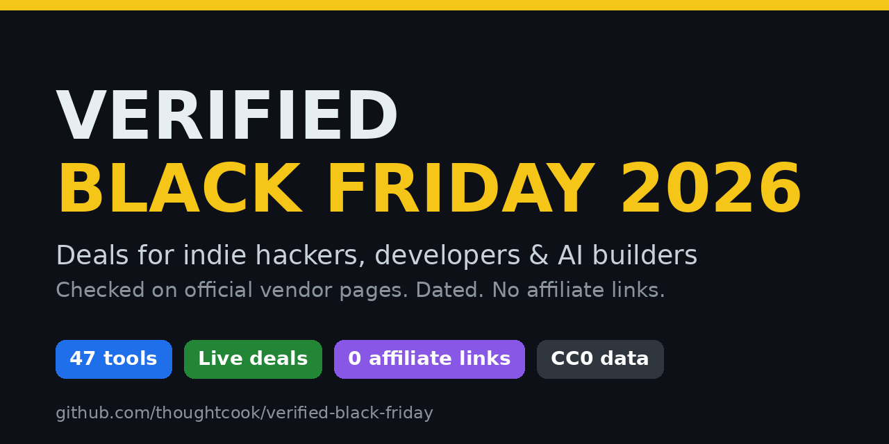

# 🧾 Verified Black Friday 2026 Deals

**Black Friday 2026 deals and Cyber Monday 2026 deals for indie hackers, developers and AI builders, where every price is checked on the vendor's own page and dated.**

**[🌐 Browse & filter the deals](https://thoughtcook.github.io/verified-black-friday/)** · **[📦 JSON](data/deals.json)** · **[📄 CSV](data/deals.csv)** · **[➕ Submit a deal](https://github.com/thoughtcook/verified-black-friday/issues/new?template=submit-deal.yml)**

> **No invented prices. No affiliate links. No 2025 deals dressed up as new.** If we couldn't confirm a deal, the list says so.
>
> ⭐ **Star this repo to get notified.** Deals are rechecked daily from Oct 21 through Dec 2, with full rechecks every Monday and Thursday and every day from Nov 20.

## Contents
[Top 5 picks](#-top-5-picks) · [Key dates](#-key-dates) · [Best live deals](#-best-live-deals-right-now) · [Stack builders](#-stack-builders) · [Legend](#legend) · [By category](#deals-by-category) · [Myth-busting](#-myth-busting) · [How we verify](#-how-we-verify) · [FAQ](#-faq) · [Contributing](#-contributing) · [Changelog](CHANGELOG.md)

## 🏆 Top 5 picks
_Savings are worked out only from prices shown on the linked official page (checked 2026-11-10)._

| # | Deal | Price | Saving | Why it's here |
|---|---|---|---|---|
| 1 | [Smooth Recorder](https://www.smoothrecorder.com) | $19 one-time | $30 off $49 (~61%) | Mac screen recorder, lifetime licence, limited to 100 buyers |
| 2 | [Proton VPN](https://protonvpn.com/black-friday) | $2.99/mo (1-yr, $35.88 first year) | 70% off (official /black-friday) | Official Black Friday page is live |
| 3 | [Hostinger](https://www.hostinger.com/black-friday) | Hosting from $1.99/mo · VPS from $6.49/mo · .com $0.01 | Up to 85% off hosting | Ends Dec 14, 2026 |
| 4 | [Proton Pass](https://proton.me/pass/black-friday) | Pass Plus $1.99/mo ($23.88 first year) | 60% off first year | Official Black Friday page is live |
| 5 | [SpaceWise](https://www.spacewisemac.in/pricing) | $3.99 lifetime (code DIWALI50) | $4 off $7.99 (50%) | Diwali promo through Nov 11, 2026 (not BF-labelled) |

## ⏰ Key dates
| Date (2026) | What happens |
|---|---|
| Oct 20 | First full verification ✅ |
| Oct 21 to Dec 2 | Daily rechecks (full rechecks on Mondays and Thursdays) |
| Nov 11 | SpaceWise Diwali $3.99 promo ends |
| Nov 20 to Dec 2 | Full recheck every day |
| **Nov 27** | **Black Friday** |
| **Nov 30** | **Cyber Monday** |
| Dec 14 | Hostinger sale ends (latest end date published so far) |

A live countdown is on the [website](https://thoughtcook.github.io/verified-black-friday/).

## ⭐ Best live deals right now
_Live or Early only, with deals that publish an end date listed first. Unverified deals never appear here._

| Service | Deal | Dates | Ends | Status | Link | Checked |
|---|---|---|---|---|---|---|
| **Rank Math PRO** | Official /offer (Nov 10 morning): still PRO Anniversary Sale up to 40% OFF (not BF-labelled). Countdown still 2026-11-10 16:00:00 with no timezone. Previously $8.99 visible; a $5.59 sale figure was not in readable HTML this run, so not recorded. Recheck after the countdown stamp. | Anniversary sale live Nov 6 2026; page countdown to 2026-11-10 16:00:00 (tz not stated) | 2026-11-10 | 🟢 Live | [official](https://rankmath.com/offer/) | 2026-11-10 |
| **SpaceWise 2.0 (Mac)** | Official /pricing (Nov 10): Diwali sale still live (not BF-labelled). Lifetime Pro $3.99 (was $7.99), code DIWALI50; offer valid till Nov 11, 2026. | Through Nov 11 2026 (Diwali promo; not BF) | 2026-11-11 | 🟢 Live | [official](https://www.spacewisemac.in/pricing) | 2026-11-10 |
| **Picmal (Mac design/export tool)** | Official /pricing (Nov 9): Black Friday LIVE. Script startsAt 2026-11-07T00:00:00Z endsAt 2026-11-24T08:00:00Z; code BLACKFRIDAY applied (data-offer). 1 Mac $29→$14.50 (printed). 2/5/10 Mac list $39/$89/$149; offer-on copy says 2 Macs is $5 more than the $14.50 1-Mac price. data-tiers attribute also lists offerPrice $14.50/$19.50/$44.50/$74.50 (read from HTML this run). Marketing bar still says 50% off until 30 November — script endsAt Nov 24 08:00Z is authoritative. | Nov 7 – Nov 24 2026 (script window) | 2026-11-24 | 🟢 Live | [official](https://picmal.app/pricing) | 2026-11-10 |
| **Rapid Indexer** | Official homepage (Nov 3): BF top-up credit bonuses +20% all / +30% on $100+ / +40% on $1,000+ (credits never expire). Through 27 Nov 2026 23:59 UTC. | Through 27 Nov 2026 23:59 UTC | 2026-11-27 | 🟢 Live | [official](https://rapid-indexer.com/) | 2026-11-10 |
| **WP Rocket** | Official /black-friday-2026 and /pricing (Nov 10): LIVE BF. 1-year 40% off code black-friday; 3-year 60% off code black-friday-3y; first-time purchase, renews at regular price. dataLayer list−discount: 1-yr Single $35.97; Plus $71.97; Multi 50 $179.97. 3-yr Single $70.36; Plus $140.92; Multi 50 $352.60. Also Multi 100 1-yr $239.97 / 3-yr $467.51; Multi 500 1-yr $359.97 / 3-yr $705.40. Countdown data-date=2026-11-28; some CTA copy says November 27. | BF live Nov 10 2026; countdown to Nov 28 2026 (some copy says Nov 27) | 2026-11-28 | 🟢 Live | [official](https://wp-rocket.me/black-friday-2026/) | 2026-11-10 |
| **Vogoo AI** | Official /black-friday (Nov 5): LIVE — 40% off yearly plans with code BLACKFRIDAY. Lite $6.45/mo (reg $10.75); Pro $7.47/mo / $89.64 billed yearly (reg $12.45/$149.40). Monthly/credit packs excluded. Auto dates 00:00 UTC Nov 3 – 23:59 UTC Nov 30 2026. | Nov 3 – Nov 30 2026 UTC (live) | 2026-11-30 | 🟢 Live | [official](https://vogoo.ai/black-friday) | 2026-11-10 |
| **Kavel (AI image/video)** | Official pricing banner (Nov 3): 'EARLY BLACK FRIDAY' 2x credits on every new plan (first month on monthly, whole first year on yearly), normal price, no code. Starter $100/yr ($8.33/mo). Ends December 1. | Live Oct 2026 - Dec 1 2026 | 2026-12-01 | 🟢 Live | [official](https://www.kavel.ai/pricing) | 2026-11-10 |
| **Wins (Mac window manager)** | Official wins.cool (Nov 7): Black Friday code BF_26 40%; Single $11.99 / Pro $23.99 / X $29.99. Ends Dec 1 2026. | Nov 1 – Dec 1 2026 | 2026-12-01 | 🟢 Live | [official](https://wins.cool/) | 2026-11-09 |
| **Fluent (Mac AI assistant)** | Official fluentmac.app/buy?discount_code=BF2026 (Nov 5): Black Friday 25% code BF2026 until Dec 1. Basic $49→$36.75; Standard $69→$51.75; Team $29→$21.75/seat. Discounted prices visible with code on buy page. | Until Dec 1 2026 | 2026-12-01 | 🟢 Live | [official](https://fluentmac.app/buy?discount_code=BF2026) | 2026-11-09 |
| **NeoTiler (Mac)** | Official getneotiler.com (Nov 3): Black Friday Special 30% OFF lifetime — $6.99 (was $9.99), code BF30, priceValidUntil Dec 1 2026. One-time; up to 3 Macs. | Through Dec 1 2026 | 2026-12-01 | 🟢 Live | [official](https://getneotiler.com) | 2026-11-09 |
| **Compresto (Mac)** | Official compresto.app (Nov 6): Black Friday 40% off all plans with code BFCM26. Personal lifetime $49→$29.40; Standard lifetime page $69→$41.40 with code; subscriptions first payment 40% off. Through Dec 1 2026 (blog + pricing banner). | Nov 2 – Dec 1 2026 | 2026-12-01 | 🟢 Live | [official](https://compresto.app/pricing) | 2026-11-09 |
| **Omnisend** | Official /bfcm/ (Nov 9): still 30% off first 3 months, code BLACK-FRIDAY-2026, through Dec 1 2026. Page now has conflicting eligibility: one line says exclusively for former paying customers now on the Free plan; another (and window.__OTE_OVERRIDES__) says valid for new customers and Free plan users upgrading to a paid plan. Free migration ≤5 days. | Until Dec 1 2026; eligibility copy conflicts | 2026-12-01 | 🟢 Live | [official](https://www.omnisend.com/bfcm/) | 2026-11-10 |
| **SciFig** | Official /black-friday (Nov 3): Extra 20% off new subscription first month/year + upgrades/credit packs (auto, no code). Example Starter $80 first year (renews $100/yr). Page claims up to 52% total vs 12× monthly on Pro annual first year. | Through 1 Dec 2026 23:59 PT | 2026-12-01 | 🟢 Live | [official](https://scifig.ai/black-friday) | 2026-11-10 |
| **AppsByMo (Mac suite)** | Official homepage + content.js (Nov 10): LIVE. Script window start=2026-11-08T21:00:00Z end=2026-12-02T08:00:00Z. Code BLACKFRIDAY; 50% off every paid app; App Store prices halved. Static HTML still shows the pre-JS “upcoming” default — theme.js uses the script dates, which have already started. Individual app sale prices are in content.js; not restated here as invented 50% totals. | Nov 8 21:00 UTC – Dec 2 08:00 UTC (script; copy says 9 Nov – 1 Dec) | 2026-12-02 | 🟢 Live | [official](https://appsbymo.app/) | 2026-11-10 |
| **Bimg AI** | Official /black-friday (Nov 5): 50% off first month (monthly), or 50% off first year and every annual renewal. Campaign Nov 3 – Dec 3 2026. Choose plan on pricing page; confirm discount at checkout. | Nov 3 – Dec 3 2026 | 2026-12-03 | 🟢 Live | [official](https://bimg.ai/black-friday) | 2026-11-10 |
| **Internxt** | Official blog (Nov 2) + /black-friday (Nov 5): 87% off; from €1.29/mo 1TB; lifetime from €247. Sale ends Dec 3 2026; discount auto at checkout. Plan $ cards on sale page still JS-opaque — euro figures from official blog.internxt.com/black-friday-deals/. | Sale ends Dec 3 2026 | 2026-12-03 | 🟢 Live | [official](https://internxt.com/black-friday) | 2026-11-10 |
| **Deepvue** | Official /black-friday-2026 (Nov 3): Core + Journal $490/yr (was $990) still. Masterclass VIP join-by Nov 12 2026 11:59 PM ET; $490 lock to Dec 4 2026 11:59 PM ET. | Live Oct 2026; $490 lock to Dec 4 2026; masterclasses bonus to Nov 12 2026 | 2026-12-04 | 🟢 Live | [official](https://deepvue.com/black-friday-2026/) | 2026-11-10 |
| **Later (social scheduling)** | Official /black-friday-sale (Nov 5): 6 months free on new annual Growth or Scale (3 mo already in annual + 3 via code LATERBF26). Growth shown $37.50/mo billed yearly. New customers only; web checkout not iOS; no renewals/upgrades/monthly. | Nov 1 – Dec 4 2026 | 2026-12-04 | 🟢 Live | [official](https://later.com/black-friday-sale/) | 2026-11-10 |
| **Tidio Lyro AI** | Official /black-friday (Nov 3): Early BF — Lyro AI Agent monthly $1 for first 2 months (e.g. 50 conversations plan was $78→$1). Promo codes BFCM50…BFCM1000 by quota. Offer expires December 5. | Early BF live; through Dec 5 2026 | 2026-12-05 | 🟢 Live | [official](https://www.tidio.com/black-friday/) | 2026-11-10 |
| **CloudLinux / Imunify360** | Official Imunify homepage + imunify360.com/imunify360-pricing/ and cloudlinux.com/pricing + /deals (Nov 10): now visually LIVE. CSS flipped to show the BF heroes (original heroes hidden). Imunify yearly 40%: Single $144→$86.40/yr; 30 users $300→$180; 250 $420→$252; Unlimited $540→$324. CloudLinux yearly (new partner accounts): 1 Hosting Account from $63.00/server/yr (1 server 25% / 2–4 $54.00 / 5–49 $42.00 30% / 50+ $33.60 30%); 5 Hosting Accounts from $108.00 (2–4 $90.00 / 5–49 $75.60 / 50+ $58.80); Unlimited from $162.00 (2–4 $144.00 / 5–49 $117.60 / 50+ $109.20). Footnote: new partner accounts only; upfront yearly; renewals revert; until Dec 5, 2026. Official X still said through Nov 30. No coupon code. | Visually live Nov 10 2026; footnote until Dec 5 2026 (official X had said Nov 30) | 2026-12-05 | 🟢 Live | [official](https://www.imunify360.com/) | 2026-11-10 |
| **Cloudways** | Official promo-code.php (Nov 7): 80% off first 2 months, code BFCM802; Flexible $11→$2.2/mo; Autonomous $20→$4/mo; new customers. Hellobar Dec 6 2026 13:00. | BF live Nov 2026 | 2026-12-06 | 🟢 Live | [official](https://www.cloudways.com/en/promo-code.php) | 2026-11-10 |
| **HostPapa** | Official /deals (Nov 5): Black Friday — Web/WordPress hosting from $1.25/mo; VPS from $2.95/mo; Dedicated from $47.96/mo; up to 90% off; no code (auto in cart). New customers first term (e.g. Essentials 3-yr renews $7.29/mo). Offer valid until Dec 7, 2026 11:59pm EST. | BF live Nov 2026; ends Dec 7 2026 11:59pm EST | 2026-12-07 | 🟢 Live | [official](https://www.hostpapa.com/deals/) | 2026-11-10 |
| **NordVPN** | Official /black-friday (Nov 7 WebFetch): From $3.49/mo; up to 78% off + 3 mo. Ends Dec 9 2026. FAQ Oct 21–Dec 9 2026. Last year's (2025) BF low $2.99/mo | Oct 21 - Dec 9 2026 | 2026-12-09 | 🟢 Live | [official](https://nordvpn.com/black-friday/) | 2026-11-10 |
| **NordPass** | Official /black-friday (Nov 7 WebFetch): live until Dec 9. FAQ up to 50% OFF annual Personal + 3 extra months. USD cards JS-opaque this run. Business BF20OFF 20%. | Oct 21 - Dec 9 2026 | 2026-12-09 | 🟢 Live | [official](https://nordpass.com/black-friday/) | 2026-11-10 |
| **Hostinger** | Official BF (Nov 7): web hosting from $1.99/mo (85% off); VPS from $6.49/mo (67% off); .com $0.01 1st yr; no code. Oct 19–Dec 14 2026. | Oct 19 - Dec 14 2026 | 2026-12-14 | 🟢 Live | [official](https://www.hostinger.com/black-friday) | 2026-11-10 |
| **Surfshark** | Official pricing (Nov 7): One 'Black Friday deal' $2.49/mo +3 mo ($67.23 first 27 mo); Starter $2.49/mo ($67.23); One+ $3.99/mo ($107.73). Save 90%/83%. | Live by Oct 12 2026; 2025 ran to Dec 1 | not stated | 🟢 Live | [official](https://surfshark.com/pricing) | 2026-11-10 |
| **ExpressVPN** | Official pricing (Nov 7): Black Friday Early Access. 2-yr Basic $2.99/mo +4 mo ($83.72/28 mo); Advanced $4.19 ($117.32); Pro $7.19 ($201.32). Last year's (2025) final week $2.44/mo | Live Oct 2026 | not stated | 🟡 Early | [official](https://www.expressvpn.com/pricing) | 2026-11-10 |
| **Proton VPN** | Official /black-friday (Nov 10): still LIVE BF. VPN Plus 1-yr 70% off → $2.99/mo; billed $35.88 first 12 mo; renews $83.88/12 mo (was $9.99/mo list). Unlimited welcome 92% off $1.00 first month then $12.99/mo. End not stated on /black-friday. /pricing (Nov 10) now defaults to the same 1-yr Plus $2.99/mo ($35.88/12) and Unlimited 50% off $6.49/mo ($77.88/12) with coupon BF2026NEW, but still has no “Black Friday”/“Early” text. Previous standing 2-yr Plus $3.49/mo ($83.76/24) is gone from default SSR (remains only in hydration JSON). | BF live as of Nov 9 2026; end not stated on /black-friday this run | not stated | 🟢 Live | [official](https://protonvpn.com/black-friday) | 2026-11-10 |
| **CyberGhost** | Official (Nov 7): Early Access Sale — BF early. 2yr+4mo $2.19/mo ($61.32/28 mo, 83% off). | Early Access BF Oct–Nov 2026 | not stated | 🟡 Early | [official](https://www.cyberghostvpn.com/) | 2026-11-10 |
| **Private Internet Access** | Official (Nov 7): Early Access Sale — BF savings now. ~$2.03/mo 3yr+4mo; 1yr $3.99/mo. | Early Access BF Oct–Nov 2026 | not stated | 🟡 Early | [official](https://www.privateinternetaccess.com/buy-vpn-online) | 2026-11-10 |
| **IPVanish** | Official /black-friday (Nov 7): from $2.19/mo. 2-yr Essential $2.19; Complete $2.79. | BF live by Oct 16 2026 | not stated | 🟢 Live | [official](https://www.ipvanish.com/black-friday/) | 2026-11-10 |
| **PureVPN** | Official /black-friday (Nov 7): 5-yr Standard $1.69/mo ($101.55, 87% off). | BF live Oct 2026 | not stated | 🟢 Live | [official](https://www.purevpn.com/black-friday) | 2026-11-10 |
| **SiteGround** | Official Early Black Friday (Nov 7): StartUp $1.99/mo (88%, renews $17.99); GrowBig $3.99 (86%, renews $29.99); GoGeek $5.99 (86%, renews $44.99); prepaid 12 mo. | Early BF live as of Nov 6 2026 | not stated | 🟡 Early | [official](https://www.siteground.com/web-hosting.htm) | 2026-11-07 |
| **Sintra AI** | Official pricing sale (Nov 3; not BF-labelled): 1-mo Save 50% $48.50/mo (was $97); 3-mo Save 60% $23.60/mo (was $59); 12-mo Save 70% $15.60/mo (was $52). 250 credits/mo; 14-day money-back | Live by Oct 30 2026; end not stated on page | not stated | 🟢 Live | [official](https://sintra.ai/pricing) | 2026-11-10 |
| **Scalenut** | Official pricing (Nov 7): BF Early Access 65% off annual + 3X limits. Starter $21/mo (was $59); Plus $31 (was $89); Professional $70 (was $199); billed annually. Monthly full price. | BF Early Access live as of Nov 6 2026 | not stated | 🟢 Live | [official](https://scalenut.com/pricing) | 2026-11-10 |
| **1Password** | Official personal pricing (Nov 7): new customers first-year annual — Individual $2.99/mo (reg $3.99), Families $4.49/mo (reg $5.99), ~25% off. Not BF-labelled. Last year's (2025) 50% off annual | Oct 2026 | not stated | 🟡 Early | [official](https://1password.com/pricing/password-manager) | 2026-11-10 |
| **Proton Pass** | Official /pass/black-friday (Nov 7): Pass Plus 60% off — $1.99/mo, billed $23.88 first 12 mo, renews $35.88/yr; Pass Family 60% — billed $33.48 first 12 mo, renews $59.88/yr (up to 6); Unlimited cross-sell 50% — $6.49/mo, billed $77.88 first 12 mo, renews $119.88/yr. New users; existing unlock via account. | BF live as of Nov 7 2026; end not stated on Pass BF page | not stated | 🟢 Live | [official](https://proton.me/pass/black-friday) | 2026-11-10 |
| **Skylum Luminar (photo editor)** | Official skylum.com/luminar pricing (Nov 3): Black Friday banner up to 77% off. Perpetual: All Platforms $139 (was $477); Max $159 (was $546). One-time. End not stated | Black Friday offer live Oct 24 2026; end not stated | not stated | 🟢 Live | [official](https://skylum.com/luminar/pricing) | 2026-11-09 |
| **Smooth Recorder (Mac)** | Official site (Nov 3): $19 one-time lifetime instead of $49 (next 100 buyers; first 100 at $9 all claimed). Still live. | Oct 2026 | not stated | 🟢 Live | [official](https://www.smoothrecorder.com) | 2026-11-09 |
| **Pictory** | Official /pricing/ (Nov 10): LIVE Black Friday Offer on Professional annual — $29.50/month billed annually (was $59), code BLACKFRIDAY2026. End date not stated on the pricing page. | BF live as of Nov 10 2026; end not stated on official /pricing/ | not stated | 🟢 Live | [official](https://pictory.ai/pricing/) | 2026-11-10 |
| **CapCut (Desktop)** | Official CapCut Black Friday sale (Nov 7): first month $3.99 or less monthly; PC only; new/expiring/lapsed. Prices vary by region. | BF live Nov 2026 | not stated | 🟢 Live | [official](https://www.capcut.com/tools/capcut-black-friday-sale) | 2026-11-10 |
| **Cliproxy (static ISP / residential proxies)** | Official cliproxy.com (Nov 7): residential from $0.58/GB; Dynamic from $0.72/GB; Static from $3.00/mo. No live BF label. | Promo-tier seen Oct 23 2026 | not stated | 🟡 Early | [official](https://cliproxy.com/) | 2026-11-10 |
| **Shotomatic** | 40% off lifetime with code BF2026: 1 Mac $23.40 (was $39); up to 3 Macs $65.40 (was $109). One-time; subscriptions excluded; before tax. Official pricing with discount_code (not affiliate). End not stated. Rechecked Nov 3. | Live since Oct 18 2026; coupon no stated end | not stated | 🟢 Live | [official](https://www.shotomatic.com/pricing?discount_code=BF2026) | 2026-11-09 |
| **Cutfac (Mac AI short-form)** | Official /pricing (Nov 3): now Black Friday-labelled; BF2026 applied at checkout 40% off one-time: 1 Mac $29.40 (was $49); 3 Macs $41.40 (was $69); 5 Macs $59.40 (was $99). One-time + 1 yr updates. | BF2026 live Nov 3 2026; end not stated on page | not stated | 🟢 Live | [official](https://cutfac.com/pricing) | 2026-11-09 |
| **Codexpert / EasyCommerce** | Official codexpert.io/coupon + easycommerce.dev/pricing (Nov 3): BFCM up to 70% off Codexpert products until Cyber Monday ends. EasyCommerce Pro Personal yearly $59.70 (was $199); Professional $149.70 (was $499); Agency $239.70 (was $799); coupon BFCM26. | Live Nov 2026 through Cyber Monday (countdown on coupon page) | not stated | 🟢 Live | [official](https://codexpert.io/coupon/) | 2026-11-10 |
| **Sender** | Official pricing (Nov 7): Black Friday — 60% on 24-month (40% Standard / 60% Professional) or 30% on 12-month; first-time users; no code. | BF live as of Nov 6 2026 | not stated | 🟢 Live | [official](https://www.sender.net/pricing/) | 2026-11-10 |
| **Systeme.io** | Vendor subdomain blackfriday.systeme.io (Nov 3): BF/CM yearly deals — Startup Plan $170/year (~$14.17/mo, ~40% claim); Webinar & Unlimited on discounted yearly (exact $ not clear). No coupon. | BF/CM 2026 landing live Nov 2; week countdown on page | not stated | 🟢 Live | [official](https://blackfriday.systeme.io) | 2026-11-10 |
| **Perch (Mac coding-agent menu bar)** | Official perch.run/black-friday (Nov 3): Lifetime licence $17.40 (was $29), 40% off, code BLACKFRIDAY2026; first 500 orders; team seats same $17.40. Also Perch Pro iPhone $29/yr (was $49) until Dec 1, no code. | 2 Nov – 1 Dec 2026 PT or until first 500 orders | not stated | 🟢 Live | [official](https://perch.run/black-friday) | 2026-11-09 |
| **Growave (Shopify loyalty)** | Official /bfcm-deals (Nov 3): Growth $159/mo (was $199) lifetime 20% for new + upgrades to Growth; auto at checkout. Through 1 Dec 2026 23:59 ET. | Through 1 Dec 2026 23:59 ET | not stated | 🟢 Live | [official](https://www.growave.io/bfcm-deals) | 2026-11-10 |
| **PastePal (Indie Goodies)** | Official Indie Goodies BF page (Nov 3): 50% lifetime $7.49 (was $14.99), code INDIEGOODIESBF26. End date not stated on page. | BF listing live Nov 3 2026; end not stated on page | not stated | 🟢 Live | [official](https://indiegoodies.com/blackfriday) | 2026-11-09 |
| **Almighty (Indie Goodies)** | Official Indie Goodies BF page (Nov 3): 50% lifetime $7.49 (was $14.99), code INDIEGOODIESBF26. End date not stated on page. | BF listing live Nov 3 2026; end not stated on page | not stated | 🟢 Live | [official](https://indiegoodies.com/blackfriday) | 2026-11-09 |
| **BearConnect (LinkedIn automation)** | Official home + /pricing (Nov 8): banner “Black Friday: 50% Off for 6 Months” code 50OFFBC. List: Starter $56 / LinkedIn account / month billed annually ($670/year per account); Growth $237/month for 5 LinkedIn accounts billed annually (additional accounts $47/month each). Discounted totals after 50% not printed. End date not stated. | BF live as of Nov 8 2026; end not stated | not stated | 🟢 Live | [official](https://bearconnect.io/pricing/) | 2026-11-09 |

## 🧱 Stack builders
Bundles built only from the verified live deals above.

| Stack | Pieces | Verified prices |
|---|---|---|
| 🚀 **Indie launch stack** | Hostinger web hosting + .com domain + business email | from $2.49/mo (48 mo) + $0.01 first year |
| 🛰️ **Indie VPS stack** | Hostinger VPS + Proton VPN Plus | from $6.49/mo + $2.99/mo (2-yr) |
| 🎙️ **AI creator stack** | ElevenLabs Starter ($1 first mo to Nov 1) or Creator ($11) + Smooth Recorder | from $1 first month + $19 one-time |
| 🍎 **Mac dev cleanup stack** | SpaceWise Pro + Smooth Recorder | $3.99 + $19 = $22.99 one-time |
| 🔒 **Cheapest 2-yr privacy** | Private Internet Access or CyberGhost | $56.94 for 2 yr + 2 mo ($2.19/mo) |

## Legend
| Badge | Meaning |
|---|---|
| 🟢 Live | The 2026 Black Friday or Cyber Monday deal is live |
| 🟡 Early | An early 2026 deal is live; the main sale could be better |
| ⚪ Not yet | No 2026 deal yet. Any price shown is **last year's (2025)**, for reference only |
| 🟠 Unverified | Reported by a third party but **not** shown on the official page |
| ⛔ Never discounts | The vendor says it doesn't run seasonal sales |

`official` = the vendor's own page · `report` = a dated third-party article or post, upgraded once the vendor page confirms it.

## Deals by category

### 🤖 AI tools

| Service | Deal | Dates | Ends | Status | Link | Checked |
|---|---|---|---|---|---|---|
| **ElevenLabs** | Official pricing (Nov 9): no Black Friday label. Starter $1 card still present with an expired timer (Starter first-month ended Nov 1). Creator $11 first-month still shown. Watching for BF. | Starter ended Nov 1 2026; Creator first-month may still display | not stated | ⚪ Not yet | [official](https://elevenlabs.io/pricing) | 2026-11-10 |
| **Sintra AI** | Official pricing sale (Nov 3; not BF-labelled): 1-mo Save 50% $48.50/mo (was $97); 3-mo Save 60% $23.60/mo (was $59); 12-mo Save 70% $15.60/mo (was $52). 250 credits/mo; 14-day money-back | Live by Oct 30 2026; end not stated on page | not stated | 🟢 Live | [official](https://sintra.ai/pricing) | 2026-11-10 |
| **Scalenut** | Official pricing (Nov 7): BF Early Access 65% off annual + 3X limits. Starter $21/mo (was $59); Plus $31 (was $89); Professional $70 (was $199); billed annually. Monthly full price. | BF Early Access live as of Nov 6 2026 | not stated | 🟢 Live | [official](https://scalenut.com/pricing) | 2026-11-10 |
| **Cursor** | Official cursor.com/pricing (Nov 7): no BF promo. Last year's (2025) 20% off annual Pro + $100 credit | Last year's (2025): to Dec 1 2025 | not stated | ⚪ Not yet | [official](https://cursor.com/pricing) | 2026-11-10 |
| **Midjourney** | Official plans page (Nov 3 WebFetch; curl 403): no BF promo; standing 20% off annual: Basic $10/mo or $96/yr, Standard $30 or $288, Pro $60 or $576, Mega $120 or $1,152. Last year's (2025) 20% off annual Standard | to Dec 1 2025 | not stated | ⚪ Not yet | [official](https://docs.midjourney.com/hc/en-us/articles/27870484040333-Comparing-Midjourney-Plans) | 2026-11-10 |
| **Jasper** | Official jasper.ai/pricing (Nov 9): no BF. Pro $59/month billed yearly or $69/month billed monthly. Last year's (2025) 40% off annual + 300k bonus words | Last year's (2025): to Dec 1 2025 | not stated | ⚪ Not yet | [official](https://www.jasper.ai/pricing) | 2026-11-10 |
| **Descript** | Official descript.com/pricing (Nov 9): no BF. Paid plans from $16/month. Last year's (2025) Annual Creator/Business: +1,000 AI credits +10 media hours | Last year's (2025): Nov 2025 | not stated | ⚪ Not yet | [official](https://www.descript.com/pricing) | 2026-11-10 |
| **Perplexity** | NOT RECHECKED Oct 22 (perplexity.ai 403 via curl, WebFetch timed out twice). Last year's (2025) Pro 50% off via PayPal; 1 mo free Pro with Comet | Nov 2025 | not stated | ⚪ Not yet | [report](https://jenlehner.com/blog-content/black-friday-2025) | 2026-11-06 |
| **Grammarly** | Official grammarly.com/plans (Nov 9): no BF. Visible $12 USD; embedded subscription JSON monthly regularPrice 30.0 / quarterly 60.0 / annual 144.0 (price equals regularPrice — no discount field). Last year's (2025) ~50% off Pro annual | Last year's (2025): Nov 2025 | not stated | ⚪ Not yet | [official](https://www.grammarly.com/plans) | 2026-11-10 |
| **ChatGPT / Claude** | Claude official anthropic.com/pricing (Oct 29): Pro $17/mo annual ($200) or $20 monthly; Max from $100/mo; no BF. ChatGPT pricing NOT RECHECKED (403 / JS challenge) |  | not stated | ⚪ Not yet | — | 2026-11-10 |
| **Grok (SuperGrok)** | Official x.ai/pricing (Nov 3): Free $0; Plus $8/mo; Premium $30/mo; Super $100/mo; Ultra $200/mo; Teams $30+/user/mo. Monthly. No BF. Keep separate from classic X Premium help doc. | Check Nov 16 / 24 | not stated | ⚪ Not yet | [official](https://x.ai/pricing) | 2026-11-10 |
| **HeyGen** | Official pricing (Nov 9): no BF. Creator $29/mo (or $24/mo annual); Pro starts at $49/mo; Business $149/mo plus $20/seat/mo. Hidden countdown dates 2026-08-11 to 2026-08-12 are expired leftovers. | Check Nov 16 / 24 | not stated | ⚪ Not yet | [official](https://www.heygen.com/pricing) | 2026-11-10 |
| **Pictory** | Official /pricing/ (Nov 10): LIVE Black Friday Offer on Professional annual — $29.50/month billed annually (was $59), code BLACKFRIDAY2026. End date not stated on the pricing page. | BF live as of Nov 10 2026; end not stated on official /pricing/ | not stated | 🟢 Live | [official](https://pictory.ai/pricing/) | 2026-11-10 |
| **Typeless (AI voice dictation)** | Official /pricing (Nov 6): Free $0; Pro $12 USD/member/mo billed yearly, $30 monthly. No live BF (student strings only; Last year's (2025) BF i18n remnants). | Check Nov 16 / 24 | not stated | ⚪ Not yet | [official](https://www.typeless.com/pricing) | 2026-11-10 |
| **CapCut (Desktop)** | Official CapCut Black Friday sale (Nov 7): first month $3.99 or less monthly; PC only; new/expiring/lapsed. Prices vary by region. | BF live Nov 2026 | not stated | 🟢 Live | [official](https://www.capcut.com/tools/capcut-black-friday-sale) | 2026-11-10 |
| **Dreamina (CapCut AI)** | Official FAQ (Nov 3): membership campaign ran Oct 21–30 2026 ($0.29 Basic first month then $15/mo) — ENDED. Prefer FAQ over any residual homepage banner. Demoted from Live. | Membership ended Oct 30 2026 | 2026-10-30 | ⚪ Not yet | [official](https://dreamina.capcut.com/ai-video/dreamina-october-offer-faq-2026) | 2026-11-10 |
| **Kavel (AI image/video)** | Official pricing banner (Nov 3): 'EARLY BLACK FRIDAY' 2x credits on every new plan (first month on monthly, whole first year on yearly), normal price, no code. Starter $100/yr ($8.33/mo). Ends December 1. | Live Oct 2026 - Dec 1 2026 | 2026-12-01 | 🟢 Live | [official](https://www.kavel.ai/pricing) | 2026-11-10 |
| **Runway** | Official pricing (Nov 3): no Black Friday label. Standing annual (~20% off). Kling 4.0 generations 25% off until Nov 30 (product promo, not full BF). Watching for BF | Check Nov 16 / 24; Kling 4.0 25% off gens to Nov 30 | not stated | ⚪ Not yet | [official](https://runway.com/pricing) | 2026-11-10 |
| **Lovable** | Official pricing + docs (Nov 3): no BF keywords. Price cards JS-opaque this run; docs still describe Pro/Business + student discount. Watching | Check Nov 16 / 24 | not stated | ⚪ Not yet | [official](https://lovable.dev/pricing) | 2026-11-10 |
| **Wispr Flow (AI voice dictation)** | Official pricing (Nov 3): no BF. Free; Pro $15/user/mo or $12 annual; edu 50% off. Watching | Check Nov 16 / 24 | not stated | ⚪ Not yet | [official](https://wisprflow.ai/pricing) | 2026-11-10 |
| **Replit** | Official pricing (Nov 3): Core $20/mo ($18 annual); Pro $100/mo ($90 annual). Annual only, no BF. Watching | Check Nov 16 / 24 | not stated | ⚪ Not yet | [official](https://replit.com/pricing) | 2026-11-10 |
| **Google AI Pro (Gemini / Google One)** | Official Google AI plans page (Nov 3; JP locale HTML this fetch): Plus/Pro/Ultra present; no BF keywords. Watching | Check Nov 16 / 24 | not stated | ⚪ Not yet | [official](https://one.google.com/about/google-ai-plans/) | 2026-11-10 |
| **Gamma (AI decks)** | Official gamma.app/pricing (Oct 29): Cloudflare blocked price cards — dollars not re-verified. Tiers Free/Plus/Pro/Ultra/Business. No BF confirmed. Watching | Check Nov 3 / 16 / 24 | not stated | ⚪ Not yet | [official](https://gamma.app/pricing) | 2026-11-06 |
| **Higgsfield (AI video)** | Official /pricing (Oct 29 JS); official blog Oct 24: Starter $15/mo, Plus $49, Ultra $129; Team $79/seat, Scale $215/seat. No BF label. Watching | Check Nov 3 / 16 / 24 | not stated | ⚪ Not yet | [official](https://higgsfield.ai/pricing) | 2026-11-10 |
| **Manus (AI agent)** | Official /pricing + help.manus.im membership (Oct 29): Free $0; Pro from $20/mo (4k credits) / $40/mo (8k); Team from $20/seat/mo; annual ~17% off. No BF. Watching | Check Nov 3 / 16 / 24 | not stated | ⚪ Not yet | [official](https://manus.im/pricing) | 2026-11-10 |
| **Factory AI** | Official factory.ai/pricing (Nov 3): no BF/CM 2026 label. Standing Pro $20/mo, Plus $100/mo, Max $200/mo. No BF. | Check Nov 16 / 24 | not stated | ⚪ Not yet | [official](https://factory.ai/pricing) | 2026-11-10 |
| **Creatune** | ANNOUNCED official /black-friday (Nov 7): 30% off first year annual plans from Nov 20. Basic $83.16; Pro $167.16; Max $335.16. Auto at checkout. | Goes live Nov 20 – Dec 1 2026 (Pacific) | 2026-12-01 | ⚪ Not yet | [official](https://creatune.ai/black-friday) | 2026-11-10 |
| **Tidio Lyro AI** | Official /black-friday (Nov 3): Early BF — Lyro AI Agent monthly $1 for first 2 months (e.g. 50 conversations plan was $78→$1). Promo codes BFCM50…BFCM1000 by quota. Offer expires December 5. | Early BF live; through Dec 5 2026 | 2026-12-05 | 🟢 Live | [official](https://www.tidio.com/black-friday/) | 2026-11-10 |
| **Vogoo AI** | Official /black-friday (Nov 5): LIVE — 40% off yearly plans with code BLACKFRIDAY. Lite $6.45/mo (reg $10.75); Pro $7.47/mo / $89.64 billed yearly (reg $12.45/$149.40). Monthly/credit packs excluded. Auto dates 00:00 UTC Nov 3 – 23:59 UTC Nov 30 2026. | Nov 3 – Nov 30 2026 UTC (live) | 2026-11-30 | 🟢 Live | [official](https://vogoo.ai/black-friday) | 2026-11-10 |
| **SciFig** | Official /black-friday (Nov 3): Extra 20% off new subscription first month/year + upgrades/credit packs (auto, no code). Example Starter $80 first year (renews $100/yr). Page claims up to 52% total vs 12× monthly on Pro annual first year. | Through 1 Dec 2026 23:59 PT | 2026-12-01 | 🟢 Live | [official](https://scifig.ai/black-friday) | 2026-11-10 |
| **Bimg AI** | Official /black-friday (Nov 5): 50% off first month (monthly), or 50% off first year and every annual renewal. Campaign Nov 3 – Dec 3 2026. Choose plan on pricing page; confirm discount at checkout. | Nov 3 – Dec 3 2026 | 2026-12-03 | 🟢 Live | [official](https://bimg.ai/black-friday) | 2026-11-10 |

### 🔒 VPN

| Service | Deal | Dates | Ends | Status | Link | Checked |
|---|---|---|---|---|---|---|
| **Surfshark** | Official pricing (Nov 7): One 'Black Friday deal' $2.49/mo +3 mo ($67.23 first 27 mo); Starter $2.49/mo ($67.23); One+ $3.99/mo ($107.73). Save 90%/83%. | Live by Oct 12 2026; 2025 ran to Dec 1 | not stated | 🟢 Live | [official](https://surfshark.com/pricing) | 2026-11-10 |
| **NordVPN** | Official /black-friday (Nov 7 WebFetch): From $3.49/mo; up to 78% off + 3 mo. Ends Dec 9 2026. FAQ Oct 21–Dec 9 2026. Last year's (2025) BF low $2.99/mo | Oct 21 - Dec 9 2026 | 2026-12-09 | 🟢 Live | [official](https://nordvpn.com/black-friday/) | 2026-11-10 |
| **ExpressVPN** | Official pricing (Nov 7): Black Friday Early Access. 2-yr Basic $2.99/mo +4 mo ($83.72/28 mo); Advanced $4.19 ($117.32); Pro $7.19 ($201.32). Last year's (2025) final week $2.44/mo | Live Oct 2026 | not stated | 🟡 Early | [official](https://www.expressvpn.com/pricing) | 2026-11-10 |
| **Proton VPN** | Official /black-friday (Nov 10): still LIVE BF. VPN Plus 1-yr 70% off → $2.99/mo; billed $35.88 first 12 mo; renews $83.88/12 mo (was $9.99/mo list). Unlimited welcome 92% off $1.00 first month then $12.99/mo. End not stated on /black-friday. /pricing (Nov 10) now defaults to the same 1-yr Plus $2.99/mo ($35.88/12) and Unlimited 50% off $6.49/mo ($77.88/12) with coupon BF2026NEW, but still has no “Black Friday”/“Early” text. Previous standing 2-yr Plus $3.49/mo ($83.76/24) is gone from default SSR (remains only in hydration JSON). | BF live as of Nov 9 2026; end not stated on /black-friday this run | not stated | 🟢 Live | [official](https://protonvpn.com/black-friday) | 2026-11-10 |
| **CyberGhost** | Official (Nov 7): Early Access Sale — BF early. 2yr+4mo $2.19/mo ($61.32/28 mo, 83% off). | Early Access BF Oct–Nov 2026 | not stated | 🟡 Early | [official](https://www.cyberghostvpn.com/) | 2026-11-10 |
| **Private Internet Access** | Official (Nov 7): Early Access Sale — BF savings now. ~$2.03/mo 3yr+4mo; 1yr $3.99/mo. | Early Access BF Oct–Nov 2026 | not stated | 🟡 Early | [official](https://www.privateinternetaccess.com/buy-vpn-online) | 2026-11-10 |
| **Mullvad** | Official pricing (Nov 3): flat ~$5.59 / other FX; page continues to say no lifetime or discounted rates (crypto fee note historically) |  | not stated | ⛔ Never discounts | [official](https://mullvad.net/en/pricing) | 2026-11-10 |
| **IPVanish** | Official /black-friday (Nov 7): from $2.19/mo. 2-yr Essential $2.19; Complete $2.79. | BF live by Oct 16 2026 | not stated | 🟢 Live | [official](https://www.ipvanish.com/black-friday/) | 2026-11-10 |
| **PureVPN** | Official /black-friday (Nov 7): 5-yr Standard $1.69/mo ($101.55, 87% off). | BF live Oct 2026 | not stated | 🟢 Live | [official](https://www.purevpn.com/black-friday) | 2026-11-10 |
| **Cliproxy (static ISP / residential proxies)** | Official cliproxy.com (Nov 7): residential from $0.58/GB; Dynamic from $0.72/GB; Static from $3.00/mo. No live BF label. | Promo-tier seen Oct 23 2026 | not stated | 🟡 Early | [official](https://cliproxy.com/) | 2026-11-10 |

### 🖥️ Hosting & VPS

| Service | Deal | Dates | Ends | Status | Link | Checked |
|---|---|---|---|---|---|---|
| **RackNerd** | Official /blackfriday redirects to /specials (Nov 3): KVM from $21.99/yr etc; dedi code 15OFFDEDI. No 2026 BF pricing. Last year's (2025) ~$10.60/yr | 2025 ref: Nov 2025 | not stated | ⚪ Not yet | [official](https://www.racknerd.com/blackfriday) | 2026-11-10 |
| **BandwagonHost** | Official bandwagonhost.com (Nov 3): live plan prices; HTML only commented-out old BF/11-11 codes (BWH2021BF etc), no live 2026 promo. Last year's (2025) ~19% off | Nov 2025 | not stated | ⚪ Not yet | [official](https://bandwagonhost.com/) | 2026-11-10 |
| **Hostinger** | Official BF (Nov 7): web hosting from $1.99/mo (85% off); VPS from $6.49/mo (67% off); .com $0.01 1st yr; no code. Oct 19–Dec 14 2026. | Oct 19 - Dec 14 2026 | 2026-12-14 | 🟢 Live | [official](https://www.hostinger.com/black-friday) | 2026-11-10 |
| **SiteGround** | Official Early Black Friday (Nov 7): StartUp $1.99/mo (88%, renews $17.99); GrowBig $3.99 (86%, renews $29.99); GoGeek $5.99 (86%, renews $44.99); prepaid 12 mo. | Early BF live as of Nov 6 2026 | not stated | 🟡 Early | [official](https://www.siteground.com/web-hosting.htm) | 2026-11-07 |
| **Cloudways** | Official promo-code.php (Nov 7): 80% off first 2 months, code BFCM802; Flexible $11→$2.2/mo; Autonomous $20→$4/mo; new customers. Hellobar Dec 6 2026 13:00. | BF live Nov 2026 | 2026-12-06 | 🟢 Live | [official](https://www.cloudways.com/en/promo-code.php) | 2026-11-10 |
| **Vultr** | Official /pricing (Nov 3 WebFetch; curl 403): Cloud Compute Regular from $2.50/mo; list prices only, no BF/promo language. Do not use third-party idcspy. Last year's (2025) up to $300 new-user credit | No BF on official pricing Nov 3; 2025 ref Nov 2025 | not stated | ⚪ Not yet | [official](https://www.vultr.com/pricing/) | 2026-11-10 |
| **DigitalOcean / Linode / Hetzner** | Official pricing pages (Oct 29): no BF/promo text on digitalocean.com/pricing, linode.com/pricing (WebFetch), hetzner.com |  | not stated | ⚪ Not yet | — | 2026-11-10 |
| **DMIT** | Official dmit.io /pages/pricing (Nov 10 WebFetch; curl 403 CF): list prices only, no BF/promo banner. Event/black-friday pages not live. Sample LAX.AS3.T1 TINY $6.90/Monthly; WEE $36.90/Annually. Last year's (2025) BF buy-two-get-one Pro + spend cashback is not live. | Last year's (2025) BF typically late Nov; recheck Nov 16 / 24 | not stated | ⚪ Not yet | [official](https://www.dmit.io/pages/pricing) | 2026-11-10 |
| **Railway** | Official pricing (Nov 3): Hobby $5/mo; Pro $20/mo; Free/$1 usage; Trial $5 credit. No BF promo. Watching | Check Nov 16 / 24 | not stated | ⚪ Not yet | [official](https://railway.com/pricing) | 2026-11-10 |
| **HostPapa** | Official /deals (Nov 5): Black Friday — Web/WordPress hosting from $1.25/mo; VPS from $2.95/mo; Dedicated from $47.96/mo; up to 90% off; no code (auto in cart). New customers first term (e.g. Essentials 3-yr renews $7.29/mo). Offer valid until Dec 7, 2026 11:59pm EST. | BF live Nov 2026; ends Dec 7 2026 11:59pm EST | 2026-12-07 | 🟢 Live | [official](https://www.hostpapa.com/deals/) | 2026-11-10 |
| **CloudLinux / Imunify360** | Official Imunify homepage + imunify360.com/imunify360-pricing/ and cloudlinux.com/pricing + /deals (Nov 10): now visually LIVE. CSS flipped to show the BF heroes (original heroes hidden). Imunify yearly 40%: Single $144→$86.40/yr; 30 users $300→$180; 250 $420→$252; Unlimited $540→$324. CloudLinux yearly (new partner accounts): 1 Hosting Account from $63.00/server/yr (1 server 25% / 2–4 $54.00 / 5–49 $42.00 30% / 50+ $33.60 30%); 5 Hosting Accounts from $108.00 (2–4 $90.00 / 5–49 $75.60 / 50+ $58.80); Unlimited from $162.00 (2–4 $144.00 / 5–49 $117.60 / 50+ $109.20). Footnote: new partner accounts only; upfront yearly; renewals revert; until Dec 5, 2026. Official X still said through Nov 30. No coupon code. | Visually live Nov 10 2026; footnote until Dec 5 2026 (official X had said Nov 30) | 2026-12-05 | 🟢 Live | [official](https://www.imunify360.com/) | 2026-11-10 |

### 🍎 Mac & dev tools

| Service | Deal | Dates | Ends | Status | Link | Checked |
|---|---|---|---|---|---|---|
| **CleanShot X** | Official cleanshot.com/pricing (Nov 7): no BF/sale. Basic $35 once. Last year's (2025) BF refs ~$29. | NO PROMO YET as of Nov 7 2026 | not stated | ⚪ Not yet | [official](https://cleanshot.com/pricing) | 2026-11-10 |
| **Unclutter BF Mac Apps Collection** | Last year's (2025) 12 apps (CleanShot X, DaisyDisk, Downie, ForkLift, Default Folder X...) $331 -> $76; any single app 50% off | Nov 24/25 2025 for ~2 weeks | not stated | ⚪ Not yet | [report](https://www.cultofmac.com/deals/best-black-friday-2025-mac-apps) | 2026-11-10 |
| **Raycast Pro** | Last year's (2025) 30% off Pro. Official Nov 3: no BF/sale keywords in HTML (prices largely JS) | BF 2025 | not stated | ⚪ Not yet | [report](https://www.reddit.com/r/raycastapp/comments/1p9r6u3/black_friday_30_off_on_raycast/) | 2026-11-10 |
| **Bartender 6** | Last year's (2025) 20% off, code BLACKFRIDAY2025. Oct 29: Bartender 7 launched; official page shows a 'Bartender Pro Lifetime Launch Discount' (price loads by JS, not read; not Black Friday) | BF 2025 | not stated | ⚪ Not yet | [report](https://9to5mac.com/2025/12/01/black-friday-cyber-monday-app-discounts-deal/) | 2026-11-10 |
| **TablePlus** | Official pricing (Nov 7): BLACK_FRIDAY_2026 25% banner still enable="false" — not live. |  | not stated | ⚪ Not yet | [official](https://tableplus.com/pricing) | 2026-11-10 |
| **CleanMyMac (MacPaw)** | Last year's (2025) 30% off Basic/Plus, code BF2025 | to Dec 1 2025 | not stated | ⚪ Not yet | [report](https://www.popsci.com/gear/cleanmymac-software-black-friday-deal/) | 2026-11-10 |
| **Things 3** | Last year's (2025) 30% off: Mac $34.99, iPhone $6.99, iPad $13.99. Official page Oct 29: no sale text (prices load by JS) | to Dec 1 2025 | not stated | ⚪ Not yet | [report](https://9to5mac.com/2025/12/01/black-friday-cyber-monday-app-discounts-deal/) | 2026-11-10 |
| **Framer** | Last year's (2025) 50% off first year | BF 2025 | not stated | ⚪ Not yet | [report](https://designerup.co/blog/the-absolute-best-black-friday-and-cyber-monday-deals-for-designers-2025-edition/) | 2026-11-10 |
| **Paste** | Last year's (2025) $14.99 first year (was $29.99). Official Oct 29: Personal $29.99/yr ($2.49/mo); students/educators 30% off first year; no BF | BF 2025 | not stated | ⚪ Not yet | [report](https://allthings.how/the-most-useful-mac-and-ios-app-deals-for-black-friday-2025/) | 2026-11-10 |
| **Setapp** | No verified BF discount. Official Nov 3: Mac plan visible; no BF promo text |  | not stated | ⚪ Not yet | [official](https://setapp.com/pricing) | 2026-11-10 |
| **Skylum Luminar (photo editor)** | Official skylum.com/luminar pricing (Nov 3): Black Friday banner up to 77% off. Perpetual: All Platforms $139 (was $477); Max $159 (was $546). One-time. End not stated | Black Friday offer live Oct 24 2026; end not stated | not stated | 🟢 Live | [official](https://skylum.com/luminar/pricing) | 2026-11-09 |
| **Picmal (Mac design/export tool)** | Official /pricing (Nov 9): Black Friday LIVE. Script startsAt 2026-11-07T00:00:00Z endsAt 2026-11-24T08:00:00Z; code BLACKFRIDAY applied (data-offer). 1 Mac $29→$14.50 (printed). 2/5/10 Mac list $39/$89/$149; offer-on copy says 2 Macs is $5 more than the $14.50 1-Mac price. data-tiers attribute also lists offerPrice $14.50/$19.50/$44.50/$74.50 (read from HTML this run). Marketing bar still says 50% off until 30 November — script endsAt Nov 24 08:00Z is authoritative. | Nov 7 – Nov 24 2026 (script window) | 2026-11-24 | 🟢 Live | [official](https://picmal.app/pricing) | 2026-11-10 |
| **Warp, Superhuman, Linear, Obsidian Sync, Fantastical, Arc/Dia, RapidAPI** | No official BF deal (Oct 29 official pages: warp.dev, superhuman.com (17% off = annual billing), linear.app, obsidian.md). SIGNAL ONLY: flexibits.com pricing HTML has a hidden 'Black Friday Sale! Save 20%' banner whose script dates are 2025-11-24 to 2025-12-02 (Last year's (2025) Fantastical 20% off). Only grey-market reseller posts on Reddit otherwise |  | not stated | ⚪ Not yet | — | 2026-11-10 |
| **Vitals (Mac)** | AppSumo listing confirmed (Nov 9): $15 lifetime (was $39, −62%), participation black-friday-2026. Official vitalsmac.com/pricing is launch $15 lifetime / $9 year, rising in steps to $39 — no Black Friday label. | AppSumo BF 2026 tag; vendor site is launch pricing | not stated | 🟠 Unverified | [report](https://appsumo.com/products/vitals-for-mac/) | 2026-11-10 |
| **Smooth Recorder (Mac)** | Official site (Nov 3): $19 one-time lifetime instead of $49 (next 100 buyers; first 100 at $9 all claimed). Still live. | Oct 2026 | not stated | 🟢 Live | [official](https://www.smoothrecorder.com) | 2026-11-09 |
| **SpaceWise 2.0 (Mac)** | Official /pricing (Nov 10): Diwali sale still live (not BF-labelled). Lifetime Pro $3.99 (was $7.99), code DIWALI50; offer valid till Nov 11, 2026. | Through Nov 11 2026 (Diwali promo; not BF) | 2026-11-11 | 🟢 Live | [official](https://www.spacewisemac.in/pricing) | 2026-11-10 |
| **Tailscale** | Official pricing (Oct 29): no promo text | Check Nov 3 / 16 / 24 | not stated | ⚪ Not yet | [official](https://tailscale.com/pricing) | 2026-11-10 |
| **Folder Preview Pro (Anybox)** | X post by @IndieMarkdowns (Oct 20) says maker-confirmed 30% off with code BFF2026. Official page (Oct 30): anybox.app/folder-preview-pro returns 404. Last year's (2025) 30% off ($6.99) | Nov 27-Dec 3 2026 (claimed) | 2026-12-03 | 🟠 Unverified | [official](https://x.com/IndieMarkdowns/status/2112593838716182670) | 2026-11-10 |
| **Wins (Mac window manager)** | Official wins.cool (Nov 7): Black Friday code BF_26 40%; Single $11.99 / Pro $23.99 / X $29.99. Ends Dec 1 2026. | Nov 1 – Dec 1 2026 | 2026-12-01 | 🟢 Live | [official](https://wins.cool/) | 2026-11-09 |
| **Enconvo (Mac AI agent)** | Maker-side announcement (MacWorthy / IndieMarkdowns): 30% off lifetime licenses with code BLACKFRIDAY2026, Nov 23–30. Official enconvo.com/pricing (Nov 8) now Standard $59 / Premium $119 / Teams $159 once (was $49 / $99 / $139) — still no Black Friday label or code field. | Nov 23 – Nov 30, 2026 (claimed) | 2026-11-30 | 🟠 Unverified | [official](https://enconvo.com/pricing) | 2026-11-10 |
| **DevUtils** | Maker/IndieMarkdowns claim 50% off all plans for BF 2026. Official https://devutils.com/pricing/ (Oct 30) still Basic $29 / Personal $39 perpetual — NO discount visible yet | BF 2026 (claimed; not on official pricing yet) | not stated | 🟠 Unverified | [official](https://devutils.com/pricing/) | 2026-11-10 |
| **Univocal (Mac dictation/read-aloud)** | ANNOUNCED official purchase (Nov 7): BF Nov 20–Dec 1 code BF2026 $15 (was $39 lifetime). Window not open yet; list $39. | Goes live Nov 20 – Dec 1 2026 | 2026-12-01 | ⚪ Not yet | [official](https://univocalapp.com/purchase/) | 2026-11-10 |
| **Shotomatic** | 40% off lifetime with code BF2026: 1 Mac $23.40 (was $39); up to 3 Macs $65.40 (was $109). One-time; subscriptions excluded; before tax. Official pricing with discount_code (not affiliate). End not stated. Rechecked Nov 3. | Live since Oct 18 2026; coupon no stated end | not stated | 🟢 Live | [official](https://www.shotomatic.com/pricing?discount_code=BF2026) | 2026-11-09 |
| **Cutfac (Mac AI short-form)** | Official /pricing (Nov 3): now Black Friday-labelled; BF2026 applied at checkout 40% off one-time: 1 Mac $29.40 (was $49); 3 Macs $41.40 (was $69); 5 Macs $59.40 (was $99). One-time + 1 yr updates. | BF2026 live Nov 3 2026; end not stated on page | not stated | 🟢 Live | [official](https://cutfac.com/pricing) | 2026-11-09 |
| **Fluent (Mac AI assistant)** | Official fluentmac.app/buy?discount_code=BF2026 (Nov 5): Black Friday 25% code BF2026 until Dec 1. Basic $49→$36.75; Standard $69→$51.75; Team $29→$21.75/seat. Discounted prices visible with code on buy page. | Until Dec 1 2026 | 2026-12-01 | 🟢 Live | [official](https://fluentmac.app/buy?discount_code=BF2026) | 2026-11-09 |
| **Parallels Desktop** | Official buy page (Nov 7): countdown only; no official BF dollar price or verified code (secondary PD50 ignored). | Countdown only; no official $ | not stated | ⚪ Not yet | [official](https://www.parallels.com/products/desktop/buy/) | 2026-11-10 |
| **NeoTiler (Mac)** | Official getneotiler.com (Nov 3): Black Friday Special 30% OFF lifetime — $6.99 (was $9.99), code BF30, priceValidUntil Dec 1 2026. One-time; up to 3 Macs. | Through Dec 1 2026 | 2026-12-01 | 🟢 Live | [official](https://getneotiler.com) | 2026-11-09 |
| **Compresto (Mac)** | Official compresto.app (Nov 6): Black Friday 40% off all plans with code BFCM26. Personal lifetime $49→$29.40; Standard lifetime page $69→$41.40 with code; subscriptions first payment 40% off. Through Dec 1 2026 (blog + pricing banner). | Nov 2 – Dec 1 2026 | 2026-12-01 | 🟢 Live | [official](https://compresto.app/pricing) | 2026-11-09 |
| **Perch (Mac coding-agent menu bar)** | Official perch.run/black-friday (Nov 3): Lifetime licence $17.40 (was $29), 40% off, code BLACKFRIDAY2026; first 500 orders; team seats same $17.40. Also Perch Pro iPhone $29/yr (was $49) until Dec 1, no code. | 2 Nov – 1 Dec 2026 PT or until first 500 orders | not stated | 🟢 Live | [official](https://perch.run/black-friday) | 2026-11-09 |
| **PastePal (Indie Goodies)** | Official Indie Goodies BF page (Nov 3): 50% lifetime $7.49 (was $14.99), code INDIEGOODIESBF26. End date not stated on page. | BF listing live Nov 3 2026; end not stated on page | not stated | 🟢 Live | [official](https://indiegoodies.com/blackfriday) | 2026-11-09 |
| **Almighty (Indie Goodies)** | Official Indie Goodies BF page (Nov 3): 50% lifetime $7.49 (was $14.99), code INDIEGOODIESBF26. End date not stated on page. | BF listing live Nov 3 2026; end not stated on page | not stated | 🟢 Live | [official](https://indiegoodies.com/blackfriday) | 2026-11-09 |
| **AppsByMo (Mac suite)** | Official homepage + content.js (Nov 10): LIVE. Script window start=2026-11-08T21:00:00Z end=2026-12-02T08:00:00Z. Code BLACKFRIDAY; 50% off every paid app; App Store prices halved. Static HTML still shows the pre-JS “upcoming” default — theme.js uses the script dates, which have already started. Individual app sale prices are in content.js; not restated here as invented 50% totals. | Nov 8 21:00 UTC – Dec 2 08:00 UTC (script; copy says 9 Nov – 1 Dec) | 2026-12-02 | 🟢 Live | [official](https://appsbymo.app/) | 2026-11-10 |

### 🔍 SEO

| Service | Deal | Dates | Ends | Status | Link | Checked |
|---|---|---|---|---|---|---|
| **Rank Math PRO** | Official /offer (Nov 10 morning): still PRO Anniversary Sale up to 40% OFF (not BF-labelled). Countdown still 2026-11-10 16:00:00 with no timezone. Previously $8.99 visible; a $5.59 sale figure was not in readable HTML this run, so not recorded. Recheck after the countdown stamp. | Anniversary sale live Nov 6 2026; page countdown to 2026-11-10 16:00:00 (tz not stated) | 2026-11-10 | 🟢 Live | [official](https://rankmath.com/offer/) | 2026-11-10 |
| **Semrush** | Official pricing (Oct 29): no BF; SEO $117.33/mo billed annually or $139 monthly (up to 17% off annual); 7-day trial | Expected late Nov | not stated | ⚪ Not yet | [official](https://www.semrush.com/prices/) | 2026-11-10 |
| **Ahrefs** | Ahrefs officially says it never runs seasonal discounts incl. Black Friday; only annual billing ~17% off | n/a | not stated | ⚪ Not yet | [official](https://help.ahrefs.com/en/articles/1406260-do-you-offer-any-discounts-or-free-trials) | 2026-11-10 |
| **Rapid Indexer** | Official homepage (Nov 3): BF top-up credit bonuses +20% all / +30% on $100+ / +40% on $1,000+ (credits never expire). Through 27 Nov 2026 23:59 UTC. | Through 27 Nov 2026 23:59 UTC | 2026-11-27 | 🟢 Live | [official](https://rapid-indexer.com/) | 2026-11-10 |

### 🧰 SaaS & productivity

| Service | Deal | Dates | Ends | Status | Link | Checked |
|---|---|---|---|---|---|---|
| **Adobe Creative Cloud Pro** | Last year's (2025) 50% off first year $34.97/mo (from $69.99); students 70% off. UNVERIFIED Oct 2026: Kavel AI blog (Oct 18) says CC Pro 50% off first 3 months (not BF-labelled); adobe.com plans page not readable by fetch. NOT RECHECKED Oct 29: plans page 403 via curl; WebFetch returns no prices | Nov 13-28 2025 | not stated | ⚪ Not yet | [report](https://www.macrumors.com/2025/11/19/adobe-black-friday-sale/) | 2026-11-06 |
| **1Password** | Official personal pricing (Nov 7): new customers first-year annual — Individual $2.99/mo (reg $3.99), Families $4.49/mo (reg $5.99), ~25% off. Not BF-labelled. Last year's (2025) 50% off annual | Oct 2026 | not stated | 🟡 Early | [official](https://1password.com/pricing/password-manager) | 2026-11-10 |
| **NordPass** | Official /black-friday (Nov 7 WebFetch): live until Dec 9. FAQ up to 50% OFF annual Personal + 3 extra months. USD cards JS-opaque this run. Business BF20OFF 20%. | Oct 21 - Dec 9 2026 | 2026-12-09 | 🟢 Live | [official](https://nordpass.com/black-friday/) | 2026-11-10 |
| **Proton Pass** | Official /pass/black-friday (Nov 7): Pass Plus 60% off — $1.99/mo, billed $23.88 first 12 mo, renews $35.88/yr; Pass Family 60% — billed $33.48 first 12 mo, renews $59.88/yr (up to 6); Unlimited cross-sell 50% — $6.49/mo, billed $77.88 first 12 mo, renews $119.88/yr. New users; existing unlock via account. | BF live as of Nov 7 2026; end not stated on Pass BF page | not stated | 🟢 Live | [official](https://proton.me/pass/black-friday) | 2026-11-10 |
| **Notion** | Official notion.com/pricing (Oct 29): no BF promo text in fetched HTML. Last year's (2025) 25% off Plus/Team annual (unconfirmed) | Nov 2025 | not stated | ⚪ Not yet | [report](https://www.kickidler.com/info/top-black-friday-deals-for-saas) | 2026-11-10 |
| **Canva Pro** | Last year's (2025) 30-50% off annual (unconfirmed). NOT RECHECKED Oct 29: canva.com/pricing returns unsupported-browser page to curl and WebFetch | Nov 2025 | not stated | ⚪ Not yet | [report](https://www.kickidler.com/info/top-black-friday-deals-for-saas) | 2026-11-10 |
| **Setapp / JetBrains** | No verified deal. JetBrains store NOT RECHECKED Oct 22 (no prices in fetched HTML) |  | not stated | ⚪ Not yet | — | 2026-11-10 |
| **Spark Mail (Readdle)** | Official pricing (Oct 29): no BF. Plus $10/mo or $99/yr (shown struck from $120 = standard annual saving 17%); Pro $20/mo or $199/yr | Check Nov 3 / 16 / 24 | not stated | ⚪ Not yet | [official](https://sparkmailapp.com/pricing) | 2026-11-10 |
| **WP Rocket** | Official /black-friday-2026 and /pricing (Nov 10): LIVE BF. 1-year 40% off code black-friday; 3-year 60% off code black-friday-3y; first-time purchase, renews at regular price. dataLayer list−discount: 1-yr Single $35.97; Plus $71.97; Multi 50 $179.97. 3-yr Single $70.36; Plus $140.92; Multi 50 $352.60. Also Multi 100 1-yr $239.97 / 3-yr $467.51; Multi 500 1-yr $359.97 / 3-yr $705.40. Countdown data-date=2026-11-28; some CTA copy says November 27. | BF live Nov 10 2026; countdown to Nov 28 2026 (some copy says Nov 27) | 2026-11-28 | 🟢 Live | [official](https://wp-rocket.me/black-friday-2026/) | 2026-11-10 |
| **X Premium** | NOT RECHECKED fully Nov 9: help.x.com 403 (curl+WebFetch); premium signup shells had no public monthly/annual prices. | Check Nov 16 / 24 (help.x.com 403) | not stated | ⚪ Not yet | [official](https://help.x.com/en/using-x/x-premium) | 2026-11-06 |
| **Eden (eden.so creator/content workspace)** | Official /pricing (Nov 5): Personal $7.50/mo ($90/yr); Personal Plus $12.50 ($150/yr); Starter $25 ($299/yr); Pro $66 ($790/yr); Max $167 ($1,999/yr). No live BF (bundle name signal only). | Check Nov 16 / 24 | not stated | ⚪ Not yet | [official](https://eden.so/pricing/) | 2026-11-10 |
| **Readwise Reader** | Official /pricing (Nov 5): Full $9.99/mo billed yearly; Highlights $7.99/mo yearly; Highlights Lite $5.59/mo yearly. No BF. | Check Nov 16 / 24 | not stated | ⚪ Not yet | [official](https://readwise.io/pricing) | 2026-11-10 |
| **Fitbod: Gym & Fitness Planner** | Help article (Nov 5 WebFetch): Yearly $95.99/yr; Monthly $15.99/mo; Lifetime Membership — promotion only. App Store: Monthly/Yearly IAPs; no Lifetime SKU visible this run. No BF. | Check Nov 16 / 24 | not stated | ⚪ Not yet | [official](https://help.fitbod.me/hc/en-us/articles/360004904714-How-to-Subscribe-to-Fitbod) | 2026-11-10 |
| **Pabbly Plus (automation)** | Official blackfriday.pabbly.com (Nov 7): early sale ENDED. Hero: 'The Black Friday early sale has ended'; waitlist live. Prior early Plus $799/yr (was $1,428) coupon BFCM26. Returns Nov 27 2026. | Early ended Nov 6 05:00Z; return Nov 27 2026 | 2026-11-27 | ⚪ Not yet | [official](https://blackfriday.pabbly.com/) | 2026-11-10 |
| **Deepvue** | Official /black-friday-2026 (Nov 3): Core + Journal $490/yr (was $990) still. Masterclass VIP join-by Nov 12 2026 11:59 PM ET; $490 lock to Dec 4 2026 11:59 PM ET. | Live Oct 2026; $490 lock to Dec 4 2026; masterclasses bonus to Nov 12 2026 | 2026-12-04 | 🟢 Live | [official](https://deepvue.com/black-friday-2026/) | 2026-11-10 |
| **Granola (AI meeting notes)** | Official pricing (Oct 29 WebFetch): Basic $0; Business $14/user/mo; Enterprise $35/user/mo. No BF promo. Watching | Check Nov 3 / 16 / 24 | not stated | ⚪ Not yet | [official](https://www.granola.ai/pricing) | 2026-11-10 |
| **Supabase** | Official pricing (Oct 29): Free $0; Pro from $25/mo; Team from $599/mo; Enterprise custom. No BF promo. Watching | Check Nov 3 / 16 / 24 | not stated | ⚪ Not yet | [official](https://supabase.com/pricing) | 2026-11-10 |
| **n8n (automation)** | Official pricing (Oct 29): Starter 20€/mo annual; Pro 50€/mo annual; Business 667€/mo annual; Startup 50% off Business (<20 employees). No BF label. Watching | Check Nov 3 / 16 / 24 | not stated | ⚪ Not yet | [official](https://n8n.io/pricing/) | 2026-11-10 |
| **PostHog** | Official pricing (Oct 29): generous free tier forever; PAYG above limits; annual volume via sales. No BF. Watching | Check Nov 3 / 16 / 24 | not stated | ⚪ Not yet | [official](https://posthog.com/pricing) | 2026-11-10 |
| **Gumloop (no-code agents)** | Official pricing (Oct 29): Pro from $37/mo after 14-day trial; Enterprise custom. No BF. Watching | Check Nov 3 / 16 / 24 | not stated | ⚪ Not yet | [official](https://gumloop.com/pricing) | 2026-11-10 |
| **Lenny's Newsletter** | Official subscribe page (Nov 3): no Black Friday/Cyber Monday 2026 label. Standing $20/mo and $200/yr. No 2026 promo. | Check Nov 16 / 24 | not stated | ⚪ Not yet | [official](https://www.lennysnewsletter.com/subscribe) | 2026-11-10 |
| **AdBlock Premium** | Official getadblock.com/en/premium (Nov 3 curl): no BF/CM 2026 label. Standing Premium $4/mo or $40/yr. Watching for BF. | Check Nov 16 / 24 | not stated | ⚪ Not yet | [official](https://getadblock.com/en/premium/) | 2026-11-10 |
| **AdGuard** | Halloween sale ENDED (Oct 26–Nov 1). License page Nov 3: promo expired UI. No BF announced. Watching for BF. | Halloween ended Nov 1 2026; BF not announced | not stated | ⚪ Not yet | [official](https://adguard.com/en/license.html) | 2026-11-10 |
| **Adblock Plus** | Official adblockplus.org/premium (Nov 9): no BF/CM 2026 label. Visible plan cards Yearly $40 (Save 17% vs monthly) or Monthly $4. Checkout widget also printed $20/$2 with class placeholder — not recorded as a promo. Watching for BF. | Check Nov 16 / 24 | not stated | ⚪ Not yet | [official](https://adblockplus.org/premium) | 2026-11-10 |
| **Codexpert / EasyCommerce** | Official codexpert.io/coupon + easycommerce.dev/pricing (Nov 3): BFCM up to 70% off Codexpert products until Cyber Monday ends. EasyCommerce Pro Personal yearly $59.70 (was $199); Professional $149.70 (was $499); Agency $239.70 (was $799); coupon BFCM26. | Live Nov 2026 through Cyber Monday (countdown on coupon page) | not stated | 🟢 Live | [official](https://codexpert.io/coupon/) | 2026-11-10 |
| **Sender** | Official pricing (Nov 7): Black Friday — 60% on 24-month (40% Standard / 60% Professional) or 30% on 12-month; first-time users; no code. | BF live as of Nov 6 2026 | not stated | 🟢 Live | [official](https://www.sender.net/pricing/) | 2026-11-10 |
| **MailerLite** | Official /black-friday-deal (Nov 10): ANNOUNCED — 26% off annual plans Nov 17, 2026 14:00 UTC to Dec 18, 2026 16:00 UTC. Comfort $144/year from $107/year during the sale; Power $300/year from $222/year during the sale. Checkout code not printed on the page yet. Not live yet. | Starts Nov 17 2026 14:00 UTC – Dec 18 2026 16:00 UTC (announced) | 2026-12-18 | ⚪ Not yet | [official](https://www.mailerlite.com/black-friday-deal) | 2026-11-10 |
| **TimeCamp** | Official /black-friday-2026 (Nov 10): ANNOUNCED — 30% off the annual Ultimate plan for the first 12 months, code TCBF26, first-time subscriptions only; then renews at the usual price. Starts Nov 23, 2026 00:00 UTC, ends Dec 5, 2026 23:59 UTC. Not live yet. | Nov 23 2026 00:00 UTC – Dec 5 2026 23:59 UTC (announced) | 2026-12-05 | ⚪ Not yet | [official](https://www.timecamp.com/black-friday-2026/) | 2026-11-10 |
| **Dubsado** | Official /black-friday-2026 (Nov 3): ANNOUNCED — 50% off first year annual starting Nov 23 2026 9am PT. Premier $525→$262.50; Starter $335→$167.50. Marquee may say LIVE — treat start date as authoritative. Not live yet. | Starts Nov 23 2026 9am PT (announced) | not stated | ⚪ Not yet | [official](https://www.dubsado.com/black-friday-2026) | 2026-11-10 |
| **Systeme.io** | Vendor subdomain blackfriday.systeme.io (Nov 3): BF/CM yearly deals — Startup Plan $170/year (~$14.17/mo, ~40% claim); Webinar & Unlimited on discounted yearly (exact $ not clear). No coupon. | BF/CM 2026 landing live Nov 2; week countdown on page | not stated | 🟢 Live | [official](https://blackfriday.systeme.io) | 2026-11-10 |
| **Omnisend** | Official /bfcm/ (Nov 9): still 30% off first 3 months, code BLACK-FRIDAY-2026, through Dec 1 2026. Page now has conflicting eligibility: one line says exclusively for former paying customers now on the Free plan; another (and window.__OTE_OVERRIDES__) says valid for new customers and Free plan users upgrading to a paid plan. Free migration ≤5 days. | Until Dec 1 2026; eligibility copy conflicts | 2026-12-01 | 🟢 Live | [official](https://www.omnisend.com/bfcm/) | 2026-11-10 |
| **Growave (Shopify loyalty)** | Official /bfcm-deals (Nov 3): Growth $159/mo (was $199) lifetime 20% for new + upgrades to Growth; auto at checkout. Through 1 Dec 2026 23:59 ET. | Through 1 Dec 2026 23:59 ET | not stated | 🟢 Live | [official](https://www.growave.io/bfcm-deals) | 2026-11-10 |
| **Scrollsequence** | ANNOUNCED on official BFCM page (Nov 3): 50% off all plans, code BFCM2026, Nov 24–Dec 31 2026. Not live yet. | Nov 24 – Dec 31 2026 (announced) | 2026-12-31 | ⚪ Not yet | [official](https://beta.scrollsequence.com/black-friday-cyber-monday-deals) | 2026-11-10 |
| **EngageBay** | Official /offer (Nov 10): still not live. Title/FAQ/CTA now read like a 40% Black Friday 2026 CRM offer (signup coupon ICbFKuOi), but the countdown is still “Counting down to Friday, 27 November 2026”. Treat the countdown start as authoritative. | Stated go-live 27 Nov 2026 on offer page countdown (announced) | not stated | ⚪ Not yet | [official](https://www.engagebay.com/offer) | 2026-11-10 |
| **Later (social scheduling)** | Official /black-friday-sale (Nov 5): 6 months free on new annual Growth or Scale (3 mo already in annual + 3 via code LATERBF26). Growth shown $37.50/mo billed yearly. New customers only; web checkout not iOS; no renewals/upgrades/monthly. | Nov 1 – Dec 4 2026 | 2026-12-04 | 🟢 Live | [official](https://later.com/black-friday-sale/) | 2026-11-10 |
| **Internxt** | Official blog (Nov 2) + /black-friday (Nov 5): 87% off; from €1.29/mo 1TB; lifetime from €247. Sale ends Dec 3 2026; discount auto at checkout. Plan $ cards on sale page still JS-opaque — euro figures from official blog.internxt.com/black-friday-deals/. | Sale ends Dec 3 2026 | 2026-12-03 | 🟢 Live | [official](https://internxt.com/black-friday) | 2026-11-10 |
| **BearConnect (LinkedIn automation)** | Official home + /pricing (Nov 8): banner “Black Friday: 50% Off for 6 Months” code 50OFFBC. List: Starter $56 / LinkedIn account / month billed annually ($670/year per account); Growth $237/month for 5 LinkedIn accounts billed annually (additional accounts $47/month each). Discounted totals after 50% not printed. End date not stated. | BF live as of Nov 8 2026; end not stated | not stated | 🟢 Live | [official](https://bearconnect.io/pricing/) | 2026-11-09 |

## 💡 Myth-busting
- **Ahrefs doesn't do Black Friday.** Its help center says it never runs seasonal discounts. The only saving is annual billing (~17%).
- **Mullvad doesn't do sales.** Its pricing page says it has charged a flat €5/month since 2009, and that "no €1/month rate or lifetime membership" could support the service.
- **"Lifetime" accounts sold on Reddit or Telegram** for Warp, Superhuman, Linear and similar tools are grey-market resales, not deals. We don't list them.
- **Headline "/mo" VPN prices** are usually billed upfront for two or more years and renew at a higher price.

## ✅ How we verify
1. Every deal links to the **official vendor page** where possible.
2. Deals seen only in news articles or social posts are tagged `report` or 🟠 Unverified.
3. Every row has a **last checked** date.
4. Prices are copied from the source, never estimated. Savings are simple arithmetic on official prices.
5. Last year's prices always start with **"Last year's (2025)"**.
6. There are zero affiliate or referral links.
7. A weekly GitHub Action checks every link and validates the data schema.

## ❓ FAQ
**Why isn't X on the list?** Either it has no 2026 deal yet or we couldn't verify one. [Suggest it](https://github.com/thoughtcook/verified-black-friday/issues/new?template=submit-deal.yml) with an official link.
**Do you earn money from this?** No. There are no affiliate links or sponsored placements.
**Can I use the data?** Yes. It's CC0, so you can use it anywhere without asking or crediting us.
**A price is wrong!** Open an issue with the official link and we'll fix it and log the change in [CHANGELOG.md](CHANGELOG.md).
**I'm a vendor. Can I add my deal?** Yes. Use the deal form and say you're the vendor. It needs a public official page showing the price.
**Why do some rows show 2025 prices?** To show what to expect. They're always labelled "Last year's (2025)".

## 🤝 Contributing
Use the [deal form](https://github.com/thoughtcook/verified-black-friday/issues/new?template=submit-deal.yml) or open a PR. An **official vendor link is required**. Edit `data/deals.json`, then run `python3 scripts/build.py`. See [CONTRIBUTING.md](CONTRIBUTING.md).

## Disclaimer
Not affiliated with any vendor listed. Prices and terms change without notice, and regional prices and taxes vary, so always confirm on the vendor's site before you buy. There are no affiliate links. The data is CC0.

**If this saved you money, ⭐ star the repo so others find it.**

